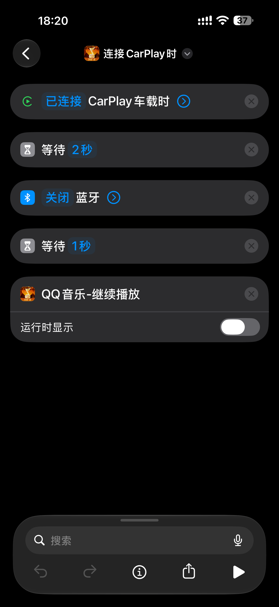
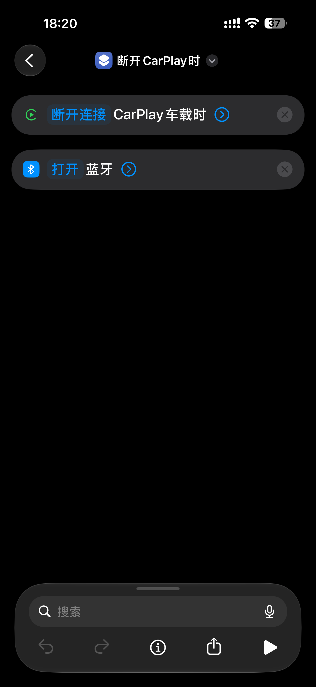
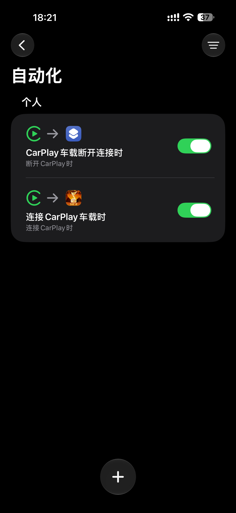
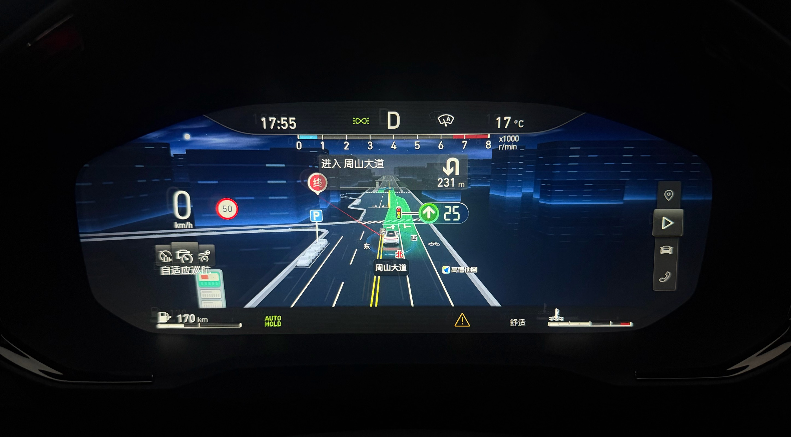

# DiPlay · 领克 01（2021 款）/ 亿咖通 ECARX 适配

[当前适配与验证](#当前适配与验证) · [简体中文](README.zh-CN.md) · [繁體中文](README.zh-TW.md) · [English summary](#english-summary) · [更新记录](CHANGELOG.md)

本仓库主要适配 **2021 款领克 01 亿咖通 ECARX 车机**，源于
[jiopia/DiPlay-ECARX](https://github.com/jiopia/DiPlay-ECARX) 的领克 05 移植版，
通用上游已合并 **DiPlay v0.2.22**。应用沿用本项目版本 **0.2 / versionCode 101**。

本页对应 **`dev` 开发分支**，已合入 `release` 的热点恢复和已确认功能。新增语音键短按接管仍待实车验证。

## 当前适配与验证

用户报告环境为 **Android 9 / API 28、Qualcomm MSM8996、`dcy11_a1`**。
应用最低安装要求为 API 24，不等于所有 Android 设备或 ECARX 固件均兼容。
实车反馈对应当时的测试包，未绑定当前 APK 提交；不能据此把新组合记为完整验收通过。

| 功能 | 当前状态 |
| --- | --- |
| 导航、HUD、车道及仪表 | 用户反馈导航/HUD 正常；封面、车道已确认，可视区域“看起来 OK”。重连和新组合继续回归 |
| 媒体控制 | 用户确认媒体 service 控制可用。统一使用 ECARX MediaCenter，保留 Android MediaSession；不再提供 UNI/DIM/Standard 切换 |
| 蓝牙媒体让位 | 用户反馈音乐不再走蓝牙；退出恢复和 iPhone 蓝牙关开后的自动重连仍需分别检查 |
| 车机热点 | 手动开启、应用启动和无线连接共用启动流程；Android 9 明确失败后按 Wi-Fi 实际状态重置，最多恢复重试一次，仍待实车确认 |
| 原厂 HiCar 开关 | 按实际权限显示并回读状态；它不等于接管原厂语音助手，也不改变麦克风路由 |
| Siri 采集 | 用户确认原有采集路径正常，当前重点是按键触发；不再提供通信采集方案 B |
| USB | **最新反馈仍有问题**。早期特定场景“测试 OK”不代表当前 USB 首连、重连和异常路径已全部通过 |

### DEV 与 Release 的区别

| 内容 | `dev` | `release` |
| --- | --- | --- |
| ECARX 语音键短按接管 | 已实现，待实车；后台保持、去重、断连释放，长按和通话期间放行 | 未合入，保留原方控逻辑 |
| 按键 SDK 注册/释放修正 | 已合入 | 未合入 |
| 连接前蓝牙恢复检查及排障报告 | 增强检查；USB、唤醒/重试、媒体及采集统计更完整 | 既有恢复流程与基础报告 |
| 旧“仅长按打开 Siri”设置 | 已移除 | 仍保留 |
| 本地录音自检、独立媒体探测面板 | 已清理；保留媒体连接依赖和常规报告 | 不包含 |
| Siri 通信采集方案 B | 已删除，只保留原采集路径 | 未引入 |

`release` 已纳入的核心媒体、导航/HUD、HiCar 和热点恢复也在 `dev` 中。
`main` 保留原 fork 基线，旧 main 备份为 `backup/main-before-upstream-reset`。
界面仅提供 **English、简体中文、繁體中文**及跟随系统，不支持的系统语言回退英文。

### 使用与验证

- 使用已有连接方式配置 iPhone；同一时间只运行一个投屏会话。
- 蓝牙媒体让位与“关闭整机蓝牙”是不同选项，分别测试；不要把旧领克 05 的关闭蓝牙绕行方案当作通用前置。
- 热点恢复只在明确失败后进行；先看 Wi-Fi 状态，再完成开启→关闭并重试热点一次。恢复可能断开其他无线设备，最终 Wi-Fi 关闭；不修改热点名称和密码。
- `dev` 语音键测试前关闭 HY 的语音键接管。仅可中断的有序短按广播由 DiPlay 接管，普通广播保留原车处理。
- 异常时先保存完整报告，再重试；分别记录真实声音、按键响应、原厂开关、手机路由和实际显示。

当前代码 `8dbdf066` 的本机完整检查：2,665 项测试通过、1 项端口条件跳过，三个 lint 和三个 Debug 构建通过。方控设置已复核 1920×1080、正常字体截图。
软件检查不替代实车验收，也不代表已发布新的签名 APK。

[DEV 待验收说明](docs/LYNK_01_PENDING_VALIDATION.md) · [车机回归清单](docs/CAR_TEST_20261028.md) · [测试说明](docs/TESTING.md) · [已确认功能的历史来源](docs/LYNK_01_VERIFIED_BRANCH.md)

> ### ⚠️ 发布的 APK 不含 MFi 身份
>
> 要让 iPhone 把车机当成合法 CarPlay 配件，APK 里必须有 Apple 签发的配件身份
> （`offline-mfi/identity.pk8` + `offline-mfi/certificate.p7b`）。这是 Apple 的授权资产，
> 本仓库**不提供、不打包、不再分发**。
>
> source-only 构建不含这些资产；缺少可用身份时，应用会在设置/身份前置检查处停止，
> **不是已经进入 USB 或无线握手才失败**。普通 Android 手机可先看 UI，独立测试系统热点入网或 OTG 枚举，
> 但这些不等于本应用 CarPlay 链路验证。只有合法认证前置满足后，才谈端到端连接。要在车上试，请自行构建：
> [如何把 MFi 身份打进 APK](#如何把-mfi-身份打进-apk)。
>
> 例外：如果这台车机上**已经装过**含身份的旧版（签名相同），覆盖安装不卸载时，旧版装进私有目录的
> 身份会被继续沿用，可以直接连。

---

## 适用环境

> **以下为原 fork 的领克 05 历史适配记录。** 环境、状态矩阵、车型特定操作与限制均按其原记录保留；
> 本仓库领克 01 与 USB 的最新状态以上方[当前适配与验证](#当前适配与验证)为准。

| 项 | 实测的那一台 |
|---|---|
| 车型 | 领克 05 2020（`Lynk & Co 05_IP732`） |
| 车机 | 亿咖通 ECARX 深度定制，高通 820A / arm64 |
| 系统 | Android 9（API 28），`dcy11-userdebug`，`test-keys` |
| 固件 | `AP_DCY11_IHU_CN_DCY11_IP732_20012107` |
| 屏幕 | 中控 12.7″ 1920×1080；仪表 display 1「HDMI 屏幕」1920×720 |
| 包名 | `com.shihab.diplay`（与上游同名，但签名不同，两者不能互相覆盖安装） |
| 签名 | AOSP 平台密钥（车机是 `test-keys`，据此才能拿到 signature 级权限去调 DIM） |

亿咖通车机不是这一套的话（不是 `ecarx.adapterapi` / 没有 `DimInteraction`），本版不会比上游更好用：
设置页里「亿咖通导航」整块会自动隐藏，剩下的就是上游的 CarPlay 本体。

## 与上游的区别

| | 上游 DiPlay 0.2.21 | 本移植版 0.1 |
|---|---|---|
| 目标车机 | 比亚迪 DiLink 1.0/3/4/5.x、B 系列等 | 亿咖通 ECARX（领克 05） |
| 仪表导航 | BYD HUD + DiLink 集群节点 | 亿咖通 DIM：`INaviInteraction` 推箭头 id / 距离 / ETA / 路名 |
| 仪表画面 | BYD 专用投屏 | 本项目在 display 1 自建 `Presentation`，装 CarPlay **原生集群流**（1920×720，8:3），再由 DIM 开关把这块屏接到仪表 |
| 仪表媒体卡片 | BYD 自带音乐源 | `IMediaInteraction` 推曲名/歌手/专辑/播放状态（关蓝牙后唯一来源） |
| BYD 代码 | 有 | **全部删除** |
| 版本号 | `0.2.21`（versionCode 40） | `0.1`（versionCode **100**，保证能覆盖升级） |
| MFi 身份 | 发布包内置实验性身份 | **默认不内置**，构建时用环境变量挂载 |
| 取证/探针代码 | 少量 | 全部清除，不留在发布包里 |

上游留下的说明与文档（`docs/RELEASE-NOTES-*.md`、`docs/COMPATIBILITY.md` 等）作为上游历史保留在仓库里，
里面提到 BYD 车机、BYD HUD、DiLink 集群的段落**不代表本移植版的行为**（那部分代码已整体删除）。
上游英文/繁中 README 存档于 `docs/UPSTREAM-DIPLAY-README*.md`。

## 状态矩阵：说到哪一步就是哪一步

### ✅ 已实车验证（2026-10-24，领克 05 实车，无线连接）

- **无线 CarPlay 连接、中控投屏**（Wi-Fi Direct / 车机热点两条路都走通了）。
- **仪表导航**：仪表盘整幅显示 CarPlay 这一路的**高德车道级地图**（CarPlay 集群流，1920×720，贴合
  异形区域），同时经亿咖通 **DIM** 把箭头、距离、路名、预计到达时间递给车机（HUD 与卡片用）。
  导航开始时仪表**不再闪一下**，也不需要手动去开「仪表投屏」。实拍见
  [导航投屏](#导航投屏仪表和中控只能二选一)。
- **HUD**：导航开始时 HUD 与仪表卡片同时出现箭头与距离，导航结束后一起撤掉。
- **仪表媒体卡片**：曲名、歌手、专辑、播放状态（前提：关掉 iPhone 蓝牙，见[蓝牙与媒体](#蓝牙与媒体为什么必须关掉它)）。
- **导航结束收尾**：仪表交回车机自己的页面，不留残影、不盖住原厂仪表。
- **导航语音压低音乐（duck）**、**车机蓝牙让位与自动恢复**。

### ⚠️ 原 fork 当时未实车验证的项目（历史记录）

- **USB 有线连接。** 本版没有在这台车上试过有线。线材、USB 权限、iAP2 握手都可能有本车前未暴露的
  问题，请不要把「无线好用」外推到「有线也好用」。
- **方向盘按键。** 学习界面可用，媒体键 / 语音键 / 接听挂断已接线，但没有逐键系统验证。
  语音键可能被车机自带语音助手**重复响应**一次，见[功能设置](#功能设置哪些必须开哪些按需开哪些不要开)。
- **麦克风上行。** 通话与 Siri 的采音未在这台车上测过音质与回声，不要假设和上游一样。
- **iOS 版本跨度。** 只在测试机的 iOS 上验证过；系统升级后 Apple 端的认证与投屏行为可能变。
- **多车型。** 只在一台 05 上验证。其它亿咖通车型的 display 编号、仪表尺寸、DIM 版本都可能不同。

### 🚧 原 fork 当时的计划（历史记录）

- **USB 有线连接**的完整验证与修复（优先级最高）。
- **百度地图的转向数据**（未测试；高德与苹果地图已可用）。
- **其它亿咖通车型**的 display 探测与仪表尺寸自适应。

## 安装与升级

1. 备份现有设置与诊断报告，确认安装包版本、包名和签名来源。
2. 同包名、同签名使用覆盖安装：`adb install -r <apk>`，或通过车机文件管理器安装。
3. 签名不同时不能直接覆盖；先保留设置和报告，再处理安装迁移，不把卸载或清数据作为常规重连方法。
4. 首次启动按界面完成认证、权限和连接配置。source-only 包缺少身份时会停在前置检查，不能用于验证完整 CarPlay 建连。

Debug 包名为 `com.shihab.diplay.hudtest`，Release 为 `com.shihab.diplay`；两者设置不自动互通。
测试时退出其他投屏会话，避免同时使用同一 USB、网络或音频资源。

## 功能设置：哪些必须开，哪些按需开，哪些不要开

> 以下设置表保留原 fork 的领克 05 历史说明，尤其旧菜单位置、DIM 媒体和关闭蓝牙的组合不适用于当前版本。
> 当前设置按连接、显示、音频、导航、车辆、诊断和高级分类；媒体使用 ECARX MediaCenter，导航/HUD 使用独立 DIM 通道。

| 设置项 | 默认 | 建议 | 说明 |
|---|---|---|---|
| **仪表导航** | 开 | **必须开** | 不开就不向仪表推任何 DIM 数据，仪表与 HUD 都不会有箭头、距离、路名。导航开始时"仪表投屏"也由它驱动。 |
| **仪表媒体卡片** | 开 | **按需开**（建议开） | 把 CarPlay 的曲名/歌手/专辑/播放状态推到仪表。关掉后，仪表只在你**用车机自带蓝牙放歌**时才有内容；一旦按下面的做法关掉 iPhone 蓝牙，卡片就会一直是空的。 |
| **仪表投屏** | 关 | **不要开** | 它把**整块中控画面镜像到仪表**，会盖住仪表上的箭头和媒体卡片——这就是之前"开了投屏反而看不到箭头"的原因。导航开始时本项目会自己接管这块屏，不需要手动开；手动打开前它会弹确认框。 |

另外两组按需：

| 位置 | 设置项 | 什么时候动它 |
|---|---|---|
| 设置 → 方向盘按键 → 「亿咖通方向盘按键」 | 媒体键控制 CarPlay / 接听挂断 / 语音(Siri) | 想让方向盘按键管 CarPlay 时打开，然后逐个键点按学习。学习过的键继续生效。 |
| 设置 → 连接设置 → 「打开连接设置」 | 连接方式（Wi-Fi Direct / 车机热点 / 已有 Wi-Fi） | 默认即可。车机热点那一路需要在弹出提示时允许。 |

两个容易踩的坑：

- **语音键重复响应。** `dev` 使用连接期间的短按广播接管；`release` 尚未合入该修复。先保存按键日志确认来源，不按旧说明直接停用系统助手。HiCar 开关只作用于对应原厂应用。
- **不要同时用车机自带导航。** 车机自己的导航一开始就会去抢仪表那块屏，两套导航同时跑，画面会互相盖。

## 蓝牙与媒体：为什么必须关掉它

> 本节保留原 fork 在领克 05 上的历史绕行方案，不是当前领克 01 的已验证修复或通用建议。
> 用户实际操作是 iPhone「设置 → 蓝牙」关开，后续还需手点车机；A2DP 与自动重连根因仍待定位。

**症状**：CarPlay 连上了、画面也有了，但**没有声音**；或者有声音却和 iPhone 不同步；或者仪表媒体卡片
显示的是车机蓝牙里的歌，不是 CarPlay 正在放的那首。

**原因**：iPhone 同时被两条通道牵着——CarPlay（AirPlay 音频）和**车机经典蓝牙**（A2DP/HFP）。
只要经典蓝牙还连着，iPhone 就倾向把音频交给蓝牙通道，车机的音源也还停在蓝牙音乐上。所以：

> **必须切断 iPhone 与车机之间的经典蓝牙，音频才会走 CarPlay。**

**解法**：用 iPhone 自带的「快捷指令 → 自动化」，连上/断开 CarPlay 时自动关/开蓝牙。截图：

<p align="center">
  
  
  
</p>

### 那 2 秒是干什么的 —— 顺序不能改

```
「连接 CarPlay 车载时」
  1. 等待 2 秒      ← ★ 不能少，也不能改成 1 秒
  2. 关闭 蓝牙
  3. 等待 1 秒
  4. 播放音乐（例：QQ音乐-继续播放）
```

- **为什么等 2 秒**：CarPlay 的会话建立（iAP2 认证 → AirPlay 启动）大约需要 1 秒多。**1 秒就关蓝牙，
  正好落在握手中间，会话被打断 ⇒ 有画面没声音**；等 2 秒再关，握手已经完成，音频顺利切到 CarPlay。
  这是实测结论：`1 s ⇒ 无声，2 s ⇒ 正常`。
- **为什么还要等 1 秒再播放**：关闭蓝牙以后车机的音频路由要重新选一次，立刻播放会被吞掉开头。
- **断开时反过来**：`断开连接 CarPlay 车载时 → 打开蓝牙`。不打开的话下次上车车机蓝牙是关的，
  电话和车机自带音乐都用不了。

自动化本身还有两个开关要设对：

- **「运行时显示」关掉**（截图里就是关的）。开着的话每次连接都会在手机上弹一条通知。
- 新建自动化时选**「立即运行」**（不要「运行前询问」），否则每次上车还得手动点一下"运行"。
  iOS 版本不同措辞不同，位置在自动化编辑页底部。

### 副作用（这是取舍，不是 bug）

蓝牙一关，车机就收不到 iPhone 的 AVRCP 元数据，**仪表媒体卡片只能靠本 App 自己推**
（就是「仪表媒体卡片」那个开关）。所以这两个设置是一套的：关蓝牙 + 开仪表媒体卡片。

## 导航投屏：仪表和中控只能二选一

CarPlay 给仪表的画面和给中控的画面是**同一个地图 App 渲染的两路视图**，导航 App 只能让其中一路进
「车道级」。

<p align="center">
  
</p>

*领克 05 实车：仪表盘整幅显示高德车道级导航（「进入 周山大道」右转 231 m、限速 50）。这一路占满了
仪表，中控那一路就只能是线路总览。*

### 高德地图

- **「3D 车道级」与「线路总览」在仪表和中控上只能二选一。** 仪表用车道级，中控就只能是线路总览；
  中控用车道级，仪表就退成线路总览。
- 切换方法：**在中控的导航界面上点「线路总览 / 3D 车道级」**那个按钮，两路画面会一起换。
- 仪表那一路是 CarPlay 的**集群地图流**（本项目在 display 1 自建窗口装它，1920×720），
  画的就是导航 App 自己渲染的车道级画面，上面截图里没有额外叠任何东西。
- 亿咖通 **DIM** 是**另一条线**：箭头 id、距离、路名、ETA 单独推给车机，HUD 与仪表卡片用的是它。
  两条线互不影响 —— 「仪表有地图」不等于「HUD 有箭头」，两边都要正常才算好。

### 苹果地图

- 点屏幕**右上角的方向箭头**切换（跟随车头 / 正北朝上）。

### 百度地图

- **未测试。** 它的转向数据能不能进仪表没有验证过，不保证。

## 第一次连接：iPhone 上要点「允许」

第一次连接时 iPhone 会弹几个框，**都必须点允许**，点错一次后面就会一直连不上：

1. 插线或发起无线连接后，iPhone 弹「**允许此配件访问**」/「**信任此电脑**」→ 点**允许**，需要时输入锁屏密码。
2. 蓝牙配对框 → 点**配对**，再点**允许**。
3. CarPlay 首次连接提示 → 允许。

如果之前误点过「不允许」：**设置 → 通用 → 传输或还原 iPhone → 还原 → 还原位置与隐私**，
然后重新连接，弹框会再次出现。

## 如何把 MFi 身份打进 APK

发布版故意不含身份；要在车上试，自己构建一版带上它。

### 1. 准备两个文件

```
<任意目录>/auth-assets/offline-mfi/identity.pk8       ← Apple 签发的配件私钥
<任意目录>/auth-assets/offline-mfi/certificate.p7b    ← 对应的配件证书链
```

**本项目不提供这两个文件**，也不教怎么获取。你要么持有 Apple MFi 授权拿到的身份，要么从你合法持有的
配件里自己取。两个文件缺一个、或长度为 0，构建会在 `verifyStandaloneAuthentication` 这一步直接失败。

### 2. 用环境变量挂上去再构建

```bash
DIPLAY_AUTH_ASSETS_DIR=/path/to/auth-assets ./gradlew :mobile:assembleRelease
```

- 不设 `DIPLAY_AUTH_ASSETS_DIR` 就是**不含身份**的发布包（默认）。
- `mobile/build.gradle.kts` 用 `assets.srcDir` 把那个目录挂进 APK；目录里只允许这两个文件，
  多塞一个 `.p12` / `.keystore` 会被 `rejectBundledCredentials` 挡下来。

### 3. 确认真的打进去了

```bash
unzip -l mobile/build/outputs/apk/release/mobile-release.apk | grep offline-mfi
# 期望两行：assets/offline-mfi/identity.pk8、assets/offline-mfi/certificate.p7b
```

`apksigner verify --print-certs` 看到的是你的平台密钥（不是身份证书）——两者不是一回事。

### 4. 风险，先说清楚

- **把含身份的 APK 发给别人 = 公开分发 Apple 的授权资产**，私钥可被提取，滥用后果自负。
  所以本仓库的发布包不含它，只写方法。
- 身份装进 APK 以后就不保密了：谁拿到包，谁就拿到私钥。
- 首次启动时 App 会把资产拷到私有目录（`noBackupFilesDir/offline-mfi`），之后从那里读。
  因此**覆盖安装（不卸载）会沿用旧身份**，`adb uninstall` 或换车机后必须重新打包。

## 诊断报告

出问题先抓报告，不要凭现象猜。

1. 复现问题，记下发生时间。
2. **设置 → 诊断 → 保存诊断报告**，Android 10 以上一般在 `Downloads/DiPlay`，
   Android 7–9 会先要存储权限，也是存到那里。
3. 报告里对仪表问题最有用的几行：
   - `Cluster panel: showing on "HDMI 屏幕" 1920x720 projection=true` — 仪表窗口上屏了
   - `DIM mirror left to the platform at guidance start` — 导航开始没有强抢仪表（正常应出现一次）
   - `DIM guidance started arrowId=NNN` / `DIM arrow=… arrowId=NNN` — 箭头 id 在发
     （`arrowId=0` 表示这一帧没拿到转向类型）
   - `DIM guidance ended` → `presentation switch -> false` → `Cluster panel: dismissed` — 结束收尾的
     三步，顺序反了会留残影
   - `media counters media=true sourceType=… sourceList=… pushed=…` — 媒体卡片通道是否活着

## 从源码构建

按当前 [CI 配置](.github/workflows/android.yml)准备 **JDK 25**、Android SDK `platforms;android-37.0`、
Build Tools `36.0.0` 和 platform-tools；仓库 wrapper 固定 **Gradle 9.5.0**。
CI 另安装 NDK `28.2.13676358`；本轮构建复用仓库预编译原生库，不能据此把安装该 NDK 写成所有普通构建的硬性前置。
`compileSdk` / `targetSdk` 为 37，应用 `minSdk` 为 24。运行 Gradle 的 JDK 与 Java 11 源码目标不同。
`BUILD.md` 保留历史环境说明，版本要求以当前 Gradle/CI 配置为准。

```bash
# 不含 MFi 身份的 Debug 包：适合代码/UI检查，不承诺可直接连 iPhone
./gradlew :mobile:assembleDebug
# 产物：mobile/build/outputs/apk/debug/mobile-debug.apk
```

完整检查命令见 [AGENTS.md](AGENTS.md)，覆盖 shared/common/home 测试、三个 lint 和三个 Debug 构建。
下面的 Release 构建还需要你自己的合法签名配置；没有签名材料不能照搬成可发布包。

```bash
# 发布包（不含 MFi 身份）
./gradlew :mobile:assembleRelease

# 含 MFi 身份的实车测试包：先把两个身份文件放到某个目录的 offline-mfi/ 下
DIPLAY_AUTH_ASSETS_DIR=/path/to/auth-assets ./gradlew :mobile:assembleRelease
```

产物：`mobile/build/outputs/apk/release/mobile-release.apk`。签名与平台权限的关系、手工校验命令
见 [BUILD.md](BUILD.md)。

## 已知限制

> 下列是原 fork 的历史限制，尤其“停用语音助手”“关闭蓝牙”等操作不应当作本仓库的通用修复。
> 当前领克 01 的未解决问题及验证边界见[当前适配与验证](#当前适配与验证)。

- 只在一台领克 05 上验证；其它亿咖通车型未适配。
- 仪表是箭头 + 距离 + 路名，不是整幅地图。
- 关掉 iPhone 蓝牙后，车机蓝牙电话、车机自带音乐都不可用（这是换取声音的代价）。
- 语音键可能双响应，需停用车机自带语音助手。
- 「仪表投屏」开关留着是历史遗留，正确用法是不碰它。

## 许可与致谢

- 上游 [DiPlay](https://github.com/shihabal3amri/DiPlay)（BSD/Apache 与 GPL 混合，见 `LICENSE` 与
  `docs/licenses`），其上游为 [xcertplay](https://github.com/shilapi/xcertplay)（GPL-3.0）。
- 界面与站点部分改编自 [DiAuto](https://github.com/shihabal3amri/DiAuto)（AGPL-3.0）。
- 分发修改版时请保留这些声明。CarPlay 与相关图标属于 Apple Inc.；本项目与 Apple、领克、亿咖通均无
  隶属或背书关系。
- 本仓库发布版**不含**任何 Apple 授权资产；MFi 身份的获取与使用由使用者自行负责。

---

## English summary

This page describes the **`dev` branch** for the **2021 Lynk & Co 01 / ECARX**.
Both branches include upstream **v0.2.22**, with this fork's **0.2 / versionCode 101** sequence.
The Lynk & Co 05 notes above are historical, not current installation requirements or acceptance evidence.

- **User feedback:** media-service controls and navigation/HUD work; artwork and lanes were confirmed, and the visible-area editor looked correct. The original Siri capture path was reported working.
- **Still pending:** USB problems remain in the latest feedback. Hotspot recovery, reconnection and the new Siri key route require vehicle regression on the resulting build.
- **Branch differences:** `dev` adds connected-session Siri short-press takeover, callback release fixes and richer connection diagnostics. `release` does not yet contain that key takeover. Core ECARX media/HUD, HiCar controls and unified hotspot recovery are included in both.
- **Removed from dev:** the communication-capture experiment, local microphone self-test, standalone MediaCenter inspection panel and the old long-press-only setting. Standard capture and normal failure reports remain.
- **Hotspot recovery:** on Android 9, a confirmed failure checks Wi-Fi state, stops the failed hotspot, cycles Wi-Fi on then off and retries the hotspot once. Saved credentials stay unchanged; connected devices may be disconnected.
- **Build:** JDK 25, Gradle wrapper 9.5.0, SDK platform 37.0 and Build Tools 36.0.0. Minimum Android API 24 is an installation floor, not a compatibility guarantee. See [build instructions](#从源码构建) and [required checks](AGENTS.md).
- **Languages:** English, Simplified Chinese and Traditional Chinese, including the system-language option.

Source-only builds have no bundled MFi identity. Without the existing authentication prerequisites,
the app stops before CarPlay setup; installing an APK, joining a system hotspot or enumerating USB does not prove a CarPlay connection.
Preserve settings and reports before changing signatures; do not clear app data as a routine connection fix.
Software checks and historical vehicle feedback do not certify the current APK on every firmware.
