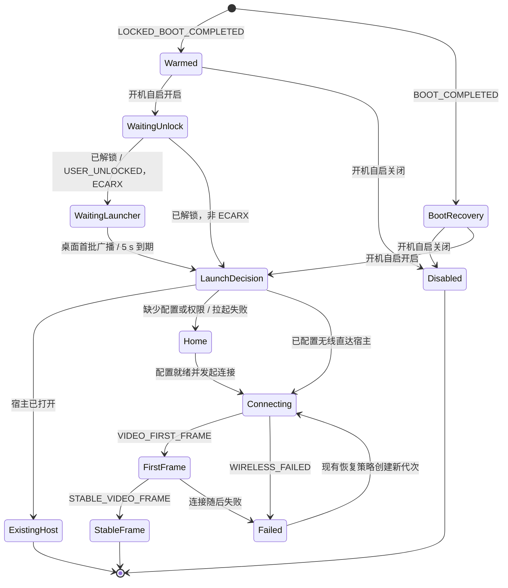

# 领克 01 / ECARX 753 平台笔记

适配过程中确认的平台事实、厂商接口、固件行为和验证状态，集中在这一份，长期维护。
各功能的使用方法见[功能与使用说明](FEATURES.zh-CN.md)；决策过程见各带日期的文档，这里只保留结论和出处。

**维护规则**

1. 只记录有出处的事实：实车日志、车机 dump 反编译、固件源码、AOSP 源码或可复跑的台架记录。推测、单测通过、编译通过都不算证据。
2. 每条事实写明来源类型和日期；状态变化时改状态、不删历史，必要时加一行“2026-xx-xx 更新”。
3. 新发现的接口、属性 ID、广播、包名先登记到第 3 节，再在代码里使用。
4. 第 7 节的验证矩阵是对外承诺的边界：没有“实车”一栏的功能，文档和设置文案不得写成已验证。
5. 本仓库不收车机 dump、反编译源码、完整日志和签名资产；第 8 节只记录本地工作区路径和校验和。

---

## 1. 目标环境

| 项 | 值 | 来源 |
| --- | --- | --- |
| 车型 | 2021 款领克 01（内部代号 DCY11） | 实车记录 |
| 车机 | 亿咖通（ECARX）753，高通 820A | 实车记录 |
| 系统 | Android 9（API 28） | 实车 dumpsys |
| 固件标记 | `WifiServiceImpl.checkAndStartWifi` 跳过 `"dcy11"`，其他车机行为以此为界 | 固件反编译 |
| AdaptAPI 运行库 | 1.1.18.9（framework dump 2026-10-31）；旧应用附带的 1.1.17 声明不能代替 | framework dump |
| GKUI | 3.3.9；HY 跨车型封装和 EAS 4.6.20 不是本车接口 | framework dump |
| 原厂导航 | `ecarx.naviservice`（导航 2.0.20133112.4135） | APK 反编译 |
| 原厂 HiCar | `com.ecarx.hmi` | 代码 `EcarxHicarControl` |
| 第三方桌面 / 媒体代理 | HYWebview `com.hyphp.hywebview` 3.6.1（versionCode 28）；嘟嘟 `com.dudu.autoui` | 实车安装列表 |
| 仪表布局 | V3 1920×720，左侧 ADAS 面板限制居中矩形宽度；安全区 top 273 / bottom 100 / left 494 / right 494 | 实车标定 |
| 中控分辨率 | 1920×1080 横屏，含车机底部 Dock | 实车截图 |
| 应用安装位置 | `/data/app/com.shihab.diplay-*/base.apk`，平台签名，flags 无 `SYSTEM`／`PERSISTENT`；历史 UID 10125，2026-11-02 截图 UID 10105 | 实车 dumpsys、截图 |
| 发布 ABI | 仅 arm64-v8a、armeabi-v7a | 构建配置 |

其他 Android 版本（10、11、13、15）只用于台架调试，不作为兼容承诺。小米 8（Android 15 / LineageOS）和 BOOX NoteX2（Android 11）出现在证据里时，都是台架。

## 2. 识别车机与能力探测

应用启动时两步判断（`EcarxCapabilities.detect`，优先级从高到低）：

1. DIM 接口类 `com.ecarx.xui.adaptapi.diminteraction.DimInteraction` 存在。
2. `Build` 的 BRAND / MANUFACTURER / PRODUCT / DEVICE / HARDWARE / FINGERPRINT 任一含 `ecarx`。
3. 安装了 `com.ecarx.xui.service`、`com.ecarx.eas.service`、`com.ecarx.assistant`、`com.ecarx.xiaoka`、`ecarx.naviservice` 任一。

识别成功只决定显示哪些设置卡片；每个接口在调用前再做一次类探测，缺失即关闭对应功能并在诊断报告记一行。`GeelyHeadUnit.detected` 是另一套判断（`geely_fx11` / `CS11_A4` 的 Build 字段），只管方向盘原始键和麦克风源。

厂商类全部在车机系统镜像里，APK 不打包、不编译依赖任何厂商 JAR；单测用 `src/test` 内自写的最小接口夹具。可选的 `EcarxAdaptapiAbiTest` 用 `-PecarxAdaptapiJar=<path>` 指定仓库外 JAR 核对方法签名，不给路径就跳过。

## 3. 使用的厂商接口与系统面

| 子系统 | 接口 / 载体 | 访问方式 | 代码 | 出处 |
| --- | --- | --- | --- | --- |
| 仪表导航（DIM） | `INaviInteraction`：`updateNavigationInfo`（15 个 getter 的 `INavigationInfo`）、`updateTurnByTurnArrow(int/String/Bitmap)`、`updateDistanceToDestination`、`updateDistanceToNextGuidancePoint`、`updateETA`、`updateNextGuidancePointName`、`updateLaneInfo(ILaneInfo[])`、`notifyTurnByTurnStarted/Stopped` | 反射 + 动态代理，每 1 s 一次与原厂投屏工具相同的调用序列 | `EcarxHudBridge`、`EcarxDimApi` | 原厂投屏工具与 `ecarx.naviservice` 反编译 |
| 仪表箭头编号 | 101–143 有图标；与原厂 amap 映射重合处逐点一致（102 左、103 右、108 掉头、109 直行、111/112 环岛、115 终点、101 起点） | `updateTurnByTurnArrow(int)`，缺失时退 SVG 字符串或本地位图 | `EcarxArrowCode` | `ecarx.naviservice` smali + 另一移植项目实车扫描 |
| 仪表回调 | `DimInteraction$IInteractionCallback`、`INaviInteraction$INavigationInteractionCallback`；方控 `onDoInteractionAction(2, null)` 是原厂 `stopNavi()`，即退出路线请求 | 注册后接收仪表侧请求 | `EcarxDimApi` | 原厂 `NaviDashboardManager` |
| 仪表媒体卡片 | `IMediaInteraction`：`IPlaybackInfo`（20 getter）、`IMedia`（14 getter，`updatePlaylist`） | 反射 | `EcarxHudBridge` | 原厂工具反编译 |
| 仪表电话 | `IPhoneCallInteraction$ICallInfo` | 反射，仅探测 | `EcarxCapabilities` | 同上 |
| DIM 总线（MQTT） | `se.cevt.dimsupportservice` 在回环 broker 上的 `ihu/…` 主题：`ihu/info/phoneprojection`、`ihu/events/navigation/ongoing`、`…/distance`、`…/ETA`、`…/fullscreenmap`、`ihu/info/navigation/turn-by-turn/{next-turn,icon,lanesupport}`、`ihu/heartbeat/navigation` | 自实现 MQTT 3.1.1 帧；只发布投屏状态两个主题，其余只订阅观测（QoS 0，独立 clean session） | `EcarxMqtt`、`EcarxProjectionChannel`、`EcarxNavigationMqttObserver` | 实车抓包、原厂服务反编译 |
| 日夜 | `Device.create(context)` → `IDayNightMode.registerDayNightModeCallBack`；车身光线属性 `0x21400305`（`TwliBriSts`，1 日 0 夜）；高德广播 `AUTONAVI_STANDARD_BROADCAST_SEND` `KEY_TYPE=10019`，`EXTRA_STATE` 30 日 32 夜 | 反射推送 + `Car` 属性订阅 + 广播 | `EcarxDayNight` | 实车：属性变化后数毫秒内 AdaptAPI 推送相同结论 |
| 车身信号（只读诊断） | `GeelyVehicleProperty` 的 usageMode（11/13 为上电态）与五个车门 | `Car` 属性订阅 | `EcarxVehicleSignalProbe` | HY 读主驾门、嘟嘟读全部车门 |
| 方向盘键（拦截 API） | `com.ecarx.xui.adaptapi.input.Input.requestKeysInterception(int[], IKeyCallback)`；键码在 200000 偏移空间，普通 `dispatchKeyEvent` 收不到 | 反射 | `EcarxSwKeyIntercept`、`EcarxSwKey` | 参考应用 `SWKeyActivity` |
| 方向盘语音 / 电话键（广播） | `ecarx.intent.action.ECARX_KEY_RVOICEASSIST_EVENT`、`ECARX_KEY_RCALL_EVENT`，extra `ecarx.extra.ECARX_KEY_ACTION_TYPE`；匹配后 `abortBroadcast()` 夺取 | 有序广播接收器 | `EcarxKeyBroadcasts` | 车机按键服务 `media$EcarXVoiceKey` 接收器 |
| 方向盘原始键（Geely） | `com.geely.inputservice.InputService` 导出，`registerListener` 无权限检查 | 绑定服务订阅原始码 | `GeelyWheelKeys` | 车机 `KeyInputController` 同法 |
| 输入服务就绪 | 广播 `com.ecarx.input.action.ACTION_INPUT_KEY_SERVICE_READY` | 接收 | — | 实车日志 |
| HY 后台语音键 | HY 把键写入 logcat；应用凭 `READ_LOGS` 读取（HY 存 155 时观察到 155 与 303 同时发出） | 读 logcat | `HySiriKeys` | 实车日志 2026-11-01 |
| 车机媒体中心 | `ecarx.xsf.mediacenter` 的 `IMediaCenterSvc`（动作 `ecarx.xsf.MEDIA_CENTER_SERVICE`），需 `ecarx.oem.permission.OPENAPI_MEDIACENTER_PERMISSION`；`com.ecarx.sdk.mediacenter.MediaCenterAPI` 封装构造器在本机为包私有 | Binder 直连 | `EcarxMediaCenterTransport` | 实车 dump |
| HY 仪表封面补发 | 定向广播到 `com.hyphp.hywebview.HyMediaReceiver`（`dashboard` 协议，字段含封面 URI）；HY 每 800 ms 轮询首个 active MediaSession | 广播 | `HyMediaDisplay` | HY 3.6.1 反编译 |
| 麦克风仲裁 | GKUI `PolicyAPI.get/init` → `getAudioPolicy().requestMic(CALL=2)`；本车服务端 `XSFOpenAPISerivce` 对申请/释放一律抛 `Method not supported in Android O and above` | 反射；预期拒绝后直接录音 | `EcarxMicPolicy` | `XSFOpenAPISerivce.apk` 反编译 |
| 热点 | Android 9 系统热点 API + 签名权限；`com.ecarx.xui.adaptapi.wifiap.WifiAp`/`IWifiAPHost` 只探测存在性 | 系统 API | `CarHotspotTethering`、`CarHotspotProbe` | 实车 v104 权限回读 |
| 原厂导航停包 | `PackageManager.setApplicationEnabledSetting("ecarx.naviservice", DISABLED_USER)`；恢复后 2 s `startForegroundService(ecarx.naviservice.service.NaviService)` | 系统 API，需 `CHANGE_COMPONENT_ENABLED_STATE` | `EcarxFactoryNavigationRestore` | 台架重放、DCYTools 1.13 反编译 |
| 原厂 HiCar 关闭 | 同上接口作用于 `com.ecarx.hmi` | 系统 API | `EcarxHicarControl` | 实车 |
| 桌面启动批次 | 桌面首次 resume 后发 `com.ecarx.intent.action.EAS_LAUNCH_BAT_0ST`，之后批次陆续启动（含 `ecarx.xsf.inputservice`） | 接收广播后再打开 CarPlay | `EcarxLauncherStartup` | 实车 2026-11-06 / 11-07 |
| 启动采样开机标识 | `Settings.Global.BOOT_COUNT`（只读）+ 进程 PID + controller owner + generation | 区分跨开机、进程重启及连接代次；读不到开机标识时仅保留原始事件 | `CarPlayStartupTimeline` | Robolectric；待实车 |
| 音量 | `dumpsys car_service`：组 0 媒体、组 1 导航，每级 150 mB，-4800（0 级）到 +1050（39 级） | 读 `Settings.Global` | `CarNavigationVolume` | 实车 2026-11-07 |

## 4. 固件与第三方行为（已确认的坑）

**启动与网络**

- 冷启动 `BOOT_COMPLETED` 在 52.1 s，桌面约 26.7 s 可见（issue #48）。台架 Android 9：`LOCKED_BOOT_COMPLETED` 比 `BOOT_COMPLETED` 早 2.3 s。
- `android:persistent` 在 `/data/app` 应用上被 PackageManager 清除；`sharedUserId=android.uid.system` 只改 UID，不是系统应用，且会导致覆盖安装失败。
- 固件自己不在开机恢复 Wi-Fi；车机设置应用进程每次启动时按 `wifi_on` 调 `setWifiEnabled`，该进程在 `LOCKED_BOOT_COMPLETED` 后 6–10 s 启动。因此解锁时开的热点会被关掉、4–5 s 后再起（实车 2026-10-31、11-06、11-07）。Android 9 客户端与 AP 互斥，DiPlay 用 `CarWifiClientGuard` 持久写 `wifi_on=0`，副作用是车机不再自动连其他 Wi-Fi（设置里可关）。
- 桌面没 resume 就不会发启动批次；解锁即开 CarPlay 盖住桌面会让 `ecarx.xsf.inputservice` 不启动，语音键失效（11-07 桌面 1.3 s 创建、从未 resume；11-06 1.7 s resume 并发批次 0）。现实现最多等 5 s。
- 开机 90 s 内蓝牙可能为 `STATE_OFF`，只观察不 `enable()`，最多等 8 s。
- 熄火开门后车机关热点和蓝牙；点亮屏幕后依次恢复蓝牙、热点。重连要等两者都回来（小米 8 台架复现，v143 实现）。

**启动状态与责任边界**

下图描述当前调度的状态与事件，不新增统一调度器。开机入口负责是否拉起宿主；进入连接后，`WirelessRun` 持有一代无线资源与 handoff 状态。`CarPlayStartupTimeline` 只记录证据、输出指标，不驱动连接或重试。

- `BootRecovery` 在自启开关判断之前检查原厂导航恢复；复用 `EcarxHudBridge.recoverFactoryNavigationIfIdle()`，仅恢复本应用暂停的包，且不覆盖解锁直达路径已经开始的导航或 HUD 输出。未解锁的预热路径不访问这份凭据保护存储。恢复链的服务拉起与进程确认在专用后台 Looper 延后约 7 s；自启关闭时广播返回后进程没有其他组件，因此 `BOOT_COMPLETED` 用 `goAsync()` 持有广播直到恢复链结束，上限 9 s（`BroadcastHold`），避免进程被回收后服务未启动、owned 标记残留。
- `Connecting` 内热点准备和蓝牙就绪可并行，热点保护仍由 `CarWifiClientGuard` 负责；蓝牙 OFF 的 8 s 等待、局部重试及所有失败预算不变。上层不复制这些内部状态。
- 首帧可来自蓝牙 fallback；稳定帧为隧道 StartSession 后的视频回调。两个检查点可能来自同一次回调，代码也可能先记录稳定帧，图中的先后关系不作为回调顺序约束；没有稳定帧不直接判为连接失败。
- 迟到的 `BOOT_COMPLETED` 仍执行恢复检查，但已有宿主会去重；它不是解锁直达路径的计时起点。ACC 唤醒不等同于整机重启。
- 每个车测包按[启动采样验收表](CARPLAY_STARTUP_SAMPLING.zh-CN.md#冷启动验收与每包记录)记录三条指标、成功/失败轮数和人工可见画面证据。

**导航与仪表**

- 原厂导航插件通过共享 MQTT 主题向仪表写错误的 1 m 距离（启用期 24 次调用 3 次 1 m；75 s 台架 90 次 11 次），与 CarPlay 数据冲突。采用停包方案，MQTT 纠偏弃用。
- 停包会删掉原厂桌面（launcher3 v999）导航卡片绑定，恢复后要手工重加；HY 同样回不来。
- 停包状态落盘后整机重启：v109 模拟器中开机广播拉起进程但未恢复原厂包，开机后 7.9–28.5 s 仍停用，手动打开 DiPlay 后 31.8 s 才恢复。现已在 `BOOT_COMPLETED` 接入空闲恢复检查，覆盖自启关闭和解锁后已导航的情形；单测通过，待实车验证，桌面卡片绑定仍不能自动恢复。
- 仪表 `stopUI`/`showUI` 作用于副屏 `ALT_UUID`，不拆视频流；`presentationOption` 只在内存，重启后曾自动重开。
- 仪表流 111 每次连接都会建立（v146 实车 22:24:12 `SETUP streams=[{type=111}]`），与有无路线无关；DiPlay 无路线时发 `stopUI`。「未导航时也显示仪表地图」开启后，无路线也发 `showUI` 并保留投屏，路线结束只停导航输出。苹果的仪表场景随车机显示/隐藏连接，不看导航状态（WWDC22 10016）；奥迪 MIB2 项目实测苹果地图无路线时 111 只在画面变化时出帧（约 0–9 fps，最长 5.5 s 无帧），所以不能按帧间隔判定断流。本车待验：iPhone 无路线时是否出图、导航 `idle` 后平台是否保留投屏、稀疏帧下 OMX 输出是否滞后一帧。
- 手机侧结束路线：`0x5203 StopRouteGuidanceUpdates` 只是停元数据订阅，不是结束导航；没找到可验证的 iPhone 结束路线命令，`onDoInteractionAction(2)` 只能记 `unsupported` 并提示用户。
- 三家地图差异（台架 2026-11-01）：苹果 0.5–0.7 Hz 预取 5–8 个路口车道；高德约 1.9 Hz 但 `0x5204` 车道为 0 条（车道画进 `CPManeuver.contentImage`）；百度约 1.7 Hz 单路口。三家距离都非单调。
- 苹果复合掉头（一条车道同时含 -180 与 -90）曾清空整排车道，已修（`24c01477`）。

**音频与麦克风**

- ECARX 会静默吞掉 `USAGE_ASSISTANT`，Siri 走媒体输出。
- 导航 usage 在音频控制器子通道播放，车机把音乐压到几乎听不见且 Android 无法设定幅度；混进音乐流则按导航/媒体音量差缩放。iPhone 的 `duckAudio` 比播报音频流早 80 / 210 ms 到达（实车 2026-11-07），据此在流打开时选通路。
- 冷启动后车机功放在没有任何焦点时不选源；导航播报需要持有可压低的临时焦点。
- Geely/Lynk 车机只为 `VOICE_COMMUNICATION` 源打开麦克风，`VOICE_RECOGNITION` 录到静音。
- GKUI 麦克风仲裁服务端未实现，申请必然失败；原厂助手与 CarPlay 的硬件麦克风争用没有解。
- 车机 A2DP 服务在 CarPlay 发 PLAY 后曾回 AVRCP PAUSE 使音乐自动暂停；蓝牙媒体让位（profile 11 `A2DP_SINK`）用于避免这一点，但在本车未实车验证。

**视频解码**

- `OMX.qcom.video.decoder.hevc` 在频繁重建（仪表地图流 0.5 s 内创建、释放 5 次）后会回 `InsufficientResources (0x80001000)`，日志为 `Failed to set format on output port`。这时 API 28 的 `MediaCodec.createDecoderByType` 不报错，直接改用列表里的下一个，即软解 `OMX.google.hevc.decoder`：v141 实车 2026-11-09 22:09:38（软解随后配置失败），v146 实车 2026-11-10 22:24:52（仪表流 1920×720 用软解出了画面）。现改为按名字创建硬解，被拒后最多重试 3 次（共 0.7 s）；仍失败时才显式走软解并写入诊断，之后按 2 s 起、最长 30 s 的间隔探测硬解，可用时在下一关键帧换回。
- 音频 AAC/Opus 解码在本车是 `OMX.google.aac.decoder` / `OMX.google.opus.decoder` 软解；API 28 没有给应用的压缩音频卸载接口，属预期。

**媒体与按键**

- HY 模式下系统媒体会话第一项是无播放状态的 `ecarx.xsf.mediacenter`，DiPlay 排第二，HY 取第一项，首次方控播放不生效。
- DCY11 注册回调不消费原厂助手事件；可能绕过标准 assistant 槽位。
- 开通「通过车辆蓝牙播放」时车机 AVRCP 已控制 iPhone，媒体键若再转发会双触发，只注册语音键。

**连接**

- iPhone 侧本车记录若首次由 USB 建立，iOS 把车当有线设备：握手第 6 步回 `0x4E0D WirelessCarPlayUpdate available=false`，不再发 `0x4E0E`/`0x4300`，不入热点。只能在 iPhone 删除本车重新配对并先走无线。蓝牙 RFCOMM、iAP2 identification、MFi（0xAA02/03/05）、Wi-Fi 配置下发（0x5702→0x5703）此时都正常。
- RFCOMM connect 实测 147–1714 ms；CSM 就绪长尾 34.6 s；bt/select 到 connect 串行空等约 235 ms（v124 会话 C）。
- 有线 USBMUX 每秒约 14 次读请求，旧实现每次新建 `UsbRequest` 导致一小时约 10 万行日志（10-31 实车）。

**主线程掉帧（Kotlin 层）**

- `logs/cap-v104-20261031-session1/full.log:4939` 的 `Start proc 7470:com.shihab.diplay` 确认 PID 7470 是 DiPlay。主线程 PID/TID 均为 7470；18:33:11.220 掉 59 帧，18:33:17.388 掉 32 帧。多个 checkpoint 中相同时间戳的日志是同一事件，不能算作独立复现。现有 logcat 没有采样调用栈，不能据此把掉帧唯一归因到某个函数。
- 设置搜索按分类分批构建，保留主线程上的 View 与输入连接；HiCar 状态、包启停及解码器查询使用后台线程。报告生成拒绝主线程调用，预览裁剪在后台完成，导出文件仍保留全文。
- Activity 启动时的导航恢复和 DIM 初始化移至后台。固件 `ServiceConnector` 使用默认 `new Handler()`，要求当前线程有 Looper，并未限定为主 Looper；DIM 补建句柄使用专用后台 Looper。原厂导航延时拉起和进程确认也使用后台 Looper，保留 owned 标记、2 s 延时、确认重试和广播保活。
- 单测只能验证线程路径与已有行为；[1920×1080 设置截图](screenshots/settings-hicar-background.png)检查异步查询后的控件位置。消除 59 帧停顿仍需用新 APK 在 753 / 820A 实车采集帧时间及调用栈确认。

## 5. 权限与签名

- 平台签名可授予 signature 级权限，但不等于 shell、不等于系统应用、不等于任意文件访问。获得权限还要 Manifest 声明、安装授予、固件允许该 UID 调用，AppOps / SELinux 仍可能拦。
- 实车已回读授予（2026-11-02 截图）：`WRITE_SECURE_SETTINGS`、`MANAGE_APP_OPS_MODES`、`MANAGE_USB`、`CONTROL_VPN`、`CONNECTIVITY_INTERNAL`、`NETWORK_SETTINGS`、`OVERRIDE_WIFI_CONFIG`、`TETHER_PRIVILEGED`、`READ_LOGS`、DIM / 媒体 / 导航相关厂商权限、`SYSTEM_ALERT_WINDOW`、`WRITE_SETTINGS`、`PACKAGE_USAGE_STATS`（功能访问仍显示未授予，依赖 `GET_USAGE_STATS` AppOp）。存储权限未授予。
- 以上 API 28 专用权限均声明 `maxSdkVersion=28`；不为 Android 10/13 调试机补 ADB 路径。
- 正式功能无一依赖 ADB（2026-11-02 起）。缺权限时明确失败并给系统设置入口，不回退 ADB。
- 公开 Release 不含 MFi 身份；身份在 `no_backup/offline-mfi/`，可在设置导入 `identity.pk8` + `certificate.p7b`。覆盖升级要同包名同签名且 versionCode 不低于已装版本；不要先卸载。

## 6. 手机侧要求

- 仪表导航提示（箭头、距离、车道）需 iOS 17.4+；仪表地图画面系统自 iOS 16.4 起；高德另需 iOS 17.4+ 且 iPhone 12 或更新。
- 无线连接需 iPhone Wi-Fi 与蓝牙均开。
- 首次配对建议走无线（见第 4 节「连接」）。

## 7. 验证矩阵

状态：**实车** = 本车确认；**台架** = 其他 Android 设备 + 真 iPhone；**模拟器** = Android 9 模拟器 + 回放；**待验** = 只有软件测试。版本是最后一次取得该证据的包。

| 功能 | 状态 | 版本 / 日期 | 备注 |
| --- | --- | --- | --- |
| 无线 CarPlay 基本连接、画面、触摸、音乐 | 实车 | v142 车测包 2026-11-08 | 日常使用基线 |
| USB 连接（插线只充电 / 开关后切有线） | 实车 | v122 2026-11-04 | USB 卡顿、取消授权回退未解 |
| 电话接打、通话中音乐导航暂停与恢复 | 实车 | 2026-11-01 | 通话音质实验选项不在内 |
| 仪表封面图片、导航车道、可视区域 | 实车 | v108 及之前 | 车道只验证隐藏路径；显示恢复、多分支高亮待验 |
| 仪表显隐三指手势 / `stopUI`·`showUI` | 实车 | v110 2026-11-01 | 17 次请求 15 次状态变化对应 |
| 导航接管（停包 / 恢复 / 异常退出恢复） | 模拟器 | v109 | 物理仪表距离、车道待实车 |
| 三家地图仪表显示 | 模拟器回放 | v109 | 高德真实车道帧未采到 |
| 平台权限授予 | 实车 | 2026-11-02 | 完整重启、USB/VPN 原生授权效果、方向盘服务绑定待验 |
| 日夜「跟随车机」立即切换 | 实车 | v136 2026-11-08 | 6 次遮挡传感器，25 ms 内下发 |
| 日夜选项精简、冷启动推测 | 待验 | v143 | |
| 开机解锁即启动、等待桌面批次 | 实车部分 | v134 2026-11-07 | 批次等待机制有实车依据；整体冷启动验收未做 |
| 开机热点不被车机 Wi-Fi 关掉 | 待验 | v134 | 依据来自 10-31/11-06/11-07 日志 |
| 熄火开门后点亮屏幕自动重连 | 台架 | v143，小米 8 | 实车待验 |
| 暂停音乐两个开关（主驾门 / 熄火） | 实车 | v141 | 两项都能触发 |
| 导航声音跟随 iPhone 与车机 | 待验 | v134 | 通路选择依据实车时序 |
| 蓝牙媒体让位（A2DP_SINK） | 待验 | 默认开启 | BOOX Android 11 探测失败；本车未测 |
| 方向盘语音键短按（直接接管模式） | 实车部分 | v134 | 后台 Siri 唤醒受控验证未做 |
| 方向盘键 HY 模式（READ_LOGS） | 实车 | 2026-11-01 | 155/303 并发，312/303 缺对照 |
| 麦克风 Policy 生命周期 | 待验 | | 本车预期拒绝后直接录音 |
| RFCOMM 预连接并行、局部恢复 | 待验 | v124+ | 预期省约 235 ms，需 A/B |
| 高通低延迟解码 | 待验 | 默认关闭 | `effectiveness=unverified` |
| 保留系统栏时的前台布局 | 待验 | | Robolectric 截图，非车机 |
| 公开 Release 应用内更新 | 实车 | v143→v144 2026-11-09 | |
| 开机 `BOOT_COMPLETED` 恢复 DiPlay 暂停的原厂导航 | 模拟器 | PR #70 2026-11-10，Android 9 模拟器 | 覆盖自启关闭、解锁后已导航两条路径；广播 `goAsync` 持有仅有单测；实车待验；桌面卡片绑定不恢复 |
| 启动指标（开机 / 进程 / 代次分组，首帧与稳定帧） | 台架 | PR #70 2026-11-10，小米 8 + 模拟器 | 开机计数与 PID 落盘为真实数据，首帧检查点为注入数据；实车冷启动 p50/p95 未采 |

## 8. 证据索引（本地工作区 `lyno-carplay/`，不随仓库分发）

| 位置 | 内容 |
| --- | --- |
| `jimu-ext/extract/20261031-092437/framework/` | `ecarx.adapterapi.jar`（SHA-256 `f4704d7d…`）、`ecarx.gkui.openapi.impl.jar`（`e77681de…`） |
| `jimu-ext/extract/20261031-092357/com.ecarx.sdk.openapi/XSFOpenAPISerivce.apk` | 麦克风仲裁服务端（`59c773d7…`） |
| `analysis/20261101-hy-vs-diplay/`、`analysis/20261101-oem-widget/` | 停包 vs 纠偏对照、桌面卡片绑定复测 |
| `analysis/20261101-nav-coverage/` | 三家地图回放、复合掉头缺陷 |
| `analysis/20261101-bench/` | 三家地图 0x5201/0x5204 频率台架 |
| `analysis/20261102-amap-16.25.2-carplay-ipa/` | 高德不发车道的静态分析 |
| `analysis/hywebview-361-20261030/` | HY 3.6.1 媒体轮询、dashboard 协议 |
| `analysis/dcytools113-20261029/sources/` | HY 停包机制源码 |
| `handoff-support/emulator-lab/mock/results/internal-navigation-takeover-20261030/` | 75 s 台架停包对照 |
| `logs/cap-v104-20261031-session1/` | 权限回读、导航距离纠偏边界 |
| `logs/cap-v109-20261101-session1/` | v109/v110 仪表显隐、方控、音乐暂停 |
| `logs/real-car-20261031/`、`new-1107-log/` | 实车日志 |
| `artifacts/` | 各版本 APK 与验证记录 |
| 仓库内 `docs/verification/navigation-v109/` | 可分发的回放结果 |

## 9. 相关文档

- 决策：[导航接管路线](NAVIGATION_TAKEOVER_DECISION.zh-CN.md)、[开机启动优先级与系统应用边界](STARTUP_PRIORITY_AND_SYSTEM_APP.zh-CN.md)
- 接口细节：[ECARX SDK 与麦克风 Policy](ECARX_SDK_CONTEXT.zh-CN.md)、[车机媒体接管方](MEDIACENTER_BACKENDS.md)、[蓝牙媒体让位](BLUETOOTH_MEDIA_YIELD.md)
- 权限：[753 车机权限与无 ADB 实施清单](ADB_AND_PLATFORM_PERMISSIONS.zh-CN.md)
- 连接：[RFCOMM 建链与 iAP2 局部恢复](RFCOMM_LOCAL_RECOVERY.zh-CN.md)、[启动耗时采样](CARPLAY_STARTUP_SAMPLING.zh-CN.md)
- 验证记录：[领克 01 dev 验证范围](LYNK_01_PENDING_VALIDATION.md)、[已确认功能整理](LYNK_01_VERIFIED_BRANCH.md)
- 评审：[2026-11-10 设计评审](ECARX_753_DESIGN_REVIEW_20261110.zh-CN.md)
