# DiPlay ECARX 功能与使用说明

- **适用版本**：v148 车测包（`versionCode 148`，在 v147 基础上增加「未导航时也显示仪表地图」），最新正式版为 [v146 Release](https://github.com/jianyun8023/diplay-ecarx/releases/tag/v146)，对照代码核对于 2026-11-11。v147、v148 的改动见 [CHANGELOG](../CHANGELOG.md)；截图来自 v141/v142 及更早版本，不代表当前版本已完成实车验收。
- **适用车机**：亿咖通（ECARX）车机，**车机版本 753**（高通 820A 平台）；当前在 **2021 款领克 01** 上验证。理论上同为领克 820A 平台的 753 车机都可用，其他版本未逐型实测。
- **这份文档解决什么**：把每个 ECARX 适配功能讲清楚——**在哪开、要什么前提、怎么用、怎么确认生效、什么时候别开**。车主照着开开关，测试同学照着判定对错，用的是同一份。
- **文中说的「HY」是什么**：**HYWebview**（包名 `com.hyphp.hywebview`），车机上的第三方桌面/媒体代理应用；我们适配并验证的版本是 **3.6.1**（versionCode 28）。下文出现的「HY 方向盘设置」「HY 媒体接管」「HY 封面通知」都指这个应用，不是车机原厂功能。v145 起，原「HY 代理」媒体模式改名为「Android 标准」。

> 只想马上把车配好 → 跳到[第 8 节「三种推荐配置」](#8-三种推荐配置)。

相对 v134，需要重新核对的设置与行为：

| 变化 | 当前用法 |
| --- | --- |
| 媒体模式改名（v145） | 「HY 代理」改名「Android 标准」，并新增「给 HY 补发封面通知」（默认开启），见 [4.1](#41-车机媒体集成) |
| 暂停音乐的两个开关（v141） | 开主驾车门、车辆熄火时各自可暂停 iPhone 音乐，默认全部关闭，见 [4.1.1](#411-暂停音乐的两个开关默认全部关闭) |
| 熄火下车后自动重连（v141、v143） | 车机关掉蓝牙和热点导致断开后，等车机自己恢复蓝牙和热点再连接，无需手动断开重连，见 [2.2](#22-自动连接) |
| 日夜模式（v136、v143） | 亿咖通车机上 5 个选项，默认「跟随车机」，收到信号立即切换；冷启动先用最近结果或定时推测，见 [6.1](#61-carplay-日夜模式) |
| 仪表安全区默认值（v145） | 1920×720 仪表默认安全区改为居中的 (494, 273)–(1426, 620)，见 [3.5](#35-仪表安全区) |
| 应用内更新与认证身份（v143、v144） | 在「设置 › 关于」检查更新、选择下载来源、查看本版更新说明；公开包不含 MFi 身份，可在「高级」导入，见 [1.4](#14-安装升级与认证身份) |
| 与其他桌面共享实时地图（v145） | Android 9 上示例桌面也能显示 CarPlay 实时地图，见 [3.4](#34-仪表地图与三指飞屏) |
| 熄火后交还声音（v147） | 会话未正常结束时也立即释放 CarPlay 音频焦点，原车声音不再等约 3 分钟，见 [4.1.1](#411-暂停音乐的两个开关默认全部关闭) |
| 仪表地图解码（v147） | 仪表地图同时显示在中控卡片或其他桌面时只用一个硬件解码器；仪表解码按 1920×720 配置，见 [3.4](#34-仪表地图与三指飞屏) |
| 未导航时也显示仪表地图（v148） | 新的实验开关，没有路线时也在仪表显示 CarPlay 地图，导航结束后地图保留，见 [3.4](#34-仪表地图与三指飞屏) |
| 视频解码回退（v147） | 硬件解码器被拒时先重试，不再悄悄改用软件解码；高通低延迟解码回退后整次连接不再请求，见 [6.4](#64-视频解码) |

同包名、同签名且版本号不低于已安装版本时覆盖安装，保留设置与认证身份；不要先卸载。公开 Release 包不内置 MFi 身份，全新安装或清除数据后需按 [1.4](#14-安装升级与认证身份) 导入。上表多数改动只有台架或单元测试证据，实车状态见 [第 9 节](#9-已知边界与未验证项)。

---

## 0. 快速索引

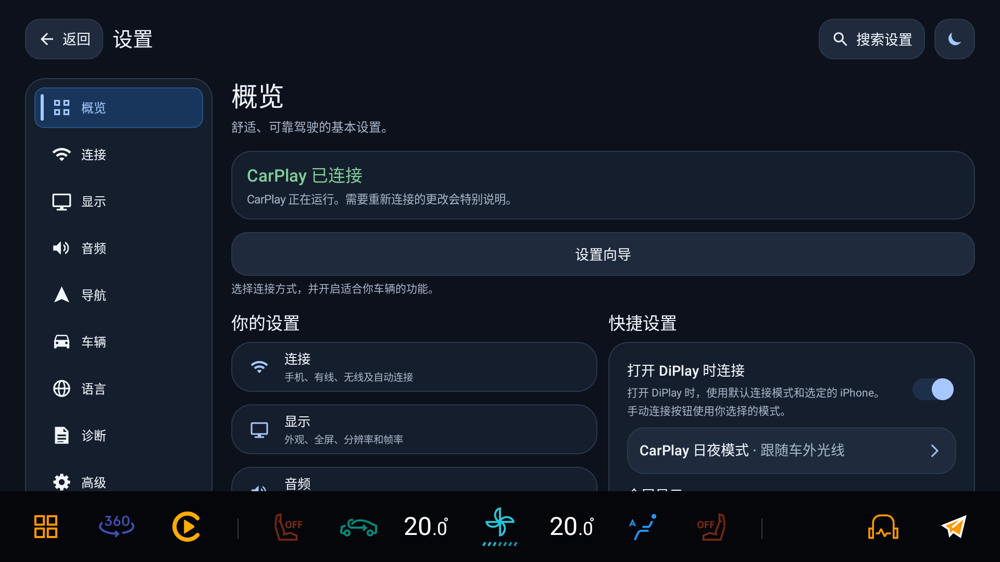

本页实车截图来自 2026-11-08 的 v141/v142（1920×1080，含车机底部 Dock），显示当时保存的设置值，不代表各功能均已验收；v145 起媒体模式名称已改为「Android 标准」，与旧截图中的「HY 代理」不同；标注「模拟器示意」或 1920×1080 自动化渲染的图不是车机拍摄。

| 我想…… | 看这一节 |
| --- | --- |
| 仪表上看到导航箭头和剩余距离 | [3.1 仪表导航](#31-仪表导航) |
| 仪表上看到车道指引 | [3.2 仪表车道指引](#32-仪表车道指引实验性) |
| 仪表上看到歌名和封面 | [3.3 仪表媒体卡片](#33-仪表媒体卡片) |
| 显示独立仪表地图或整屏镜像 | [3.4 仪表地图与三指飞屏](#34-仪表地图与三指飞屏) |
| 让仪表内容避开时速、转速表 | [3.5 仪表安全区](#35-仪表安全区) |
| 音乐走 CarPlay，保留车机蓝牙电话 | [4.2 蓝牙媒体让位](#42-蓝牙媒体让位默认开启) |
| 导航播报与音乐共存或压低音乐 | [4.4 导航播报与音量](#44-导航播报与音量) |
| 车机日夜跟着车走，不用手动切 | [6.1 CarPlay 日夜模式](#61-carplay-日夜模式) |
| 每次上车自动连上，熄火下车再上车也能接着连 | [2.2 自动连接](#22-自动连接) |
| 热点老是 2.4 GHz 卡 | [2.3 热点](#23-热点自动启动优先-5-ghz) |
| 先用 USB 连过，之后无线连不上 | [2.5 连接失败原因怎么看](#25-连接失败原因怎么看) |
| 方向盘语音键想直接叫 Siri | [5.1 Siri 语音键](#51-siri-语音键) |
| 想改语音键是短按还是长按唤醒 Siri | [5.2 方向盘按键与语音键](#52-方向盘按键与语音键)（按键学习本版不显示） |
| 在车机上接打电话 | [5.4 电话：接听、挂断与声音避让](#54-电话接听挂断与声音避让实车已验证)（实车已验证） |
| 升级 DiPlay、导入 MFi 身份、备份设置 | [1.4 安装、升级与认证身份](#14-安装升级与认证身份) |
| 连不上 / 仪表没反应 | [7.3 排错表](#73-排错表) |

---

## 1. 前提

### 1.1 车机

| 条件 | 说明 |
| --- | --- |
| 车机版本 | **753**（领克高通 820A 平台）。同为该平台 753 版本的理论上都可用；其他版本未逐型实测 |
| 系统镜像带 ECARX XUI AdaptAPI | 仪表、车道、媒体卡片全走这套接口。接口类在车机系统镜像里，**不在 APK 内**，所以每个功能都是运行时探测 |
| 已授予必要权限 | 位置（导航上报给 iPhone）、通知、后台运行不受限；音量键接管等功能需要无障碍服务；CarPlay 自身的配对与信任按提示完成。**语音键短按不需要任何授权** |
| 车机签名 | 涉及系统接口的功能（媒体卡片、部分仪表调用）需要平台签名或车机已授权的 DIM 权限，普通安装包会静默降级 |

### 1.2 手机

iPhone 与车机完成过一次配对；无线连接要求 iPhone 的 Wi-Fi 与蓝牙都打开。

把内容投到仪表时，iPhone 需使用 **iOS 17.4 或更新版本**。门槛分两层：仪表上的**导航提示**（箭头、距离、车道，走 HUD/maneuver 元数据通道）需要 iOS 17.4 及以上；仪表里的**地图画面**（CarPlay 副屏导航场景）系统自 **iOS 16.4** 起支持（场景声明键 `CPSupportsInstrumentClusterNavigationScene` 自 iOS 15.4 起），但各家地图另有门槛——**高德要求 iOS 17.4 及以上、iPhone 12 或更新机型**，且车机需支持仪表投屏（[高德 2024-08 官方说明](https://news.bjd.com.cn/2024/08/14/10867455.shtml)）。依据：Apple Developer 文档与 CarPlay Navigation Reference（center display iOS 12 / Dashboard 13.4 / instrument cluster 16.4 / HUD metadata 17.4）。

### 1.3 能力检测：为什么有些开关我没看到

DiPlay 启动时探测两类信息，然后**决定显示哪些卡片**：

1. **是不是亿咖通车机**：系统里存在 `com.ecarx.xui.service`、`com.ecarx.eas.service`、`com.ecarx.assistant`、`com.ecarx.xiaoka`、`ecarx.naviservice` 中任意一个，或 `Build` 的厂商字段带 `ecarx`。
2. **具体接口在不在**：对每个 DIM/媒体接口做一次类探测，缺哪个就关掉对应功能。

因此：

- 车机没被识别成亿咖通 → **「亿咖通导航」整张卡片不出现**。
- 识别成功但缺 `IMediaInteraction` → 导航功能照常，**仪表上的歌曲卡片不会有内容**（媒体集成仍然可选，只是推不到仪表）。

这不是 bug，是防止在不支持的固件上调用不存在的接口。

### 1.4 安装、升级与认证身份

**应用内更新（v143 起）**：**设置 › 关于** 检查本仓库 GitHub Release 的新版本，只对 Release 包名 `com.shihab.diplay` 开启。下载后先核对 SHA-256，再确认包名、签名相同且版本更新，不符合则不交给安装器。

- **下载来源**：自动（默认，先试上次可用的来源，再试 GitHub 直连和内置加速站）、GitHub 直连、指定加速站，或自定义 https 前缀。
- **本版更新说明**（v144 起）：读取当前版本 Release 附带的 `update.json`，读到后缓存。本地自打、未在 GitHub 发布的包读不到说明。
- **后台检查更新**：可在同一卡片关闭。

**MFi 认证身份**：公开 Release 包不含身份。**设置 › 高级 › MFi 证书与签名目标** 选「本地离线」时显示身份状态，可导入 `identity.pk8` 与 `certificate.p7b`：先校验私钥与证书是否匹配，匹配才替换，不匹配则保留原身份。身份存放在应用的 `no_backup` 目录，之后用公开包覆盖升级仍可使用。没有身份时首页会提示去导入。

**备份设置**：**设置 › 关于 › 在手机上备份或恢复** 显示二维码，同一网络内的手机用浏览器导出或导入设置文件，离开页面后服务自动停止。

**许可证与源码**：**设置 › 关于 › 许可证与源码** 可离线查看 GPL/AGPL 与第三方许可全文和源码入口。

---

## 2. 连接

### 2.1 无线 CarPlay

**怎么用**

1. 打开 **设置 → 连接 → 连接设置**。
2. 选一种通路：「车载热点（推荐）」「Wi-Fi Direct」或「现有 Wi-Fi / 同一局域网」。
3. 按屏幕提示完成配置并保存。
4. 回到主界面连接 iPhone。

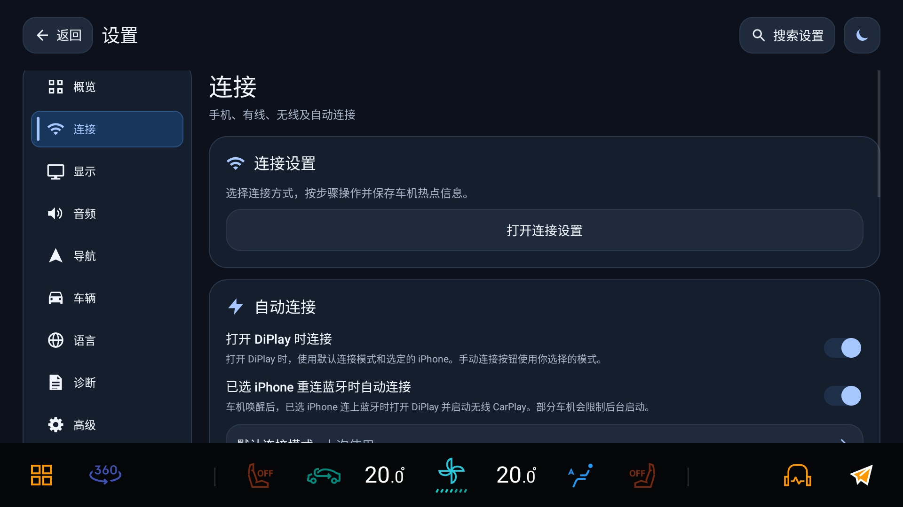

**怎么确认生效**：出现 CarPlay 画面即成功。连接期间界面会依次显示热点准备、握手、等待首个画面。

**边界**

- 车道级功能要有导航在进行；纯投屏不受影响。
- 无线失败会按握手阶段给出具体原因，见 [2.5](#25-连接失败原因怎么看)。

### 2.2 自动连接

**在哪开**：**设置 → 连接 → 自动连接**

| 开关 | 作用 |
| --- | --- |
| 车机启动后打开 | 车机开机后自动启动 DiPlay；未保存过选择时默认开启，保留已有开关选择 |
| 打开 DiPlay 时连接 | 进入 DiPlay 就自动连上一次选中的 iPhone |
| 已选 iPhone 重连蓝牙时自动连接 | 车机唤醒后，选中的 iPhone 连上蓝牙时尝试打开 DiPlay 并启动无线 CarPlay；可能受车机后台启动限制 |

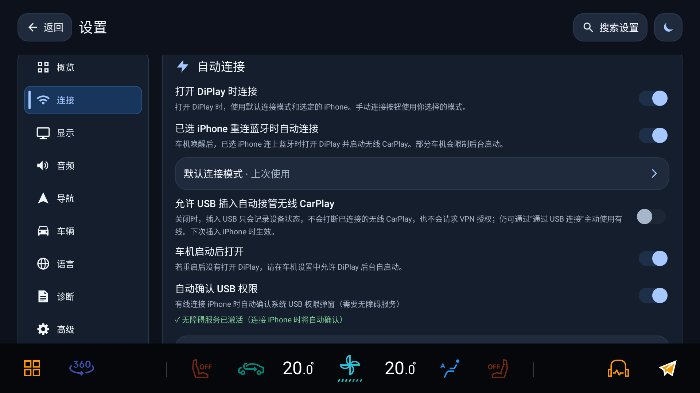

**边界**：自动连接的目标是**设置里选中的那台 iPhone**，不是"上次实际连上的那台"。

**熄火下车后再上车（v141、v143）**：熄火后打开主驾车门，车机会在约 20 ms 内关闭热点和蓝牙，CarPlay 随之断开。之后点亮屏幕时，DiPlay 不再停在「连接中」，而是被动等待车机自己恢复蓝牙，再等热点恢复（如果 DiPlay 设置了自动开启热点，则由它开启），然后继续连接。最长等 30 分钟；会话恢复后清除这个等待状态，期间返回 DiPlay 会立即取消。等待期间不会主动打开蓝牙或热点。小米 8 台架（真 iPhone，蓝牙与热点同时关闭 30 秒后恢复）无需手动操作，约 8 秒后重新出画面；实车尚待复测。

开机直达 CarPlay 需开启「车机启动后打开」「打开 DiPlay 时连接」，默认连接方式为无线并选好 iPhone，完成引导和认证。车机热点模式还需保存有效热点配置；热点未开启时，需允许 DiPlay 自动开启热点。已有 Wi-Fi 模式也支持直达，Wi-Fi Direct 与其他模式仍走原首页流程。

配置齐全时，解锁后直接打开 CarPlay，并行准备热点、网络与蓝牙；配置不全时进入首页。v134 起，ECARX 上先等原车桌面首批服务启动，最多 5 秒，避免过早覆盖桌面使语音键等服务未启动。短暂看到原车桌面属预期，不保证固定出图时间。普通平台签名安装即可，无需将应用预置到系统分区。

### 2.3 热点（自动启动优先 5 GHz）

**自动启动时**：如果热点当前是关闭的，DiPlay 会把保存的 `apBand` 改成 5 GHz、清掉旧的 2.4 GHz 信道，并回读校验；SSID、密码、加密方式都保持不变。

**不会动的情况**

- 热点已经在跑 → 不碰。
- 你在车机设置里显式选了 2.4 GHz → 尊重你的选择。
- 车机无线不是双频，或写入后回读校验不过 → 回落到车机原来的频段。

「自动开启热点」未保存过选择时默认开启，仅无线连接的车机热点模式自动执行，保留已有关闭选择；可配合「车机启动后打开」使用。手动与自动热点共用平台权限预检：本车已有 `TETHER_PRIVILEGED` 时直接尝试系统接口，否则可允许「修改系统设置」；Android 9 的热点配置读写也直接使用系统权限。应用内不保留 ADB 兜底，系统调用与热点状态回读才是成功依据，见 [权限与无 ADB 实施清单](ADB_AND_PLATFORM_PERMISSIONS.zh-CN.md)。

**保持车机 Wi-Fi 关闭**：在 **设置 → 连接 → 连接设置**选择「车载热点（推荐）」，仅 Android 9 且开启「自动开启热点」时显示，默认开启。自动启动热点前会关闭车机的 Wi-Fi 客户端并保存关闭状态，防止车机设置应用在开机时再次打开 Wi-Fi、关掉热点。它会使车机不再自动连接其他 Wi-Fi；iPhone 的 Wi-Fi 仍须开启。

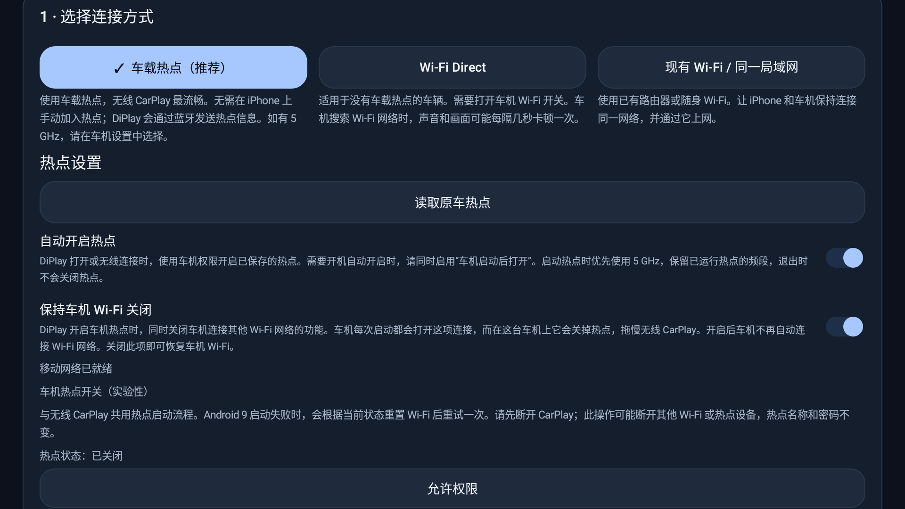

需要车机连接其他网络时关闭此项。此前由 DiPlay 关闭的 Wi-Fi，空闲时立即恢复；热点正被 CarPlay 使用时只恢复保存值，下次车辆启动生效。若恢复失败，去车机系统设置手动打开。关闭此项后，开机可能等 Wi-Fi 客户端恢复（最多 15 秒）再开热点。使用「已有 Wi-Fi」时不需要这项热点控制。

**手动热点控制**：进入 **设置 → 连接 → 连接设置**，在「无线连接」步骤里有手动开关与状态显示（含车机移动网络是否就绪），自动流程失败时用它接管。

**边界**：这部分只在 Android 9 车机上验证过；不同固件对 `apBand` 的写权限不一致。

### 2.4 USB 与无线连接

已配置无线时，「允许 USB 插入自动接管无线 CarPlay」默认关闭，插线只充电，不切有线、不重建无线会话，也不请求 VPN 授权。要临时用有线可点「通过 USB 连接」；要插线自动接管，在 **设置 → 连接 → 自动连接**开启该开关。默认连接方式明确选 USB 或尚未配置无线时，不受这项无线保护。

默认关闭时插线不断无线、开启后插线切有线，已于 2026-11-04 在 v122 实车确认；不等于 v146 已完成同项回归。建议首次配对直接使用无线；若本车记录首次通过 USB 建立，改无线前需在 iPhone 移除本车并先无线重配，见 [2.5](#25-连接失败原因怎么看)。USB 卡顿及取消授权后的自动回退仍未解决，不建议作为稳定主通路。

### 2.5 连接失败原因怎么看

无线握手失败时，界面不再无限等下去，而是按握手的**具体阶段**给出原因（每个阶段单独计时，而不是一个统一超时）：

| 界面提示 | 实际发生了什么 | 你能做什么 |
| --- | --- | --- |
| 「蓝牙已连上 iPhone，但没有建立 iAP2 会话」 | RFCOMM 连上了，但 iPhone 一直没打开 iAP2 控制会话（CSM），多半是蓝牙链路没有真的把数据送到手机 | 把 iPhone 靠近、解锁后重试；仍失败则删除本车 CarPlay 记录重新配对 |
| 「无线握手过程中 iPhone 停止响应」 | CSM 通了，但 iPhone 不再应答识别/MFi 或后续传输交换 | 解锁 iPhone、靠近车机后重试；仍失败请保存诊断报告 |
| 「iPhone 未通过 MFi 认证」 | iPhone 明确拒绝或没有完成 MFi 认证 | 删除本车 CarPlay 记录后重新配对；仍失败可能需恢复车机上的 MFi 证书 |
| 「iPhone 没有建立无线 CarPlay 隧道」 | iPhone 已通过蓝牙完成认证，但 Wi-Fi 的 iAP2 隧道一直没起来 | 保持 Wi-Fi 开启、靠近车机后重试；仍失败则删除本车记录后重新配对 |
| 「这台 iPhone 表示它现在不能使用无线 CarPlay」 | iPhone 明确回了 `WirelessCarPlayUpdate available=false`，之后不再发起 Wi-Fi 传输 | 在 iPhone 上确认 Wi-Fi 已开；删掉这台车机的旧 CarPlay 记录后重新配对，并**先走一次无线**（见下文） |
| 「这台 iPhone 没有开始建立无线 CarPlay」 | iPhone 收下了请求但一直不发起传输 | 同上；这种情况 DiPlay 不会自动重试 |
| 连接超时 | 当前阶段未在期限内完成 | 按页面提示重新连接；不同阶段不使用统一的一分钟超时 |

**关键行为**：临时 RFCOMM 建链或握手故障会有限重试；需要你在 iPhone 上处理的拒绝、权限或明确认证失败，不盲目重试。无线准备与关闭也已优化，减少等待热点稳定和旧 Bonjour 清理的时间，实际耗时需车测。

**离开连接页**：开始会话请求尚未发出时取消本次尝试；已向 iPhone 发出 CarPlayStartSession 后，当前尝试可继续在后台完成，超时失败则停止，不在首页背后重试。**连接 → 无线连接帮助 → 重置 CarPlay Wi-Fi**仍取消旧尝试，供需要明确重建连接时使用。

#### 典型场景：先用 USB 连过，之后改走就连不上

已确认的情况是首次用 USB 建立记录后无法使用无线连接，可能停在连接界面，取消、重选设备或重进连接页无法解决。

已确认：首次通过 USB 建立的本车 CarPlay 记录会导致手机拒绝后续无线连接，需要在手机上移除记录并重新无线配对。iPhone 回 `available=false` 时，也应检查 Wi-Fi 是否开启。

握手日志中，两台手机在蓝牙配对、MFi 认证和 Wi-Fi 配置下发后出现不同响应：

| 步骤 | 先无线建立（正常） | 先 USB 建立（失败） |
| --- | --- | --- |
| 蓝牙 RFCOMM 连接 | ✅ | ✅ |
| iAP2 identification | ✅ | ✅ |
| MFi 认证 | ✅ | ✅ |
| 请求 Wi-Fi 配置（0x5702 → 0x5703） | ✅ | ✅ |
| **iPhone 回 0x4E0D WirelessCarPlayUpdate** | **available=true** | **available=false** |
| iPhone 回 0x4E0E / 0x4300 并请求传输 | ✅ | ❌ 从未出现 |
| 建立 AirPlay 会话 | ✅ | ❌ 永远到不了 |

也就是说，iPhone 从头到尾没有加入车机热点，热点侧的客户端列表里也查不到它。

**怎么处理（按顺序）**

1. 在 iPhone 上确认 **Wi-Fi 已开启**。
2. iPhone → **设置 → 通用 → CarPlay 车载** → 删除这台车。
3. 重新配对，并且**第一次连接走无线**（不要插线）。
4. 无线连接成功后正常使用；USB 与无线之间的切换不作为稳定功能承诺。

**DiPlay 侧处理**：收到 `available=false` 后不再反复重试同一个拒绝，显示具体原因和手动重连入口。其他阶段由各自看门狗判断；后台保留与取消按上文处理，不能再用统一的「60 秒内失败」或「离开页面必定取消」描述。

---

## 3. 仪表与导航

> **导航 → 亿咖通导航** 分别控制 HUD／仪表导航提示、开始导航时自动显示仪表地图和可选桌面地图。整屏镜像与安全区校准在 **高级 → 仪表显示**。亿咖通专属设置仅在识别到兼容车机时出现。

### 3.1 仪表导航

**是什么**：把 CarPlay 的转向箭头、剩余距离、路名、预计到达时间推到仪表盘（走车机 DIM 接口），不依赖中控镜像。

**怎么用**

打开「HUD／仪表导航提示」后开始 CarPlay 导航。开关默认开启并保留旧版保存的选择，更改立即生效。关闭只撤下提示，手机路线、地图显隐和输入缓存继续保留。

临时缺少转向详情或下个转向距离时，仅撤下失效转向，继续更新有效的目的地、剩余距离、ETA 和车道。ETA 以剩余秒数提交给车机；手机只提供剩余时间时，先固定到达时刻，保活不会使其不断后移。

首次输出、每 5 秒保活和地图源恢复时，会重新提交当前有效导航数据，避免相同内容被车机 SDK 的缓存拦住；不靠清空箭头或结束路线触发重发。HUD 整条路线从未输出时，结束只释放地图及原厂导航接管；输出尝试部分失败时仍执行回滚清理。

**怎么确认生效**：仪表出现箭头与距离；导航结束时仪表卡片自动清空。

**边界**：箭头用整型 id 通道，调用成功不等于实际绘制；地图显隐后顶部提示和车道是否连续显示，仍以实车画面验收为准。

### 3.2 仪表车道指引（实验性）

**怎么用**：随已开启的「HUD／仪表导航提示」输出有效车道数据，无需单独开启车道开关。

**和 3.1 的关系**：与导航数据一起更新；隐藏地图画面不会停止有效导航或车道数据。

**边界**：可用性取决于手机地图是否提供车道数据以及车机固件是否支持显示，不同车型表现可能不同。没有有效车道数据时不绘制车道，避免显示过期内容。

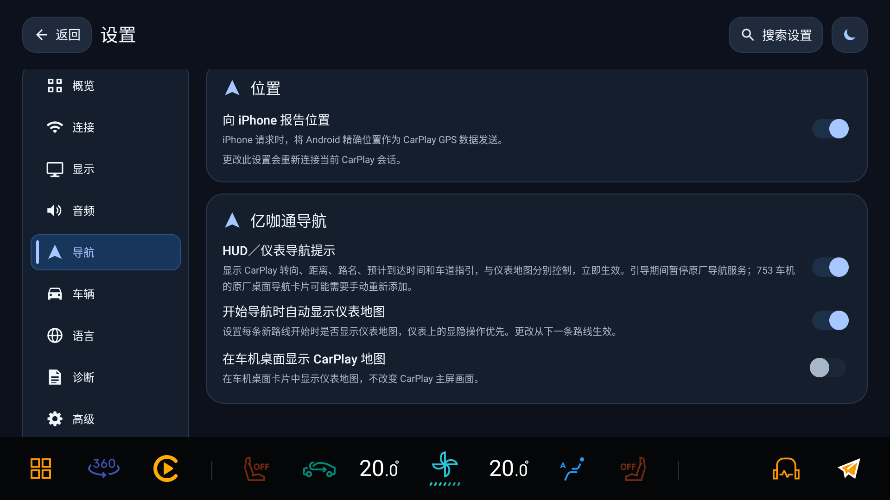

导航提示与初始仪表地图分别控制；通常无需开启整屏镜像。

**历史测试状态**：苹果地图、百度 V22 和高德已有真实 iPhone＋小米 8 台架采集与模拟仪表回放。苹果与百度覆盖车道显隐；高德采集未获得非空车道，车道部分使用合成数据补测，不能视为高德真实车道通过。v112 的三款地图手机侧请求退出均已验证；实际道路行驶、物理仪表高亮和原车确认框仍待验收。这些历史结果不代表 v134 已完成回归。

### 3.3 仪表媒体卡片

**怎么用**：在「设置 → 音频 → 车机媒体集成」选择「DiPlay 直接接管」或「Android 标准」，歌曲信息随所选后端自动输出。没有独立的仪表媒体卡片开关。

**怎么确认生效**：播放音乐时仪表出现歌名、歌手与封面。

**边界**：需要兼容固件与权限（ECARX MediaCenter）；没有权限时开关可能不出现或卡片无内容。媒体数据的后端选择见 [4.1](#41-车机媒体集成)。

### 3.4 仪表地图与三指飞屏

**前提**：仪表地图需要 iPhone **iOS 17.4 或更新版本**（地图画面系统自 16.4 起支持，见 [1.2](#12-手机)）；用高德时另需 **iPhone 12 或更新机型**。满足后在 CarPlay 的手机地图中开始导航并启用仪表地图。三款地图的差异（箭头频率、车道有无、地图可用性）见 [3.4.1](#341-三家地图在仪表上的差异)。

「开始导航时自动显示仪表地图」设置每条新路线的初始地图显隐，默认开启，更改从下一条路线生效。实际投送仍需有效 CarPlay 会话、导航路线、Surface 及当前视频源首帧就绪，中控继续使用自己的主视频流。

仪表「始终显示／从不显示」优先于初始开关，在同一次 DiPlay 运行内跨路线生效；「自动」沿用本条路线开始时的设置。导航期间跟随仪表显隐通知和三指飞屏，页面重建、打开设置和手机重连不会重置当前选择。退出 DiPlay 后清除本次仪表显隐选择，下次启动重新按保存的初始开关决定。

导航中收起独立地图时，DiPlay 暂停向仪表通报地图就绪，保留已有外屏窗口、Surface 和手机副屏地图。再次飞屏时，已收到首帧的同一 Surface 可以直接通报就绪。若 Surface 已被系统替换，则等待新 Surface 的首帧。路线从隐藏档开始时不创建仪表窗口或启动地图绘制；首次收到显示请求后才创建窗口、绑定视频 Surface，并等待首帧后通报就绪。中控详情或全览由手机地图应用决定。隐藏期间 HUD 继续输出有效导航提示，路线结束或 CarPlay 断连时才清理本次导航输出。

**高级 → 仪表显示 → 整屏镜像到仪表（实验性）**：默认关闭，通常无需开启。导航期间以整个 CarPlay 中控画面替代独立地图，可能遮住原车导航和媒体卡片。重新连接后生效，不会立即断开当前会话。

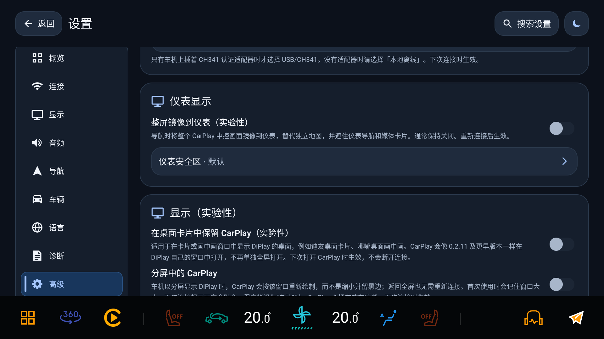

仪表菜单与三指交替操作、隐藏后的中控布局、顶部提示和车道连续性，仍需原车验收。

**未导航时也显示仪表地图（实验性，v148 起）**：**导航 → 亿咖通导航**，紧挨「开始导航时自动显示仪表地图」，默认关闭，改动立即生效。开启后，CarPlay 连接期间没有路线也在仪表显示 CarPlay 地图；仪表上的显隐操作优先，车机要求隐藏时照常收起。开始导航时已显示的地图保持显示，不受「开始导航时自动显示仪表地图」关闭的影响；导航结束只撤下箭头、距离和车道，地图继续保留。断开 CarPlay 或关掉开关时收起。

- 苹果地图没有路线时只在画面变化时更新仪表画面，停车时看起来像静止；其他地图应用没有路线时可能让仪表空白。
- 开启后仪表整趟行车都显示 CarPlay 地图，会盖住仪表原本未导航时的内容（如媒体卡片）。
- 各地图没有路线时的实际画面、导航结束后平台是否保留投屏，都待实车确认。

**仪表地图同时显示在别处（v147 起）**：仪表地图同时显示在中控卡片（**导航 → 亿咖通导航 → 在车机桌面显示 CarPlay 地图**）或其他桌面时，只用仪表地图的一个硬件解码器，再用 GPU 画到每个位置；打开或关闭卡片不重建解码器，也不需要等关键帧。此前每处各占一个硬件解码会话，车机的高通解码器可能因资源不足拒绝新实例。「整屏镜像到仪表」仍按原方式每处单独解码。仪表解码器按仪表流的 1920×720 配置（此前误用主屏 1920×880）。

**与其他桌面共享实时地图**：**高级 → 显示（实验性） → 与其他启动器共享实时地图**，默认关闭，Android 9 起可用。开启后，车机上的桌面应用可以请求 CarPlay 实时地图。v145 起 Android 9／10 也支持：桌面把自己的 `Surface` 交给 DiPlay，由 DiPlay 解码同一路仪表画面。接入方式见[桌面集成说明](LAUNCHER_INTEGRATION.md)。

### 3.4.1 三家地图在仪表上的差异

台架实测（2026-11-01，`analysis/20261101-bench/`，小米 8 + iPhone 17 Pro / iOS 27.2，同一条 OSRM 路线五轮）与静态分析的结论：

| 地图 | `0x5201` 导航数据 | `0x5204` 车道条 | 仪表地图 | 备注 |
|---|---|---|---|---|
| 苹果地图 | 0.5–0.7 Hz（约 1.4–2 s 一帧） | 预取 5–8 个路口（index 0–7，批内 11–15 ms） | 支持 | 过路口有单帧 `next=2 m / 0 m` |
| 高德 | ≈1.9 Hz，突发 | **0 条** | 支持（iOS 17.4+、iPhone 12 或更新） | 过路口 130 ms 内 3 帧 `0/1/2 m`；next-turn 1900→1500 m 跳变 |
| 百度 | ≈1.7 Hz | 单路口（`index=0`，出现 `st=1`） | 未实测确认 | 尾段受 GPS 注入偏差影响，不作结论 |

- **高德为什么不发车道**：`analysis/20261102-amap-16.25.2-carplay-ipa/` 在 16.25.2 里把车道绘成图片塞进第二个 `CPManeuver.contentImage`，没有找到 `CPLaneGuidance` / `addLaneGuidances:` 提交链。**主屏有车道 ≠ 车机收到 `0x5204`**，两者是不同能力。
- **距离字段三家都非单调**（会回跳重算），纠偏逻辑必须取最新帧，不能按单调判据推断；这也是 `EcarxDimDistanceGuard` 方案被弃用的原因之一，见 [导航接管决策](NAVIGATION_TAKEOVER_DECISION.zh-CN.md)。
- **台架限制**：GPS 用 OSRM 几何注入，与各地图自算路线不重合，越接近终点错位越大；第 5 轮（百度）终点卡住由用户手动结束，尾段数据不代表地图行为。

### 3.5 仪表安全区

**怎么用**：在 **高级 → 仪表显示** 点 **「仪表安全区」** → 拖动四边，让地图内容避开时速/转速等读数 → 保存。

**默认区域（v145 起）**：1920×720 仪表默认使用居中的 (494, 273)–(1426, 620)，左侧避让 ADAS 面板；导航画面里的车标位置随之调整。自己保存过的区域不受影响。

**生效时机**：保存并**重新连接**后生效；「重置」恢复默认区域。

### 3.6 导航接管（v109）

当前工作区采用临时停用原厂 `ecarx.naviservice` 的方案，导航结束后恢复包状态并启动原厂服务；停包或恢复失败会留下诊断，不回退到 MQTT 距离纠偏。需要车机授予组件管理权限。

**桌面卡片**：停包可能删除原厂首页导航卡片的绑定。恢复原厂包后，需在原厂桌面进入编辑模式，点击空位「+」重新添加导航卡片；重新启用服务不会自动恢复绑定。

**验证边界**：v109 已在 Android 9 模拟器验证应用停包、结束恢复及强停后再次打开恢复；物理仪表上的距离和车道仍待实车确认。具体取舍见 [导航接管决策](NAVIGATION_TAKEOVER_DECISION.zh-CN.md)。

v106 曾通过 MQTT 距离主题纠偏，一轮实车压力 Mock 仅确认当时的错误距离可被纠正；当前工作区已移除该实现，不能用旧守护日志判断新接管方案是否运行。

---

## 4. 音频与媒体

### 4.1 车机媒体集成

**在哪开**：**设置 → 音频 → 车机媒体集成**

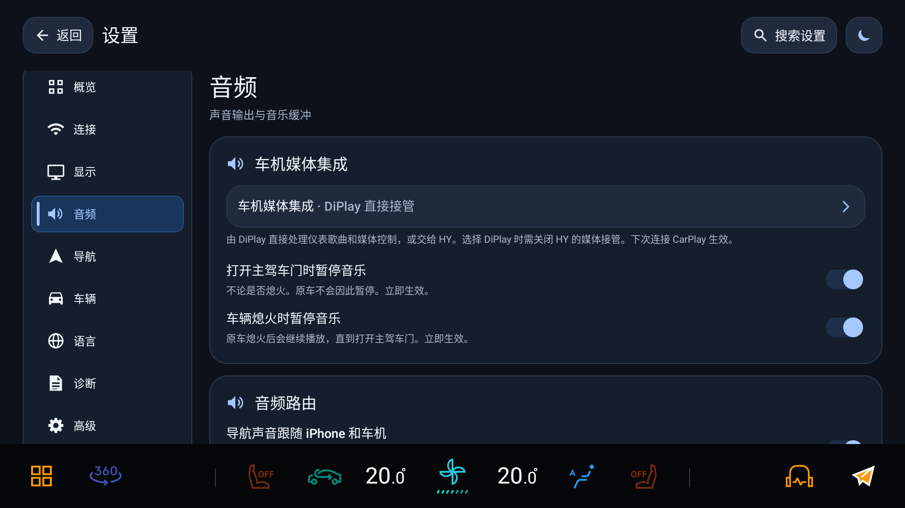

点进去只有两个选项：

界面上只有两个选项，名字不是「ECARX / Android」：

| 选项 | 内部值 | 谁向亿咖通提供媒体源 | 适合什么时候 |
| --- | --- | --- | --- |
| **DiPlay 直接接管**（默认） | `ECARX` | DiPlay 的 MediaCenter 直接注册、发布、清理 | 车机被识别为亿咖通时的常态 |
| **Android 标准**（v145 前叫「HY 代理」） | `ANDROID` | 车机或 HYWebview 读取标准会话后发布 | 使用 HY、车机没被识别，或 ECARX 直接通道异常 |

**两种模式相同的地方**：都发布标准 Android MediaSession，嘟嘟这类桌面照样能读歌名、歌手、专辑、时长、封面和播放状态，也能用标准播放/暂停/上下曲控制 iPhone；都是**下次连接 CarPlay 生效**。

**两种模式真正的差别**

| | DiPlay 直接接管 | Android 标准 |
| --- | --- | --- |
| 亿咖通媒体源 | DiPlay 自己注册与清理 | 由车机或 HY 读取标准会话；DiPlay 不注册、不申请播放归属 |
| HY 仪表封面补发 | 不发送 | 「给 HY 补发封面通知」开启（默认）时，当前歌曲封面就绪后定向补发 |
| 媒体音频焦点 | 不申请（保留原 ECARX / 渲染器行为） | 渲染器已管焦点则不重复申请；否则按原策略 |
| 方向盘媒体键 | DiPlay 转发 | DiPlay 不接管，留给车机 / HY |
| 启动前置条件 | 直接发布 | 先等旧 ECARX 注册释放确认，再发布 |

**选择时的配套动作**

- **不使用 HY**：在 DiPlay 选「直接接管」，方向盘语音键按需选择短按或长按，无需配置 HY。
- **使用 HY，但由 DiPlay 直接接管**：在 DiPlay 选「直接接管」，在 HY 关闭媒体接管和同一语音键的方控接管，避免冲突。
- **使用 HY 处理媒体**：在 DiPlay 选「Android 标准」，由 HY 读取标准会话；在 DiPlay 和 HY 的方向盘设置中选择同一组 Siri 模拟按键，也可继续使用原有 Siri 桥接入口。见 5.1。

**给 HY 补发封面通知（v145 起）**：只在「Android 标准」下显示，默认开启。它是这个模式下唯一专门发给 HY 的输出：向 HY 的 `HyMediaReceiver` 发送歌曲和封面的仪表广播。HY 仪表切歌后封面不更新时保持开启；关闭后只使用标准媒体会话。改动立即生效，重新开启时立即补发当前歌曲；设置备份包含这一项。

**怎么确认走到了哪一个**

诊断报告里看 `androidActivation`：`ACTIVE` 表示标准会话已起来；`WAITING_ECARX_CLEANUP` 表示在等旧注册释放；出现 `BLOCKED_ECARX_RESTART_REQUIRED` 说明清理结果不确定，需要重启 DiPlay 进程再试。

**边界**：这一项影响仪表媒体卡片、系统媒体控件、方向盘媒体键和 Siri 按键的归属，切换后建议重启一次 CarPlay 会话再判断。

### 4.1.1 暂停音乐的两个开关（默认全部关闭）

**在哪开**：**设置 → 音频 → 车机媒体集成** 卡片里的两个开关，改动立即生效。两项都需要车身信号，只在亿咖通车机上显示。

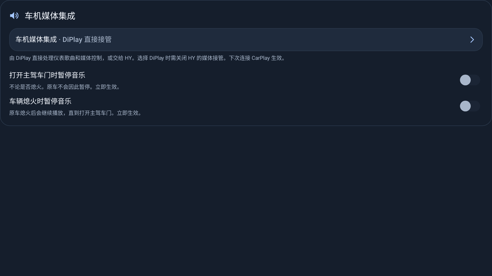

| 开关 | 何时发暂停 |
|---|---|
| 打开主驾车门时暂停音乐 | 主驾门由关到开（`PA_CP_DoorDrvrSts` 末字节 4 → 2），不论是否熄火 |
| 车辆熄火时暂停音乐 | 整车使用模式 `usageMode` 从运行（11/13）变为未运行（如 1） |

两项都只在 iPhone 正在播放时发一次暂停，之后由你手动恢复；DiPlay 不自动恢复播放。两项与 HY 车机应用的同名开关触发条件一致。HY 的第三项「车机息屏时暂停」没有做：这台车熄火后的黑屏由原车绘制，Android 一直亮屏（`dumpsys power` 为 `mWakefulness=Awake`，且持有屏幕唤醒锁），所有报告里都没有息屏广播。

**为什么默认关闭**：原车不做这两件事。原车蓝牙音乐（`BTMusicManager` 的 820A 分支）只记住断电前是否在播放，断电期间不改写；USB 音乐（`OpenApiCarHelper`）点火 OFF 时不暂停，点火 ON 时若上次在播就接着放。所以原车熄火后会一直播放到开门，下次上车接着放。

**这台车上的情况**：
- 熄火后第一次开主驾门，约 20 ms 内车机关闭热点和蓝牙，CarPlay 断开。打开「打开主驾车门」后，暂停会抢在断开前送到 iPhone（v140 报告：77 ms 内写完按键，重连时 iPhone 仍为暂停）。v141 实车：不熄火开门 1–2 ms 内发出暂停，iPhone 约 0.7 秒后停止；熄火时 1 ms 内发出暂停。
- CarPlay 页面回到前台约 1 秒后，原车媒体中心会发「播放」（v141 实车 20:26:36、20:27:36），会撤销之前的暂停，这是原车行为。
- 点亮屏幕后重连，原车媒体中心会按断电前记住的状态发「播放」（v140 报告 18:32:57），这是原车的「上车接着放」，DiPlay 不拦截。
- 便利状态（点亮未启动）开门下车，原车媒体中心会在关门后约 1–4 秒自己暂停。

**熄火后的声音（v147 起）**：熄火后车机热点重启时，CarPlay 会话可能没有正常结束（没有 TEARDOWN）。此前旧会话的音频焦点会保留到 DiPlay 界面停止，原车收音机或媒体约 3 分钟没有声音；现在会话关闭时就释放音频播放和焦点，原车几秒内恢复出声。实车待测。

**怎么核对**：诊断报告「Screen, car power and media commands」一节里会出现 `Music pause trigger=door|engine_off sent=true`；开关关闭时为 `… off`，iPhone 未在播放时为 `… skipped iphonePlaying=…`。

### 4.2 蓝牙媒体让位（默认开启）

**解决什么**：CarPlay 导航播报和音乐被车机蓝牙"抢走"，或者音乐从手机蓝牙出来而不是 CarPlay。

**在哪开**：**设置 → 音频 → 音频路由 → 声音异常排查 → 「CarPlay 期间停用蓝牙媒体（实验性）」**

**怎么用**

1. 保持「CarPlay 期间停用蓝牙媒体」**开启**。
2. 确认 **「通过车辆蓝牙播放 CarPlay 音频（实验性）」关闭**（前者开启时该项会被禁用）。
3. 重新连接一次。

**边界**

- 只停用**所选 iPhone 的蓝牙媒体**，保留电话；CarPlay 结束后自动恢复。
- 需要车机支持 A2DP Sink。
- **下次连接生效**，当前通话或当前会话不受影响。
- 更深原理与验证记录见 [docs/BLUETOOTH_MEDIA_YIELD.md](BLUETOOTH_MEDIA_YIELD.md)。

### 4.3 通过车辆蓝牙播放 CarPlay 音频（实验性）

**是什么**：把 CarPlay 音频改从车机蓝牙出，而不是 CarPlay 自己的音频通路。

**什么时候开**：车机音响只认蓝牙输入、其他通路无声时。

**在哪开**：**设置 → 音频 → 音频路由 → 声音异常排查**。与 [4.2](#42-蓝牙媒体让位默认开启) 互斥——打开它，媒体让位开关会被禁用。

### 4.4 导航播报与音量

**在哪开**：**设置 → 音频 → 音频路由 → 导航声音跟随 iPhone 和车机**。识别为 ECARX 时默认开启，覆盖升级后的未设置值也用此默认；更改后下次连接生效。

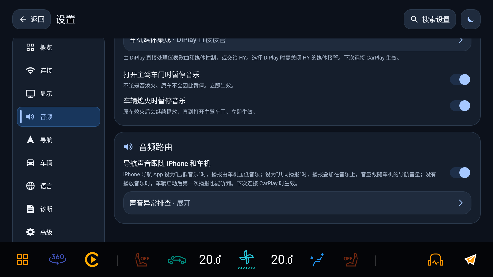

| iPhone 地图的播报方式 | 声音通路与调节 |
| --- | --- |
| 压低音乐 | iPhone 发出压低请求时，播报走车机导航通道，导航音量与音乐压低由车机控制；DiPlay 不控制该通道的压低幅度 |
| 共同播报／与音乐共存 | 不压低时，播报走音乐流叠加播放；CarPlay 音乐已有焦点时不再为每条播报重复申请，没有音乐时仍申请必要焦点，避免首条播报无声 |

共同播报的音量按车机导航音量相对媒体音量的差值调低，不能额外放大；导航音量高于媒体音量时，以媒体通路的音量为限。一条音频流内播报模式变化时，等播报间静音再切换通路；音乐通路上遇到压低请求时，DiPlay 会将音乐降到 50%。这些是当前实现行为，实际响度与切换效果仍待实车复测。

开启后隐藏「音频焦点」「导航播报申请音频焦点」「导航播报音量」「导航音频流」。通常只需在手机地图选择播报方式、在车机声音设置调导航音量；「压低音乐」使音乐过低时，可改试共同播报，各 App 的选项名称可能不同。

**手动排查**：关闭「导航声音跟随 iPhone 和车机」后，旧控制才会显示。焦点与播报焦点位于 **高级 → 视频与音频**，保存后重连；**音频 → 音频路由 → 导航播报音量**只降低播报本身，立即生效；「声音异常排查」内可选导航音频流。非 ECARX 继续使用这些手动设置。

---

## 5. 语音与按键

### 5.1 Siri 语音键

**在哪开**：设置 → 车辆 → 方向盘按键 → **方向盘唤醒 Siri**。默认开启，关闭后不再接管 Siri 按键，下级选项隐藏。CarPlay 未连接或通话中不接管。

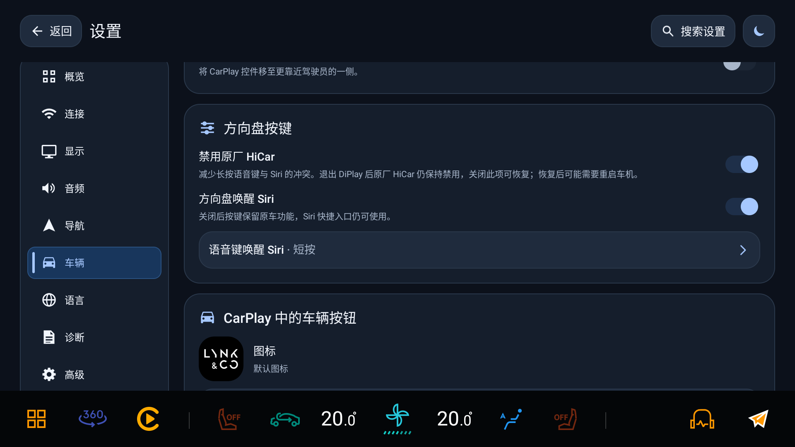

两种媒体集成方式下，这一块长得不一样（截图为 v145 改名前，「HY 代理」即现在的「Android 标准」）：

| DiPlay 直接接管 | Android 标准 |
| --- | --- |
|  |  |

| 直接接管：选短按还是长按 | Android 标准：选 HY Siri 按键组 |
| --- | --- |
|  |  |

- **DiPlay 直接接管**：选择短按或长按，另一种按法留给原车助手。默认短按，修改立即生效。
- **Android 标准**：在「HY Siri 按键」选择 **155/156** 或 **312/303**，并在 HY 方向盘设置中选择对应的“模拟按键切换”。同组两个键码都唤醒 Siri。
- **Android 9 后台监听**。连接 CarPlay 后，DiPlay 监听系统日志中匹配所选键组的注入事件，前台应用仍收到原按键。需要 `READ_LOGS`，本应用为平台签名，安装即授予；可在 **设置 → 诊断 → 权限检查** 回读实际状态，改动后须重新连接 CarPlay。此前通过本机 ADB 尝试一键授权的入口已随无 ADB 改造删除，见 [权限与无 ADB 实施清单](ADB_AND_PLATFORM_PERMISSIONS.zh-CN.md)。
- **实车边界**：本轮车机已回读 `READ_LOGS granted=true`，但尚未完成后台 Siri 唤醒和识别的受控验证。HY 保存 155 时曾观察到 155 和 303 同时由输入层发出，312/303 模式尚缺严格对照。
- **开机后短按（v134 起）**：解锁后先等原车桌面启动语音键等服务；覆盖安装记录不等于重启后短按 Siri 已验收，仍需冷启动确认。
- **显式 Siri 入口**：原有桥接应用及 `${applicationId}.action.SIRI` 事件继续可用，不受方向盘总开关影响；仍要求 CarPlay 已连接且不在通话中，也不会拉起 DiPlay 界面。

媒体后端的切换下次连接生效；Siri 总开关、短长按及虚拟按键选择立即生效。

### 5.2 方向盘按键与语音键

不提供按键学习、媒体键绑定或双击参数。上一首、下一首、播放/暂停保持固定功能，由既有媒体后端处理；音量保留车机行为，导航音量键仍由独立设置控制。

直接接管时需关闭 HY 的媒体代理及同一语音键的方控接管。「Android 标准」模式由 HY 负责原车方控，DiPlay 只监听选定的 Siri 虚拟键。两组切换码不表示短按和长按；原车短长按通过 ECARX 广播动作类型识别。

### 5.3 音量键调导航播报音量

**在哪开**：**设置 → 高级 → 「CarPlay 导航播报期间，音量键调节…」**

**作用**：只在 CarPlay 导航播报期间，把音量键指向导航音频流；其他时候按车机原有方式处理。

**边界**：需要方向盘按键无障碍权限；通话、地图缩放、摇杆保持优先。详见 [docs/NAVIGATION_WHEEL_VOLUME.md](NAVIGATION_WHEEL_VOLUME.md)。

### 5.4 电话：接听、挂断与声音避让（实车已验证）

**是什么**：在 CarPlay 画面接听、挂断 iPhone 电话，声音与麦克风走 CarPlay。车机电话界面和仪表电话卡片来自车机自己的电话栈，不是 DiPlay 同步的一份通话数据；手机同时连接车机蓝牙时，两边可能同时显示。通话期间音乐与导航避让，挂断后恢复。

**怎么用**

1. 保持 CarPlay 已连接。
2. 用 iPhone 拨号，或等来电。
3. 在 **CarPlay 电话界面**接听或挂断。仪表按钮只能操作车机电话栈所知道的电话，状态不一致时回到 CarPlay 处理。

**怎么确认生效**（实车 2021 款领克 01 已验证的行为）

| 环节 | 预期表现 |
| --- | --- |
| 来电 / 去电 | CarPlay 画面显示通话；车机电话界面与仪表显示取决于独立电话栈 |
| 接听 | 通话音频通过 CarPlay 使用车机麦克风与音响 |
| 通话中 | CarPlay 音乐停、导航播报停 |
| 挂断（车机侧或手机侧均可） | 音乐与导航播报自动恢复 |

**原理（为什么会自动停/恢复）**：通话期间 Android 的音频模式离开 `MODE_NORMAL`，DiPlay 判定为「通话中」——这同时是语音键不抢按键的同一个条件；音频焦点收到暂时性丢失（`AUDIOFOCUS_LOSS_TRANSIENT`），媒体侧记为被中断；通话结束焦点回归，被中断的音乐恢复播放。

**边界**

- 通话中按方向盘语音键不会唤起 Siri（见 5.1 的生效条件）。
- 回声消除、人声滤波、通话采样率等实验性开关（设置 → 高级）**与已验证的基础通话无关**，默认保持原样即可。
- 已验证的是电话接打与声音避让；实验性通话音质选项未做实车验收。
- 历史通过项不等于 v146 已完成电话回归；无蓝牙配对时的仪表电话显示仍待确认。

---

## 6. 显示

### 6.1 CarPlay 日夜模式

**在哪开**：**设置 → 显示 → 显示与性能 → 「CarPlay 日夜模式」**

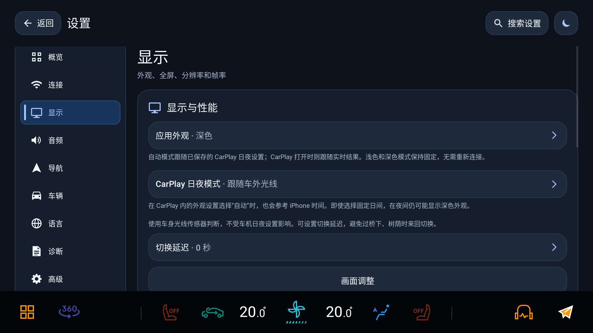

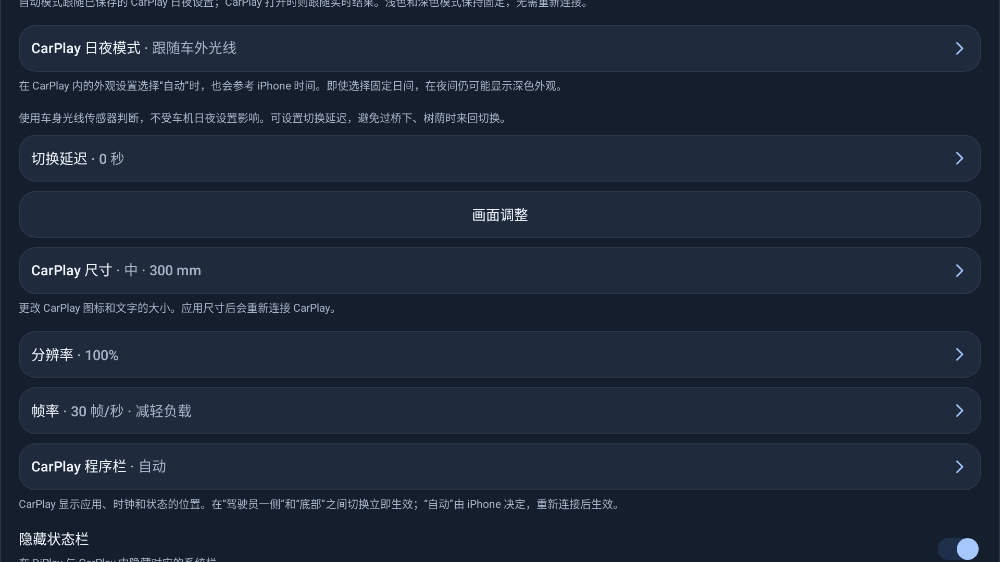

亿咖通车机上有 5 个选项（v143 起；这台车的 Android 主题锁定为夜间，所以不提供「跟随 Android 系统」）：

| 选项 | 依据 | 什么时候用 |
| --- | --- | --- |
| **跟随车机**（默认） | 车机最终的日夜结果，含车机设置里强制的白天/夜间，收到即切换 | 想和车机屏幕同步 |
| 跟随车外光线 | 车身光线传感器（`TwliBriSts`，只分日/夜），不受车机日夜设置影响；可设切换延迟（默认 0 秒） | 车机日夜设为强制时仍想按光线切，或想加防抖 |
| 定时切换 | 车机本地时间的起止，支持跨午夜 | 固定作息 |
| 固定日间 / 固定夜间 | 固定 | 调试或特殊场景 |

其他设备上另有「跟随 Android 系统」，排在第一个；「跟随车外光线」在没有车身传感器时改用 Android 光线传感器，并显示亮度门槛。

以前在亿咖通车机上选的「跟随 Android 系统」（也是旧默认值），升级后按「跟随车机」生效，诊断报告记录 `Night mode migrated`。

> v142 车测包的界面曾只列 4 项（没有「跟随车机」），车主说明的截图来自那一版。v143 起的正式版（含 v146）是上表 5 项，以 `carPlayNightModeChoices()` 为准。

**「跟随车机」怎么工作**

1. 主：读车机 AdaptAPI 的 `IDayNightMode`（启动时读一次当前值，之后靠回调）。
2. 冷启动时 AdaptAPI 约 8 秒内返回 0，期间先读车身光线属性 `0x21400305`，AdaptAPI 一给出有效值就以它为准。
3. 兜底：车机版高德的标准广播（`KEY_TYPE 10019`，`EXTRA_STATE 30=日 / 32=夜`）——没有当前状态查询，首次要等地图应用发；再不行跟随 Android 系统。

**刚启动、信号还没到时**：用 30 分钟内最近一次的日夜结果；没有就按「定时切换」的起止时间推测，不再沿用锁定为夜间的系统主题。

**实测延迟**：车身光线传感器自身判断约 3–4 秒；车机日夜结果在传感器变化后约 14 ms 跟上，DiPlay 再约 10 ms 发给 iPhone。车机日夜为「自动」时，两种跟随方式一样快；「跟随车外光线」的切换延迟只会再加时间，用来防抖。

**生效时机**：在设置里修改后立即生效，CarPlay 在后台时也会马上发给 iPhone。跟随类选项先用最近一次的结果，回到 CarPlay 后继续实时跟随。

**边界**：后端都靠反射调用，任何一步失败都不抛异常，只会退回下一层；诊断报告的 `CarPlay switched … reason=` 和 `Vehicle day/night …`、`Outside light …` 记录了实际依据和耗时。

**注意**：CarPlay 自身设置里若选了"自动"，它还会参考 iPhone 时间；即使你选了"固定日间"，夜间也可能显示为深色。

### 6.2 应用外观

**在哪开**：**设置 → 显示 → 显示与性能 → 「应用外观」**（深色 / 浅色 / 自动）。只影响 DiPlay 自己的界面，不影响 CarPlay 画面，切换**不需要重连**。

### 6.3 前台视频布局

系统栏显示时视频画面保持完整几何，不因系统栏高度变化重建会话。无开关。

v134 起，独立仪表地图窗口不再获取焦点，避免其在 CarPlay 后出现时，使车机顶部系统栏持续压在主画面上。系统栏是否隐藏仍由 **显示 → 显示与性能**的相应设置与车机固件决定；地图显隐后的实际画面仍需复测。

### 6.4 视频解码

「直接视频输出（实验性）」未保存过选择时默认开启，使用 SurfaceView 输出主屏，保留已有开关选择。画面调整不适用；需要画面调整时关闭此项及「流畅视频」并重新连接。「流畅视频」和「高通低延迟解码」仍默认关闭。默认直接输出不代表端到端延迟或所有前后台场景已完成实车验收。

以下开关在 **高级 → 视频与音频**，默认关闭。「流畅视频」改动会立即重新连接 CarPlay，另外两项下次连接生效。

| 开关 | 作用 | 出问题时 |
| --- | --- | --- |
| 流畅视频（实验性） | 按 iPhone 给每帧标的时间加一段自动调整的短延迟再显示主画面，滚动可能更均匀，触控响应会变慢。v147 起 HEVC 与 H.264 都向高通解码器请求按解码顺序立即输出（`picture-order`），被拒或出错会自动撤掉 | 关闭后重连 |
| 高效视频（HEVC） | 让 iPhone 改用 HEVC 视频格式 | 黑屏、花屏或卡顿时关闭 |
| 高通低延迟解码（实验性） | 向高通解码器请求私有低延迟模式，见[实车验证说明](QUALCOMM_LOW_LATENCY.zh-CN.md)。v147 起，一路视频回退后，同一次连接里之后新建的解码器（如仪表）也不再请求，下次连接再重新尝试 | 关闭后重连 |

**硬件解码器（v147 起）**：每路视频按名称创建高通硬件解码器。被拒绝（通常是硬件会话不够）时间隔 100／200／400 ms 重试 3 次，仍不行才改用软件解码并在报告中写明；之后定期检查硬件是否可用，可用时在下一个关键帧切回。此前 Android 9 会在被拒时自动换成 `OMX.google.*` 软件解码器，报告里看不出来。冷启动首次配置特别慢、期间帧队列溢出时，保留刚建好的解码器，不再重建一次。

---

## 7. 诊断

**权限检查**：进入 **设置 → 诊断 → 权限检查**，可查看平台签名、应用 UID、各项权限的实际授予和功能访问状态。支持只读刷新；未授予与系统未提供分开显示，检查结果也会加入导出报告。

### 7.1 保存诊断报告

**怎么用**：**设置 → 诊断 → 保存诊断报告**。报告包含连接、仪表、媒体、按键的关键判定行，可在没有 ADB 的车机上直接导出。

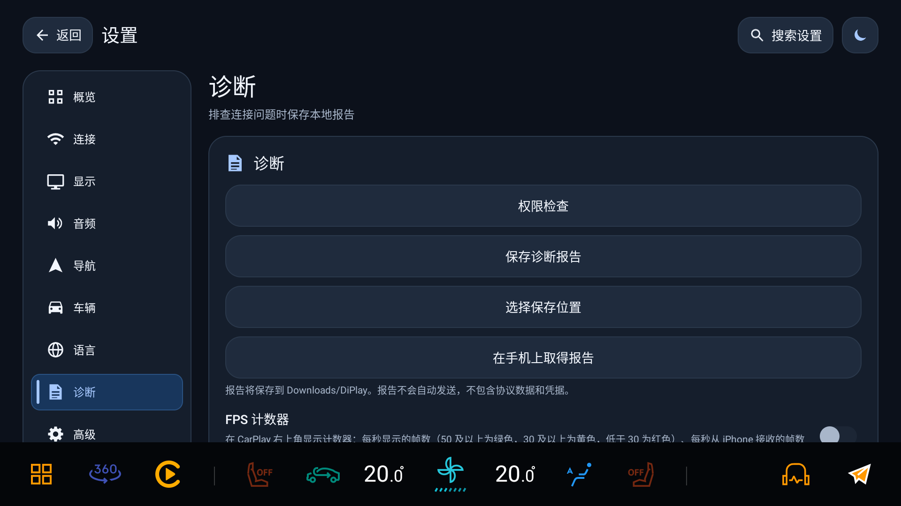

可保存到默认位置、选择保存位置，或在手机上取得报告；导出后确认拿到文件。复现前可开「调试日志」补充细节。普通模式会合并重复握手、音频、权限与 MQTT 记录，健康统计降低频率，关键变化与失败仍保留；日志变少不代表没有发生播报。报告不会自动上传。

### 7.2 报告里值得先看的行

| 关键词 | 说明 |
| --- | --- |
| `Cluster map:` / `Cluster lifecycle:` / `DIM guidance started` | 仪表画面、宿主生命周期与 DIM 导航是否真的起来了 |
| `transport=wireless` / `transport=wired` | 当前实际走的通路 |
| `USB fallback pending` / `USB detached: wireless preference` | USB 拔出后的回落判定 |
| `iap2 rx=0x4e0d wireless-carplay-update available=false/true` | iPhone 是否同意无线 CarPlay（false = iPhone 侧拒绝） |
| `iap2 no wireless transport after 60000ms` / `wireless CarPlay never started` | 60 秒等待窗口到点，界面已给出明确失败原因 |
| `bootstrap phase=` / `bootstrap stall` | 握手到达和缺失的阶段；与超时提示一起区分蓝牙链路、认证或手机未响应 |
| `Wireless startup timeline` / `LAUNCHER_FIRST_BATCH` | 开机、热点、握手、首帧及稳定帧的开机后时间点；`LAUNCHER_FIRST_BATCH_MISSED` 表示未等到桌面首批服务广播 |
| `Wireless startup metrics` | 按开机、进程、控制器和连接代次汇总首帧与稳定帧耗时；缺少证据显示 `unknown`，口径见[启动采样](CARPLAY_STARTUP_SAMPLING.zh-CN.md) |
| `Car Wi-Fi client:` / `softApClients=` | 车机 Wi-Fi 保存状态、热点保护开关和热点客户端数；结合握手日志判断手机是否接入，`unknown`／`unavailable` 不等于零客户端 |
| `navigationFollowsIphone=` / `Audio: navigation route=` | 导航是否跟随手机，以及 `car`／`music` 实际通道，结合手机地图的压低／共存模式判断 |
| `car hotspot still off; waiting for the car to turn it back on` | 熄火下车后在等车机恢复热点，属于预期的被动等待，见 [2.2](#22-自动连接) |
| `Screen, car power and media commands` | 屏幕与主屏电源、整车使用模式、车门、音频焦点、iPhone 播放状态与每条媒体命令的来源；`Music pause trigger=` 记录暂停开关是否发出 |
| `Night guess … basis=` / `CarPlay switched … reason=` | 冷启动日夜推测的依据和每次切换的原因 |
| `Video: decoder=` / `Video stream=111: decoder=` | 主屏与仪表各自的解码器和尺寸（v147 起仪表行带 `stream=111`，仪表应为 `size=1920x720`） |
| `software decoder fallback` / `available again` | 硬件解码器被拒后改用软件解码，以及之后切回硬件 |
| `video fanout` / `mirrors share this decoder` | 仪表地图同时显示在别处时共享解码器的绘制统计，每 5 分钟一行 |
| `QTI low-latency fallback … for this session` / `decoder kept, no frame queued yet` | 高通低延迟回退的范围，以及冷启动溢出时保留了解码器 |

### 7.3 排错表

| 现象 | 最可能的原因 | 动作 |
| --- | --- | --- |
| 仪表没有箭头 | 「HUD／仪表导航提示」没开，或车机未识别为亿咖通 | 确认卡片存在 → 开启开关 → 重新开始一次导航 |
| 开了镜像后箭头/歌曲没了 | 整屏镜像盖住了仪表卡片 | 关闭「整屏镜像到仪表」 |
| 声道不对、音乐从手机出 | 蓝牙媒体让位与"通过车辆蓝牙播放"配置冲突 | 按 [4.2](#42-蓝牙媒体让位默认开启) 重设后重连 |
| 导航无声、音乐过低或播报时顿一下 | 播报模式、导航音量或声音通路不合适 | 确认「导航声音跟随 iPhone 和车机」已开启并重连，核对手机播报模式和车机导航音量，见 [4.4](#44-导航播报与音量) |
| 焦点、导航音量或导航音频流设置不见了 | 跟随 iPhone 和车机时隐藏手动项 | 优先在车机调导航音量；需手动排查时先关闭跟随开关 |
| 车机不自动连接其他 Wi-Fi | 自动热点默认保持车机 Wi-Fi 客户端关闭 | 关闭「保持车机 Wi-Fi 关闭」；CarPlay 正用热点时延后到下次车辆启动恢复 |
| 冷启动后仍停在首页或 Siri 键无反应 | 配置未满足直达条件，或车机服务尚未启动 | 核对 [2.2](#22-自动连接) 的条件；从冷启动记录到异常，保存报告并注明短按／长按 |
| 插线仍切走无线 | USB 自动接管开启，或默认连接方式为 USB | 在 **连接 → 自动连接**核对两个设置；关闭接管仍异常时保存报告 |
| 日夜不跟车 | 车机没有日夜信号，退回了系统 | 保存诊断报告，查看 `Vehicle day/night backend=` 和 `reason=`；临时可改用「定时切换」 |
| 无线一直卡在连接 | iPhone 拒绝或未发起传输 | 看 [2.5](#25-连接失败原因怎么看) 的提示文案 |
| 先用 USB 连过，之后改走无线就一直卡 | iPhone 上这台车的记录是有线建立的，iOS 拒绝无线 | 删掉 iPhone 里的本车记录 → 重新配对 → **第一次走无线** |
| 拔了 USB 没回到无线 | 无线可能未开启；首次 USB 建立的本车记录也会阻止无线连接 | 确认无线已开启；如首次通过 USB 建立记录，按上一行移除并重配 |
| 熄火下车再上车后一直「连接中」 | 在等车机恢复蓝牙或热点 | 等车机蓝牙、热点恢复即可；要立即重连就返回 DiPlay（会取消等待）再连接；超过 1 分钟仍不出画面时保存报告 |
| 更新提示下载失败或读不到更新说明 | GitHub 或加速站不可达 | **设置 › 关于 → 下载来源** 换一个来源后重试 |
| 首页提示没有认证身份 | 公开包不含 MFi 身份，或清除过数据 | 按 [1.4](#14-安装升级与认证身份) 导入身份文件 |
| 挂断后音乐/导航声没恢复 | 通话状态没被清掉（音频模式仍非正常）或焦点未回归 | 重新连接一次 CarPlay；若复现，保存诊断报告并记录时间点 |

---

## 8. 三种推荐配置

### A. 只要导航提示（最省事）

- 导航 → 亿咖通导航：**HUD／仪表导航提示** 开
- 开始导航时自动显示仪表地图：**关**，需要完整地图时用仪表显隐操作展开
- 整屏镜像到仪表：**关**
- 音频 → 车机媒体集成：**DiPlay 直接接管**（默认）
- 日夜模式：跟随车机

### B. 导航 + 音乐完整

- 导航 → 亿咖通导航：**HUD／仪表导航提示** 开；手机提供的有效车道随提示输出
- 音频 → 车机媒体集成：**DiPlay 直接接管**；如果安装了 HYWebview，在 HY 关闭媒体接管和同一语音键的方控接管
- 音频 → 音频路由 → 声音异常排查：**CarPlay 期间停用蓝牙媒体** 开；**通过车辆蓝牙播放 CarPlay 音频** 关
- 音频 → 音频路由：**导航声音跟随 iPhone 和车机** 开；在手机地图选压低或共存，在车机调导航音量
- 连接 → 自动连接：按需要设置启动、打开时连接和已选 iPhone 蓝牙重连时自动连接；后两者的触发方式不同
- 车辆 → 方向盘按键：**方向盘唤醒 Siri** 开，按需要选短按或长按
- 日夜模式：跟随车机（亿咖通车机默认）

### C. 排错 / 车测

1. 诊断 → 保存诊断报告（先留一份基线）
2. 每次只改**一个**开关，改完重连一次
3. 记录：改前现象、改后现象、报告文件名、时间点
4. 涉及仪表的改动，同时记录仪表实际显示（截图或视频），因为 DIM 调用成功不等于画出来了

---

## 9. 已知边界与未验证项

| 项 | 现状 |
| --- | --- |
| 导航声音 | ECARX 默认跟随手机与车机；车机导航通道的音乐压低幅度由车机决定，共同播报通路只能相对媒体音量调低。仍待实车复测 |
| 自动热点与车机 Wi-Fi | 默认关闭车机 Wi-Fi 客户端以保护热点，会影响自动连接其他网络；关闭保护项可恢复，热点正在使用时下次车辆启动恢复 |
| 开机直达与方向盘 Siri | v134 起先等车机桌面服务，最多 5 秒；冷启动与短按 Siri 尚待验收，不承诺固定启动耗时 |
| USB 连接 | v122 的插线只充电／开关开启后切有线已实车确认；USB 卡顿和取消授权后的回退仍未解决，v146 尚需回归 |
| 先 USB 后无线 | 首次用有线建立的本车记录可能让 iOS 拒绝无线；DiPlay 给出具体提示，不盲目重试，须在 iPhone 上删记录并先走一次无线 |
| 仪表箭头或距离异常 | 当前工作区改为停包接管，先核对停包是否成功及导航输入；仍需实际行驶验收，见 [导航接管决策](NAVIGATION_TAKEOVER_DECISION.zh-CN.md) |
| 车道指引 | v109 模拟器已验证苹果与百度的车道显示。高德采集没有车道帧，实际行驶效果待验证。 |
| 自定义方向盘按键 | **本版不提供学习**：通过总开关及当前模式的 Siri 选项设置，其余按键保持固定功能 |
| 热点 5 GHz | 只在 Android 9 车机验证；写 `apBand` 失败会静默回落 |
| 日夜「跟随车机」「跟随车外光线」 | 依赖车机 AdaptAPI、车身光线属性与高德广播，都没有时退回系统；冷启动先显示推测值 |
| 未导航时也显示仪表地图（v148） | 单元测试覆盖显示、隐藏、路线结束保留与关闭释放；各地图无路线时的仪表画面待实车确认 |
| 熄火后交还声音、仪表共享解码、硬件解码重试（v147） | 单元测试与台架验证，实车待测 |
| 熄火下车后自动重连 | 等待蓝牙恢复（v141）、等待热点恢复及宿主重建后继续等待（v143）只在小米 8 台架验证，实车待测 |
| 日夜「跟随车机」冷启动 | v143 的冷启动推测待实车验证；实车只确认过 v136 收到信号后 25 ms 内切换 |
| 应用内更新 | v143→v144→v145→v146 的 Release 链路依赖 `update.json`；车机网络下各下载来源的可用性未逐一实测 |
| 实车验收 | 历史电话接打与声音避让、v122 USB 两条路径、v141 两个暂停开关有实车记录；不能外推为 v148 全部通过。导航声音、热点保护、开机服务、仪表显隐及 v145 的仪表安全区默认值仍需验收 |
| 多语言 | 仅英文 / 简体中文 / 繁体中文；其他语言界面回落英文 |

---

## 10. 这份文档还缺什么

1. **v148 实车逐项回归**：历史截图、手机台架和模拟器证据不能替代本版仪表显隐、导航与媒体的实车验收，仍需记录车型、固件与通过／失败结果。
2. **媒体卡片所需权限的准确清单**：现在只写"需要兼容固件与权限"，具体是哪几个 DIM 权限需要在车机上抓一次。
3. **导航声音与开机回归**：分别覆盖无音乐首条播报、播放音乐时压低／共存、两种模式交替，以及冷启动后热点、语音键和稳定首帧；当前实现见 2.2、2.3、4.4。
4. **完整英文手册**：README 已提供英文摘要与本页链接，详细正文目前只有中文。
5. **v146 实车截图**：媒体模式改名后的音频页与方向盘页、关于页（更新、下载来源、备份）及 MFi 导入界面尚无实车截图。
