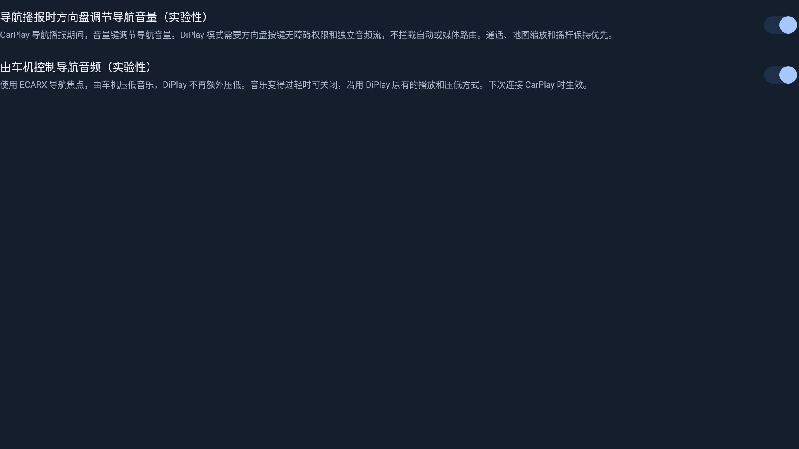
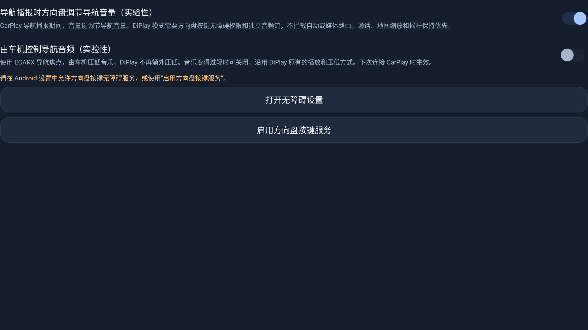

# Navigation guidance volume keys

Original contribution: 寒叙 (@Hanxu4131). This document describes the current ECARX port; installation uses the [platform permission path](ADB_AND_PLATFORM_PERMISSIONS.zh-CN.md).

## Problem and firmware evidence

The target problem is a spoken navigation prompt whose volume keys still change music volume. On ECARX 753 / Qualcomm 820A (Android 9 / API 28), requesting navigation focus alone does not establish the vendor's navigation-volume selection state. This PR adds an optional car-owned backend; the existing DiPlay backend remains the default because the car's focus/DSP policy can attenuate music excessively.

The recovered `CarAudioImplDCY11.getSuggestedAudioUsage()` checks call and priority-voice states first, then returns navigation usage 12 only when `mCPDuckingState && AudioManager.isAlternateAudioOn()` is true. Otherwise it chooses among active playbacks. The CarPlay duck receiver sets the first state; the contentType 33 focus path toggles the second without becoming an ordinary focus-stack owner. A successful request alone therefore does not prove the mode is on. Both `Car.AUDIO_SERVICE` and `Context.AUDIO_SERVICE` name the same `"audio"` service in this firmware.

`setCarPlayDuckVolume()` acts on the group selected by `getCurrentAudioPeekInfo()`, which reflects the current focus-stack top. It does not unconditionally select the media group. Its saved/restored volume and repeated-duck behavior explain why reproducing the original percentage-based broadcast can alter the wrong group or lose a wheel adjustment. DiPlay now sends zero depth and retains navigation focus; it does not infer that removing navigation focus is safe.

The evidence comes from the locally recovered `CarAudioImplDCY11` and `MediaFocusControl` implementations (2026-10-31 / 11-02 / 11-07). These are source-level findings, not acceptance of this PR on a real car. The [platform notes](ECARX_753_PLATFORM_NOTES.zh-CN.md) register the interfaces and their validation boundary.

## Version context

| Baseline | Relevant behavior |
| --- | --- |
| v124 `50829942`, v125 `950e9470` | v125 was the PR #46 Soft AP observer test package, not a new audio backend. Both used configured navigation routing and duck/unduck-driven temporary focus. |
| v128 / v129 `98e99167` | The relevant sink and prompt-focus implementations match v125. The later v129 car investigation recorded inaudible common prompts without duckAudio/focus; that history cannot establish that focus-free route 0 works now. |
| Later `b4d1b805`, `455d719e` | Audible-PCM-based prompt lifetime replaced open-stream lifetime; follow-iPhone routing selects the car or music route. This is part of the retained DiPlay policy, rather than functionality first introduced by this PR. |
| PR base `f3e7f852` | The precise pre-PR comparison for the off mode. The new car-owned preference is separate, defaults off and does not rewrite the prior focus settings. |

Version codes alone do not identify source: v125 and v129 were package-time overrides. Their local package build-source records establish the commits above; no private package or authentication asset is included here.

## Enable and use

Under **Settings → Advanced**, enable **Wheel volume during navigation guidance (experimental)**. On ECARX, an additional **Let the car control navigation audio (experimental)** switch selects the audio backend. It defaults to **off** and applies at the next CarPlay connection.

| Car audio control | Playback and ducking |
| --- | --- |
| Off (default) | Preserve the pre-PR DiPlay playback, routing, focus and ducking behavior. Existing settings retain their values. No ECARX alternate request or CarPlay duck broadcast is added. |
| On | Use the separate car navigation channel (route 0) for every prompt, request navigation focus, and let the car lower music. DiPlay adds neither percentage-based broadcast attenuation nor a second media PCM duck. If the car makes music too quiet, turn this switch off and reconnect. |

The off mode retains the existing accessibility-service key routing: only an active prompt with an identifiable separate legacy stream can be captured. Automatic/usage routing, media stream 3 and ambiguous routes pass through. That path requires wheel-key accessibility permission. Calls, zoom and joystick retain priority; consumed DOWN/repeats/UP remain paired.

The on mode uses the car's volume-key selection. During guidance and its buffered tail, the vendor marker selects navigation usage 12 (group 1), subject to the car's higher call/voice priorities. Guidance without an iPhone duckAudio command is also marked. Silence and prompt cleanup restore normal key targeting. This backend does not require accessibility-service interception for route 0.

## Implementation boundaries

- The saved `navigation_car_audio_control` preference is independent of the existing focus preferences. The host activates it only when navigation volume keys are enabled and ECARX is identified. Only that combination supplies the vendor adapter, forces navigation focus, pins route 0 and delegates ducking. The off path uses the original configuration.
- Rust `media::audio::scheduler` retains routing and gain policy. `NavigationPromptFocus` executes the existing duck/audible/tail/timeout decisions for both the car focus request and the vendor marker, without another prompt timer. No new software-duck algorithm or amplitude setting is introduced.
- `EcarxCarPlayAudioHandshake` reads `AudioManager.isAlternateAudioOn()` before a contentType 33 toggle, adopts an existing on state, and verifies the mode after requesting it. Unknown state does not justify a toggle. Only its own request is abandoned. Diagnostics distinguish mode reads from successful requests or broadcast sends.
- `com.lge.ivi.cp.action.CAR_PLAY_DUCK_COMMAND` always uses **volume=0**: the broadcast marks the prompt without requesting music attenuation. While the marker is active, a duckable focus loss does not add DiPlay media PCM attenuation. Transient-loss mute and denied-focus mute remain in force.
- Even at zero depth, the vendor receiver saves/restores a focus group's volume index. Before unduck, a zero-depth marker refreshes the snapshot to preserve navigation volume changes made during guidance. Repeated active notifications do not resend markers. Close clears the marker and prevents late callbacks from reopening the mode.

## Validation

Automated checks cover the default-off preference and preserved legacy choices, backup round trips, both backend settings layouts at 1920×1080, routing, actual focus outcomes, platform-owned ducking, alternate adoption/rejection/unknown state, zero attenuation, repeated marks, adjusted navigation volume, tail/timeout and close.

Local verification on 2026-11-18:

- Targeted JVM checks: shared **122**, common **26**, total **148 passed**, no failures or skips. These are selected tests, not a rerun of the full suite.
- Rust `media::audio::scheduler::tests`: **16 passed**.
- ARM64 native build and ELF/JNI checks: **638 Java exports plus JNI_OnLoad**; `:mobile:lintDebug` and `:mobile:assembleDebug` passed with matching native inputs. Other Android ABIs were not rebuilt. The ordinary debug APK is not a platform-signed, MFi-equipped vehicle acceptance package.
- `git diff --check` passed; the two native-graphics settings captures below use 1920×1080 landscape. UI rendering is simulated and does not establish real-car behavior.

```sh
./gradlew --offline --no-daemon \
  :shared:testDebugUnitTest \
  --tests '*EcarxCarPlayAudioHandshakeTest' --tests '*NavigationPromptFocusTest' \
  --tests '*AudioFocusAutoYieldTest' --tests '*NavigationAudioRouteTest' \
  :common:testDebugUnitTest \
  --tests '*AudioFocusSettingsTest' --tests '*SettingsBackupCodecTest' \
  --tests '*EcarxSettingsScreenshotsTest.navigationAudioBackendChoiceFitsTheCurrentHeadUnit' \
  --tests '*SettingsTranslationsTest' --tests '*TraditionalChineseTranslationsTest' \
  --tests '*SettingsLayoutSourceRulesTest' :mobile:lintDebug :mobile:assembleDebug
cargo test --locked --offline --manifest-path shared/src/main/rust/diplay-media/Cargo.toml media::audio::scheduler::tests
# ANDROID_NDK_HOME must point to the installed NDK 28.2.13676358.
scripts/check_rust_android_native.sh arm64-v8a
```





Real-car acceptance remains required:

1. With the switch off, compare against the pre-PR package using the same saved settings. Confirm original playback and ducking and no vendor handshake signals.
2. With it on, confirm the first navigation prompt after cold boot is audible without music, then repeat with music playing.
3. During guidance, check `isAlterAudioOn=true`, `isDucking=true`, suggested usage 12 and group 1 changes from volume keys. The new navigation level must remain after guidance ends, including when navigation was already atop the focus stack.
4. Check for a single car-owned attenuation, common prompts without duckAudio, buffered tails, missing-unduck timeout, disconnect and normal key targeting afterward. Record routing/DSP and app-restart behavior separately.

The private broadcast is not a pure state-only API: the receiver still writes the focus group's index and clamps a ducked result to at least 1 even when `volume=0`. Include an initially muted/zero-volume case in car acceptance. Its global duck state also has no firmware timeout; app death or a failed cleanup broadcast must not be mistaken for verified recovery. The local tests cover normal close and a surviving process's prompt timeout, not cleanup after process death or interference from another vendor client.

Historical confirmation of the accessibility feature does not establish acceptance of the new car backend. See the [acceptance matrix](RUST_CORE_REMAINING.zh-CN.md).
