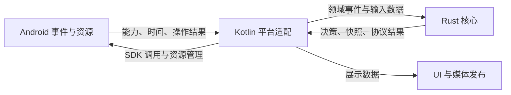
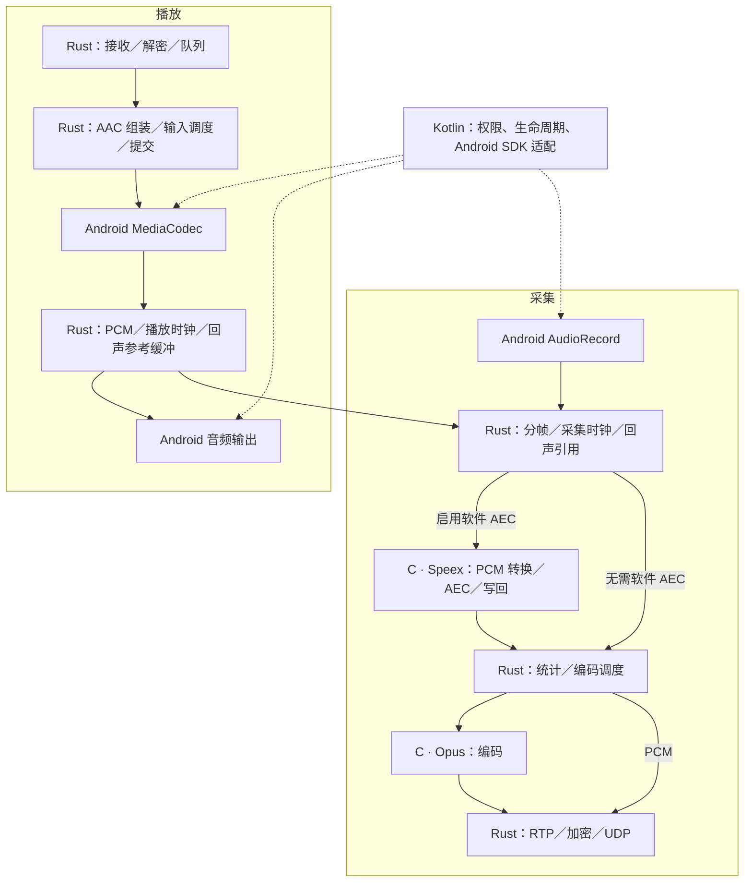

# Rust 与 Kotlin 职责收敛方案

现有 Rust 核心主体迁移已经完成。下一步围绕仍在 Kotlin 中的协议语义、媒体决策，以及不必要的 JNI 往返做局部收敛：Rust 负责核心规则和逻辑状态，Kotlin 负责平台资源、实际操作及结果。以完整职责为迁移单位，不以 Rust 代码占比或 Kotlin 文件行数衡量进度。

最初按歌曲状态、普通音频 feedback、视频控制邮箱、媒体协商、音频焦点和 JNI 门面的顺序安排；音频输入准备与麦克风 PCM 原列后续可选项。用户随后明确授权 AAC 输入和连续原生采集链，当前范围以下方实施清单为准。2026-11-15 又授权根据工作区 dump 提出的四项候选，列为 I–L。

## 基线与范围

- 分析日期：2026-11-14。`dev` 基线为 `21459bb60c0e548353b6abb035da0a343870dd42`，包含 PR #114；对应本地源码 HEAD 为 `368cf10353f96b13e2747d03cd30fe3c4cef8cda`。本方案涉及的生产 Kotlin／Rust 源码与该 `dev` 基线一致。
- 本文保留最初的 A–H 工作包与职责约束；代码实施范围见下表。当前归属见[架构说明](ARCHITECTURE.zh-CN.md)，实施约束见 [AGENTS.md](../AGENTS.md)。历史迁移分支和已关闭议题不作为新任务入口。
- 用户已确认现有测试足够。本方案不重开既有验收，不安排重复长测、回放或故障注入；[验收矩阵](RUST_CORE_REMAINING.zh-CN.md)与原始记录保持其原有范围。后续代码变更只验证其实际影响，不把本方案当作新测试已通过的记录。
- 保持 Android 9／API 28、ECARX 753、现有 ARM64／ARMv7 分发及 x86_64 测试构建边界；保留路由、平台 AEC 与设备校准。2026-11-15 用户进一步要求完整原生数据链且不保留 Kotlin 回退，因此删除麦克风 Java socket／SDK 编码器后备；其他硬件能力适配保持原义。
- 方案最初仅记录设计；后续实施按独立 PR 交付，不新增算法库或扩展产品功能；G/H 复用既有 SpeexDSP、libopus 与锁文件中的 cc 构建工具。

## 实施清单（2026-11-15）

前两批 A–F 已在下列 PR 中实现；G 的 AAC 输入与 H 连续采集链已由 [#122](https://github.com/jianyun8023/diplay-ecarx/pull/122) 合入 `dev`。用户随后授权 I–L，当前工作分支已实现如下边界。“已实现”指代码范围，不代表新增实车验收；各 PR 的合并与 CI 状态分别记录。[#115](https://github.com/jianyun8023/diplay-ecarx/pull/115) 承载本方案、原 #114 验证记录及对应设备测试入库。

| 工作包 | 实施状态与 PR | 已落实的职责边界 |
| --- | --- | --- |
| A | 已实现：[#116](https://github.com/jianyun8023/diplay-ecarx/pull/116) | Rust 持有独立 GlanceSong 投影与 GC 值 token；Kotlin 负责组合、裁剪和发布。保留 600 步对拍，空白字符行为与 Kotlin 一致。 |
| B | 已实现：[#117](https://github.com/jianyun8023/diplay-ecarx/pull/117) | 普通音频 feedback 锚点、sampleTime 和单流回复归 Rust；Kotlin 读取时钟并提交实际启动事实，buffered 保留独立语义。 |
| C | 已实现：[#118](https://github.com/jianyun8023/diplay-ecarx/pull/118) | Kotlin 仅保留 VideoControlMailbox；帧队列与清链归 Rust，旧队列语义仅用于测试替身。 |
| D | 已实现：[#121](https://github.com/jianyun8023/diplay-ecarx/pull/121)，依赖 B | SETUP 解释、回复布局、HKDF 字节和麦克风参数归 Rust；流 ID 按 session 分配。现有协议门面将 native Map 转成具名音频、麦克风及数据流计划，engine 使用明确字段并管理平台资源。仅 telephony 等待下行，其余合格输入流保留 500 ms 静默启动。 |
| E | 已实现：[#120](https://github.com/jianyun8023/diplay-ecarx/pull/120) | Rust 决定焦点优先级、请求意图和目标增益；Kotlin 持有对象表、generation 守卫及 appliedVolume。平台设置音量失败后，同目标回调仍可重试。 |
| F | 已实现：[#119](https://github.com/jianyun8023/diplay-ecarx/pull/119)，依赖 #115 | Artwork event/数组布局和发布位掩码封装为具名结果；Rust/JNI 签名不变，Bitmap 生命周期与发布提交顺序留在 Kotlin。#115 的设备测试同步迁移到新门面。 |
| G | 已实施：AAC 输入 | Rust 组装 ADTS＋payload，并复用原输入泵完成 MediaCodec 输入获取、重试与提交；保留 Google AAC 配置、输出排空和包释放。 |
| H | 已实施：连续原生采集链 | Rust 持有分帧残留、采集时钟、逐帧 echo 引用、统计窗口、编码／RTP／加密和 UDP socket；Speex C 原地处理 PCM。删除 Kotlin 数据处理、Java 发送及 SDK Opus 编码回退。 |
| I | 已实施：ECARX MQTT 与投屏消息 | `protocols::mqtt` 负责 framing、ACK、packet ID、JSON 生成／解释、发布重试／去重和订阅观察状态；Kotlin 保留平台 JSONObject／UTF-8 适配、Socket、锁、执行器与诊断。 |
| J | 已实施：HUD 发布策略 | `vehicle::hud` 持有投屏意图、快慢重试、32 项车道缓存、发布快照、差异／刷新／清理计划；Kotlin 保留 DIM 调用、实际成功提交和持久设置。 |
| K | 已实施：AirPlay 控制通道缓冲 | `protocols::rtsp::Input` 持有加密／明文残留，复用原 cipher 的计数与解析限制，只输出完整 DTO；Socket 收发、上层事件仍在 Kotlin。 |
| L | 已实施：下行音频控制链 | `media::audio::renderer` 统一 LPCM／AAC／Opus 分派、SDK codec 配置字节、输入／输出循环与 PCM 缓冲；libopus／SDK 解码能力选择由 Rust 决定，Kotlin 保留 SDK 对象与硬件操作。 |

合并依赖为 #115 → #119、#117 → #121；父 PR 合并后，子 PR 改向 `dev`。实施和评审修复的验证记录放在各 PR：主机 JVM/Rust 测试、androidTest 编译、Android ABI 构建与实机验收分别记录，不相互替代。A–E 的 JNI 导出变更同时修复构建检查：按 Rust 声明逐项核对实际导出，保留 JNI_OnLoad、ELF 和各 ABI 导出一致性校验，避免旧固定总数阻塞合法的接口增删。

既有验收矩阵保持原范围；G/H 新增的小米手机验证单独记在下方，不追认为实车验收或性能收益。

## I–L 的实施约束与交付

基线为 G/H 合入后的 `23838d88829b5b62cc99bf5d311ed9ac692ca4ba`。保留最初清单与 A–H 历史，I–L 的源码、合同与设备记录单独见[本轮实施记录](benchmarks/native-platform-boundaries-2026-11-15.md)。四项均要求原生核心，不新增依赖或 Kotlin 算法回退。

- MQTT 保留原发布端宽松 ACK、观察端严格 ACK、三字节 remaining-length 上限和独立 client ID。投屏只在 PUBACK 成功后提交；ongoing 保留排队前去重；失败连接不消耗发布重试，失败发布仅断开后再试一次。
- HUD 保留实际 SDK 调用和提交时点：先持久化清理责任再打开投屏，成功隐藏后才清除标记；半成功发布仍进入清理。快重试 2 秒／30 次后转 10 秒，刷新周期 5 tick，缓存保护当前车道索引。
- 控制／event 读取器分别持有 native 残留，借用当前 cipher；加密／解密计数独立，关闭与使用仍串行，接收长度和 ProtocolException 边界不变。控制 Socket 下沉留作后续选择。
- 音频输出采用 worker 独占的 Rust PCM 缓冲；JNI 直接驱动既有 MediaCodec，不更换硬件路径。复制异常仍释放输出，释放异常遵循 Java finally 优先级，完成释放后才同步借出 PCM 写声卡。跨 Java 回调前结束 Rust 可变借用，因为写入回调会重入 PCM DSP。没有 Kotlin PCM 工作缓冲或输入／输出算法副本；AudioTrack／AAudio、焦点、路由、增益与 SDK 能力兼容保持原义。

## 目标职责

| 层 | 负责 | 边界上的输出 |
| --- | --- | --- |
| Rust 协议与会话 | 字段解释、协议回复、增量状态、逻辑代际、重试与超时规则 | 协议结果、状态快照、下一步动作 |
| Rust 媒体 | 帧／包队列、时间锚点、背压、核心焦点策略、PCM 处理与编码策略 | 输入准备结果、目标增益、处理结果与计数 |
| Kotlin 平台适配 | SDK 对象、权限、线程／锁／取消、时钟读取、资源创建和关闭、实际操作结果 | 能力、事件、平台成功／失败事实 |
| Kotlin 展示与发布 | UI、文本排版、Bitmap 生命周期、MediaSession／Binder 发布 | 平台可见的展示和操作 |
| 已有 NDK／C 适配 | 原生视频循环、AAudio、Speex 等已接入能力 | 保持既有原生实现及校准 |

核心规则只有一个决策方；平台资源仍有自己的状态。Kotlin 保存当前 `AudioFocusRequest`、已成功应用的音量、待执行 Runnable、图片引用或 Socket，不等于重复核心状态，不应为追求“无状态宿主”把这些对象寿命搬到 Rust。

跨边界遵循三条规则：

1. 在拥有外部输入的边界完成校验，向内传递明确的数据；业务调用方不继续猜测 `Map<String, Any?>` 字段或 native 数组布局。
2. Rust 给出决策，平台执行，按原有时点提交实际结果。计划成功不能代替 SDK 成功；不确定结果和过期对象仍由现有平台保护处理。
3. 使用现有 owner、门面和基础库。避免一个算式一次 JNI、通用命令总线、全仓接口重写或为迁移新建一套运行时。

## 工作包与顺序

| 工作包 | 内容 | 方向 | 顺序 | 相对改动量 |
| --- | --- | --- | --- | --- |
| A | Glance 歌曲协议状态 | Kotlin → Rust playback | 第一批 | 中 |
| B | 普通音频 feedback | Kotlin → Rust audio | 第一批 | 小至中 |
| C | 视频控制邮箱 | 平台控制交接留 Kotlin，帧队列留 Rust | 第一批 | 小至中，含测试替身调整 |
| D | SETUP 与麦克风配置规则 | Kotlin → Rust airplay／audio | 第二批 | 中 |
| E | 音频焦点策略 | Kotlin → Rust audio | 第二批 | 中 |
| F | JNI 门面与具名结果 | 在现有门面隐藏传输布局 | 随对应工作包完成 | 小至中 |
| G | 音频解码输入准备 | 收拢到既有 Rust 媒体能力 | 后续可选 | 中 |
| H | 麦克风 PCM 连续处理 | Kotlin → 既有原生处理链 | 后续可选 | 大，涉及 Speex 连接 |

改动量用于拆分任务，不代表工期或性能收益。A、B、C 可独立交付；D 承接 B 的时间／回复边界；E 不依赖麦克风管线迁移。F 优先随调用接口变化一起完成，封面门面的清理也可单独交付。G、H 不阻塞前两批。

## A 收敛 Glance 歌曲状态

[ClusterSongState](../shared/src/main/java/com/shihab/diplay/hud/ClusterSongState.kt) 在 Kotlin 中解释 `0x5001` 的标题、歌手和播放状态，并保存增量更新。它由 [CarPlayGlance](../shared/src/main/java/com/shihab/diplay/glance/CarPlayGlance.kt) 使用。[CarPlayController.onRouteFrame](../shared/src/main/java/com/shihab/diplay/orchestration/CarPlayController.kt) 同时将消息交给这条路径和已经使用 Rust 的 [CarPlayPlaybackStatus](../shared/src/main/java/com/shihab/diplay/media/CarPlayPlaybackStatus.kt)。

**目标：** 将歌曲协议字段的解释、保留与清空逻辑归入现有 [session/playback](../shared/src/main/rust/diplay-media/src/session/playback/mod.rs)。复用底层解析能力，明确主媒体与 Glance 两种状态投影；不要另建一套 Rust iAP2 解析器，也不因复用而强制合并不同输出的生命周期。

Kotlin 保留不可变展示 DTO、原有平台字符串转换、标题与歌手组合、输出长度裁剪、监听器和 Widget 发布。优先沿现有门面接入，避免为了复用协议解析而改造整个 Glance 导航入口。

**必须保持：** 缺失字段保留旧值，显式空标题的行为，以及异常字段的容错语义。Glance 当前在播放状态为 1／3／4 时认为正在播放，主媒体只在 1 时为 true；Glance 的空标题还会清除保留的歌手。现有主媒体快照缺少这些差异所需的信息，不能直接用它的 `playing` 和文本替换 Glance 状态。输出格式及 UTF-16 裁剪不随迁移变化。

影响入口为 Controller、两种 playback 门面、Glance 及其测试；`NavigationWidget` 等消费者应保持现有快照契约。完成后，生产 Kotlin 不再独立实现歌曲协议字段的状态转换，两种消费者的行为差异有明确归属。

## B 统一普通音频 feedback

[CarPlayMediaEngine.onFeedback](../shared/src/main/java/com/shihab/diplay/airplay/CarPlayMediaEngine.kt) 仍在 Kotlin 中用首个 RTP sample、单调时间、播放延迟和 RTP 时钟计算 `sampleTime`，处理无符号 32 位回绕，并组装回复。Rust [audio/route](../shared/src/main/rust/diplay-media/src/media/audio/route.rs) 已处理接收反馈信息，[audio/buffered](../shared/src/main/rust/diplay-media/src/media/audio/buffered.rs) 已拥有 buffered 回复与时间换算。

**目标：** 让 Rust 拥有普通音频 feedback 的锚点／计算和回复语义。优先扩展现有 audio owner；Kotlin 在原有时点提供时钟、实际流启动和平台资源事实，取得完整的单流反馈结果，再完成必要的发送。普通与 buffered 流各自保留不同的时钟语义，不为共用接口强行合并状态。

**必须保持：** 使用 RTP 时钟而非解码输出采样率；启动前缺失锚点时的字段省略、延迟扣除后不小于零、原有舍入与 32 位回绕，以及 `streamConnectionID` 的无符号表示。平台取时次数和顺序、各流独立状态、已有诊断节流也不能随移动改变。既有注释记录过 16 kHz 通话被按 48 kHz 计算、反馈跑到音频前面的实际问题，这条约束应随核心实现保留。

影响 `CarPlayMediaEngine` 的 `AudioMeta`、启动回调、`onFeedback`、`NativeAudioRoute`／对应 native 入口及回复契约。完成后，Kotlin 不再维护一份可独立计算反馈位置的算法；已有 buffered 行为不受影响。

## C 简化视频控制邮箱

[VideoDecoder](../shared/src/main/java/com/shihab/diplay/media/VideoDecoder.kt) 已将视频帧直接送入 `NativeVideoPipe`。其 worker 邮箱只接收配置、Surface、镜像、Detach、刷新和 native 事件，但 [VideoDecodeQueue](../shared/src/main/java/com/shihab/diplay/media/VideoDecodeQueue.kt) 仍使用 JNI 连接旧的混合队列，带有 Frame、Resync、帧预算和参考链清理操作。

**目标：** Kotlin 使用符合现有中断／唤醒契约的简单控制邮箱；生产视频帧队列、背压和参考链继续完全属于 [vpipe](../shared/src/main/rust/diplay-media/src/media/video/vpipe.rs)。删除生产控制路径中不再承载帧的预算与清链调用。

**必须保持：** 消息 FIFO、等待可中断、关闭唤醒、排空处理、Detach 完成通知，以及 configure 前 hold／配置处理后 release 的顺序。最近修复的配置交错行为不能因替换队列退回旧逻辑。

影响范围不止 `VideoDecoder`：[HostVideoPipe](../shared/src/testCoreShadows/kotlin/com/shihab/diplay/testcore/HostVideoPipe.kt) 还使用旧的帧队列行为；`VideoDecodeQueue.kt` 中还有生产音频使用的 `DecoderInputPump` 和视频字节辅助入口；Rust [flow](../shared/src/main/rust/diplay-media/src/media/video/flow.rs) 中的参考链、溢出等函数也被生产 vpipe 使用。实施时逐项保留、移入测试源集或删除，不能整文件删除或为了测试把内部接口公开。

完成后，生产 Android 控制消息不再往返 Rust 队列；真实媒体队列只有 Rust 实现，旧 Java playback 语义仅存在于明确的测试替身中。

## D 收拢媒体协商与配置规则

[CarPlayMediaEngine](../shared/src/main/java/com/shihab/diplay/airplay/CarPlayMediaEngine.kt) 仍在 `onAudio`、`microphoneConfig`、`wantsMicrophone`、`dataStreamKey` 和 `videoDataStream` 中解释部分流字段、选择麦克风帧长／码率、组合密钥派生参数、分配远程控制流 ID，并手写部分 SETUP 回复字段。现有 [NativeAirPlayProtocol](../shared/src/main/java/com/shihab/diplay/airplay/NativeAirPlayProtocol.kt) 与 Rust airplay owner 可以承接这些职责。

**目标：** 输入字段解释和回复布局放在 `protocols::airplay`，会话内流 ID 与协商状态放在 `session::airplay`，音频参数规则复用 `media::audio` 的 codec／packetizer 能力。Kotlin 保留用户设置、InetAddress、Socket、实际端口、流对象、回调和拆除。

从窄接口开始：在现有边界解释请求，向 Kotlin 提供明确配置；平台绑定成功后，再由 Rust 结合实际结果生成回复。保留现有 DTO，不额外引入通用配置对象层。密码运算已经是原生能力，这里只收拢仍由 Kotlin 决定的协议参数，不再移植密码库。

**必须保持：** `telephony`／`speechrecognition` 与 `default`／`compatibility` 不同的麦克风请求规则、显式 `input` 的优先级、端口范围、Opus 码率和帧长选择、无符号 connection ID、HKDF salt／label 字节。保留同类型不同 `audioType` 的并存、旧流关闭与参数验证的既有先后次序、失败资源释放，以及 SETUP 回复发出后才连接 iAP relay 的动作顺序。

[MicrophoneStart](../shared/src/main/java/com/shihab/diplay/airplay/MicrophoneStart.kt) 中“通话等待下行，其他符合条件的流 500 ms 后允许静默启动”可随配置成为核心规则；其 `AtomicBoolean`、Future 取消、当前流检查和实际录音启动仍是平台资源保护，无需新增一个 native 启动锁。

影响 `AirPlaySession` 的媒体回调契约、`CarPlayMediaEngine`、AirPlay 协议门面、`MicrophoneConfig`／packetizer 及对应参考实现。完成后，平台层不再重复解释这些协议字段或选择音频参数；资源表仍由 Kotlin 管理。

## E 补齐音频焦点策略

[AudioFocusCoordinator](../shared/src/main/java/com/shihab/diplay/media/AudioFocusCoordinator.kt) 仍在 Kotlin 中选择通话／Siri／音乐优先级，决定请求意图，以及拒绝、duck、临时失焦后的目标增益。[NavigationPromptFocus](../shared/src/main/java/com/shihab/diplay/media/NavigationPromptFocus.kt) 的 duck／可听流／释放延迟规则则已使用 Rust scheduler。

**目标：** 在既有 Rust 音频职责内集中优先级、焦点事件解释和目标增益。Kotlin 把有效的通道活动及平台事件送入核心，执行请求／释放／音量设置，并返回实际授权事实。无需合并导航提示音与其他通道的独立平台请求对象。

Kotlin 继续保留 active 输出对象表、AudioAttributes、AudioFocusRequest、listener、Handler、对象对应的 generation 检查和 `appliedVolume`。核心可以记住已经报告的授权事实，但不能自行推断请求成功，或保存另一套平台对象身份。

**必须保持：** 通话高于 Siri、Siri 高于音乐；现有 0.2 衰减；焦点申请被拒时的静音范围；普通 duck 只影响音乐；临时失焦的设置开关；现有 ROM 永久失焦不处理的兼容逻辑；只有 `setVolume` 成功才更新已应用音量；被替换请求的迟到回调不影响当前输出。

影响 coordinator、scheduler 门面、AndroidMediaSink／renderer 的 acquire／release 调用，以及导航提示音的配合。完成后，Kotlin 不再独立决定通道优先级与目标音量，资源保护和成功记账依然完整。

## F 收紧 JNI 门面

[PlaybackMetadataCore](../shared/src/main/java/com/shihab/diplay/media/PlaybackMetadataCore.kt) 暴露操作编号和 `LongArray`；[NowPlayingArtworkQueue.sync](../common/src/main/java/com/shihab/diplay/NowPlayingArtworkQueue.kt) 直接解释其中的计数、偏移和特殊值。这让 native 内部传输布局成为上层业务必须了解的契约。

**目标：** 在已有门面中隐藏布局，将业务实际需要的提交、取下一项、完成、发布等操作命名，并提供字段明确的结果。已有清楚的门面不改；内部不透明状态 token 不因类型整理改成需要释放的 heap handle。

转换集中在门面边界，不给每个 native 函数新建包装类，不引入通用 RPC／序列化框架，也不把已经经过边界确认的数据在每个调用点重新校验。只有调用方需要理解的结果才增加具名结构。

**必须保持：** 封面版本／缓存决策仍由 Rust 拥有，Bitmap 引用和回收仍由 Kotlin 拥有；现有 Kotlin 图片表用于资源寿命，不应误删成“重复缓存”。[MediaCenterSessionEngine](../common/src/main/java/com/shihab/diplay/mediacenter/MediaCenterSessionEngine.kt) 的计划、平台调用、提交次序保持：正常完成但拒绝的发布仍记录已尝试快照，超时或会话失效不提交。`InitialAlbumRecovery` 的回调重入和过期结果处理也不改变。

影响门面与实际消费数组的调用方。若 JNI 签名或构造的 DTO 变化，同批更新声明、导出、R8 规则及 host shadow；不为未变化的接口扩大修改范围。完成后，业务代码不再读取 native 快照的变长布局，而原有所有权保持不变。

## G 音频输入准备：本轮实施 AAC

[AudioRenderer](../shared/src/main/java/com/shihab/diplay/media/AudioRenderer.kt) 保留 worker、codec 创建／Google AAC 配置、输出排空与诊断。Rust `media::audio::aac` 直接把 ADTS 与 native packet 的 payload 写入 SDK 输入缓冲，并调用已有 MediaCodec 方法获取／提交输入，复用 `media::video::flow::input_step` 的调度规则，保留 10 ms dequeue、100 ms 音频等待预算。

native packet＋直接缓冲不增加完整包副本；数组入口先成为 native packet，非直接缓冲由 Rust 写入其 backing array，同样没有 Kotlin AAC 组装分支。保持缺失 codec／input buffer、输入不足、空归还、时间戳、计数提交顺序、SDK 异常和外层包释放语义。LPCM／Opus 分派与原有下行 SDK Opus 能力适配未在本轮重写；G 的更宽候选范围不计为全部完成。

## H 麦克风连续原生处理链

[MicrophoneUplink](../shared/src/main/java/com/shihab/diplay/media/MicrophoneUplink.kt) 只交付 AudioRecord 读取块、SDK timestamp 和当前输出引用，执行平台 effects、重启与取消，并格式化诊断。Rust `media::audio::capture` 持有帧残留、采集时钟、echo lease、采样统计与五秒报告窗口，连续调用 Speex C 和 `uplink`，音频帧不再返回 Kotlin 中转。

PCM、残留、echo ring、DSP 和编码器资源位于原生侧；诊断计数沿用不透明 GC 值 token，由 Rust 解释和更新，Kotlin 仅把报告快照转为日志，不维护第二份计算状态。

[Speex C](../shared/src/main/jni/speex_echo.c) 接收 PCM16LE 字节帧和原生 reference，拥有复用的 short 输入／输出缓冲，完成字节转换、AEC、降噪与结果写回。复用 SpeexDSP 1.2.1；通过 Cargo 静态链接到 `libdiplay_media.so`，删除三个 ABI 的独立 Speex 预编译库。C 桥、vendored 源码和头文件纳入 Rust 来源校验，许可继续打包。

用户明确要求“不需要 Kotlin 回退”，覆盖原计划“保留无法共享 FD 时 Java DatagramSocket”的条款：Rust 自建并拥有 UDP socket，不再借用 Java FD；原生创建失败释放 AudioRecord 并报告 `NATIVE_PIPELINE`，不启动另一条数据路径。Opus 能力探测只检查实际使用的原生编码器。

每个软件 AEC 帧边界重新解析输出引用，先 retain 新 ring 再释放旧 ring；同一 producer 已关闭时保留已有尾部，取引用后关闭的候选不会被复活，缺失引用清零且可重试。同采样率恢复不重开录音器，采样率不兼容仍执行现有平台 AEC 适配。保留 30 ms 提前量、250 ms 尾长、-40/-15 dB 抑制，以及原有采集错误／无音频恢复预算、Opus 时钟和 RTP／加密计数提交点。

该图描述代码目标与归属，不是新增实车验收记录。AudioRecord 读取字节和 MediaCodec 结果仍经过必要的 Android SDK 边界；原生计算和状态没有 Kotlin 后备副本。

## 调用方与验证入口

下表保留原计划的定向回归入口，名称表示相关范围，不表示覆盖所有候选行为。实施时复用原用例，只为新增状态转换和接口补对应契约；本轮实际验证另行记录。

| 工作包 | 已有入口与需覆盖的契约 |
| --- | --- |
| A | `CarPlayGlanceTest`、`CarPlayPlaybackStatusTest`；覆盖两种播放状态解释、空标题、字段缺失、异常字段及断开清空。核对共享 Kotlin playback 参考实现。 |
| B | `CarPlayMediaEngineTest`、`CarPlayAudioStreamIsolationTest`、`BufferedAudioReplyContractTest`，Rust `audio::route`／`buffered` 用例；普通 feedback 的 RTP 时钟、舍入、回绕及缺失锚点在新增核心入口补定向断言。 |
| C | `VideoDecodeQueueTest`、`VideoWorkerWaitTest`、`VideoSurfaceHandoffTest`、`VideoFlowContractTest`、`NativeVideoLoopTest`；核对 HostVideoPipe、配置失败交错、关闭与 Detach 完成契约。 |
| D | `AppMicrophoneRequestTest`、`MicrophoneStartTest`、`CarPlayAudioStreamIsolationTest`、`AudioStreamCodecTest`、`MicrophonePacketizerGoldenTest`、`VideoInCarTest`；保留原始字段／无符号值和字节结果，覆盖创建失败与 SETUP 后动作顺序。 |
| E | `AudioFocusAutoYieldTest`、`AudioFocusRequestCompatTest`、`NavigationPromptFocusTest`、`AudioFocusSettingsTest`、`NativeAudioOutGainTest`；在现有套件补核心优先级与平台授权／应用失败的连接契约。 |
| F | `NowPlayingArtworkQueueTest`、`ClusterArtworkDeliveryTest`、`InitialAlbumRecoveryTest`、`MediaCenterSessionEngineTest`；验证门面转换、图片寿命、回调重入与提交时点。 |
| G | `AacCodecContractTest`、`AacDecoderInputTest`、`AudioStreamCodecTest` 及实际受影响的音频 renderer／NativePcm 用例；覆盖输入不足、重试／取消、空归还、SDK 异常、时间戳、计数提交和包释放。 |
| H | `MicrophoneCaptureStatsTest`、`MicrophoneCaptureLifecycleTest`、`MicrophoneEchoReferenceRecoveryTest`、`MicrophoneEncoderAttachmentTest`、`MicrophoneNoAudioRestartTest`、`MicrophonePacketizerGoldenTest`、`MicrophoneNativeContractTest`、`MicrophoneCaptureContract`；覆盖跨帧残留、回声源替换／关闭、真实 JNI 到 UDP 字节与统计，以及 Rust 内 Speex 新旧输入桥逐字节对照。 |

共享测试位于 [shared JVM tests](../shared/src/test/java/com/shihab/diplay)，宿主测试位于 [common JVM tests](../common/src/test/java/com/shihab/diplay)。内部 owner 契约继续放在 [testCoreInternal](../shared/src/testCoreInternal/kotlin)；通用参考与 SDK 替身分别沿用 [testCore](../shared/src/testCore/kotlin) 和 [testCoreShadows](../shared/src/testCoreShadows/kotlin)，不为了 unrelated module 编译而扩大生产可见性。

实施时按实际 diff 选择相关模块测试、Rust 用例，以及受影响的 JNI／R8／ABI 检查。构建与源码入口复用 [shared/build.gradle](../shared/build.gradle) 及现有 [CI](../.github/workflows/android.yml)，不新增平行检查框架。仅当新改动触及具体平台行为时才安排对应验证，不把用户已确认足够的历史测试列为所有工作包的前置门槛。

### G/H 本轮验证（2026-11-15）

实施基线为已合入 A–F 的 `dev bfd6b6a996319f79741b899836e377f41abcea9e`，当前工作分支为 `refactor/aac-input-speex-pcm`。

- Rust 核心全量单测：253 通过；最后的测试 JNI 字符类型调整后，3 项 capture 定向用例再次通过。
- shared JVM 定向回归：22 个测试类、156 项通过，无失败或跳过。覆盖 Microphone、AAC、CaptureClock、EchoReference、AudioRenderer、DecoderInput、Opus 编码能力及 AirPlay 能力通告。
- Rust Android 来源校验脚本：21 项通过；三 ABI 构建与 ELF／JNI 导出检查通过，各为 521 个 Java JNI 导出及 JNI_OnLoad。剩余两种 C 预编译库的 ELF／导出／许可证哈希检查通过。
- `:shared:assembleDebugAndroidTest`、`:mobile:minifyReleaseWithR8` 通过。测试 APK 包含三个 ABI 的核心及两种 C 适配库，共 9 个原生库；不再包含独立 Speex 库，SpeexDSP 与 KISS FFT 许可仍在。R8 mapping 和最终 DEX 已核对新增 JNI 入口及回调名称。

用户随后授权小米手机测试：同一最终 Debug 测试 APK 在小米 8／API 35 的 ARM64、ARMv7 各通过 22 项，均无失败或跳过，包含真实 AudioRecord → Rust/Speex → PCM／Opus → 加密 UDP、关闭重开和真实 AAC 解码输出。包哈希、用时与范围见[设备验证记录](benchmarks/native-aac-capture-2026-11-15.md)。测试后已恢复 ARM64，并撤回临时录音权限。

未做本批真实 iPhone／实车音路、声学 AEC 或性能测量。完整 Release 签名出包因环境缺少签名文件未完成；上述 R8 检查不依赖签名，不代表已生成可发布 APK 或已验证其设备运行。

## 每批完成条件

1. 对应生产调用方已使用目标 owner，旧的核心实现从生产源集中移除；独立测试参考可保留并标清用途。
2. 平台资源、回调身份与实际操作结果的归属清楚，没有为了迁移增加另一套缓存、状态机或释放寿命。
3. 原有字节结果、输出语义、异常与动作顺序保持；必要的行为修复另行说明，不混入职责调整。
4. 受影响的 tests、fixtures、JNI 声明／导出、R8 或构建配置一起完成；不留无人使用的新门面或旧路径兼容别名。
5. 依实际变更完成定向检查，更新架构说明与相关 AGENTS 归属规则；只把已实施的工作包改为完成，保留历史验收证据的原始范围。

## 明确保留的范围

UI、Activity／Service 生命周期、权限、蓝牙／热点、USB 认领与 VPN、存储、车机 SDK、平台字符串与日期格式化继续留在 Kotlin。现有原生视频、AAudio、加密与协议实现继续复用，不为整理目录重写。

不按文件大小整体搬走 `CarPlayController`、`CarPlayMediaEngine` 或 `AudioRenderer`；不为了降低 Kotlin 行数迁移 SDK 锁、Runnable、图片引用、AudioRecord 生命周期或简单线程交接邮箱。不新增语言切换开关、旧核心生产 fallback、通用桥接框架或新的依赖。

前两批的收益是规则归属清楚、减少协议知识在两边散落、去掉不必要的跨语言控制交接。G／H 的取舍取决于能否形成完整且更直接的数据处理边界；本方案不承诺 CPU、延迟或内存的量化改善。
