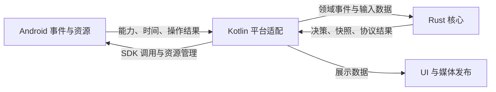

# Rust 与 Kotlin 职责收敛方案

现有 Rust 核心主体迁移已经完成。下一步围绕仍在 Kotlin 中的协议语义、媒体决策，以及不必要的 JNI 往返做局部收敛：Rust 负责核心规则和逻辑状态，Kotlin 负责平台资源、实际操作及结果。以完整职责为迁移单位，不以 Rust 代码占比或 Kotlin 文件行数衡量进度。

建议先处理歌曲状态、普通音频 feedback 和视频控制邮箱，再处理媒体协商、音频焦点和 JNI 门面；音频输入准备、麦克风 PCM 管线列为后续可选项。

## 基线与范围

- 分析日期：2026-11-14。`dev` 基线为 `21459bb60c0e548353b6abb035da0a343870dd42`，包含 PR #114；对应本地源码 HEAD 为 `368cf10353f96b13e2747d03cd30fe3c4cef8cda`。本方案涉及的生产 Kotlin／Rust 源码与该 `dev` 基线一致。
- 本文各工作包均为待实施方案。当前归属见[架构说明](ARCHITECTURE.zh-CN.md)，实施约束见 [AGENTS.md](../AGENTS.md)。历史迁移分支和已关闭议题不作为新任务入口。
- 用户已确认现有测试足够。本方案不重开既有验收，不安排重复长测、回放或故障注入；[验收矩阵](RUST_CORE_REMAINING.zh-CN.md)与原始记录保持其原有范围。后续代码变更只验证其实际影响，不把本方案当作新测试已通过的记录。
- 保持 Android 9／API 28、ECARX 753、现有 ARM64／ARMv7 分发及 x86_64 测试构建边界；不改变路由、AEC、编解码器降级和设备校准策略。
- 本轮只写方案，不修改运行逻辑、引入依赖或新增功能。

## 目标职责

| 层 | 负责 | 边界上的输出 |
| --- | --- | --- |
| Rust 协议与会话 | 字段解释、协议回复、增量状态、逻辑代际、重试与超时规则 | 协议结果、状态快照、下一步动作 |
| Rust 媒体 | 帧／包队列、时间锚点、背压、核心焦点策略、PCM 处理与编码策略 | 输入准备结果、目标增益、处理结果与计数 |
| Kotlin 平台适配 | SDK 对象、权限、线程／锁／取消、时钟读取、资源创建和关闭、实际操作结果 | 能力、事件、平台成功／失败事实 |
| Kotlin 展示与发布 | UI、文本排版、Bitmap 生命周期、MediaSession／Binder 发布 | 平台可见的展示和操作 |
| 已有 NDK／C 适配 | 原生视频循环、AAudio、Speex 等已接入能力 | 保持既有原生实现及校准 |

核心规则只有一个决策方；平台资源仍有自己的状态。Kotlin 保存当前 `AudioFocusRequest`、已成功应用的音量、待执行 Runnable、图片引用或 Socket，不等于重复核心状态，不应为追求“无状态宿主”把这些对象寿命搬到 Rust。

跨边界遵循三条规则：

1. 在拥有外部输入的边界完成校验，向内传递明确的数据；业务调用方不继续猜测 `Map<String, Any?>` 字段或 native 数组布局。
2. Rust 给出决策，平台执行，按原有时点提交实际结果。计划成功不能代替 SDK 成功；不确定结果和过期对象仍由现有平台保护处理。
3. 使用现有 owner、门面和基础库。避免一个算式一次 JNI、通用命令总线、全仓接口重写或为迁移新建一套运行时。

## 工作包与顺序

| 工作包 | 内容 | 方向 | 顺序 | 相对改动量 |
| --- | --- | --- | --- | --- |
| A | Glance 歌曲协议状态 | Kotlin → Rust playback | 第一批 | 中 |
| B | 普通音频 feedback | Kotlin → Rust audio | 第一批 | 小至中 |
| C | 视频控制邮箱 | 平台控制交接留 Kotlin，帧队列留 Rust | 第一批 | 小至中，含测试替身调整 |
| D | SETUP 与麦克风配置规则 | Kotlin → Rust airplay／audio | 第二批 | 中 |
| E | 音频焦点策略 | Kotlin → Rust audio | 第二批 | 中 |
| F | JNI 门面与具名结果 | 在现有门面隐藏传输布局 | 随对应工作包完成 | 小至中 |
| G | 音频解码输入准备 | 收拢到既有 Rust 媒体能力 | 后续可选 | 中 |
| H | 麦克风 PCM 连续处理 | Kotlin → 既有原生处理链 | 后续可选 | 大，涉及 Speex 连接 |

改动量用于拆分任务，不代表工期或性能收益。A、B、C 可独立交付；D 承接 B 的时间／回复边界；E 不依赖麦克风管线迁移。F 优先随调用接口变化一起完成，封面门面的清理也可单独交付。G、H 不阻塞前两批。

## A 收敛 Glance 歌曲状态

[ClusterSongState](../shared/src/main/java/com/shihab/diplay/hud/ClusterSongState.kt) 在 Kotlin 中解释 `0x5001` 的标题、歌手和播放状态，并保存增量更新。它由 [CarPlayGlance](../shared/src/main/java/com/shihab/diplay/glance/CarPlayGlance.kt) 使用。[CarPlayController.onRouteFrame](../shared/src/main/java/com/shihab/diplay/orchestration/CarPlayController.kt) 同时将消息交给这条路径和已经使用 Rust 的 [CarPlayPlaybackStatus](../shared/src/main/java/com/shihab/diplay/media/CarPlayPlaybackStatus.kt)。

**目标：** 将歌曲协议字段的解释、保留与清空逻辑归入现有 [session/playback](../shared/src/main/rust/diplay-media/src/session/playback/mod.rs)。复用底层解析能力，明确主媒体与 Glance 两种状态投影；不要另建一套 Rust iAP2 解析器，也不因复用而强制合并不同输出的生命周期。

Kotlin 保留不可变展示 DTO、原有平台字符串转换、标题与歌手组合、输出长度裁剪、监听器和 Widget 发布。优先沿现有门面接入，避免为了复用协议解析而改造整个 Glance 导航入口。

**必须保持：** 缺失字段保留旧值，显式空标题的行为，以及异常字段的容错语义。Glance 当前在播放状态为 1／3／4 时认为正在播放，主媒体只在 1 时为 true；Glance 的空标题还会清除保留的歌手。现有主媒体快照缺少这些差异所需的信息，不能直接用它的 `playing` 和文本替换 Glance 状态。输出格式及 UTF-16 裁剪不随迁移变化。

影响入口为 Controller、两种 playback 门面、Glance 及其测试；`NavigationWidget` 等消费者应保持现有快照契约。完成后，生产 Kotlin 不再独立实现歌曲协议字段的状态转换，两种消费者的行为差异有明确归属。

## B 统一普通音频 feedback

[CarPlayMediaEngine.onFeedback](../shared/src/main/java/com/shihab/diplay/airplay/CarPlayMediaEngine.kt) 仍在 Kotlin 中用首个 RTP sample、单调时间、播放延迟和 RTP 时钟计算 `sampleTime`，处理无符号 32 位回绕，并组装回复。Rust [audio/route](../shared/src/main/rust/diplay-media/src/media/audio/route.rs) 已处理接收反馈信息，[audio/buffered](../shared/src/main/rust/diplay-media/src/media/audio/buffered.rs) 已拥有 buffered 回复与时间换算。

**目标：** 让 Rust 拥有普通音频 feedback 的锚点／计算和回复语义。优先扩展现有 audio owner；Kotlin 在原有时点提供时钟、实际流启动和平台资源事实，取得完整的单流反馈结果，再完成必要的发送。普通与 buffered 流各自保留不同的时钟语义，不为共用接口强行合并状态。

**必须保持：** 使用 RTP 时钟而非解码输出采样率；启动前缺失锚点时的字段省略、延迟扣除后不小于零、原有舍入与 32 位回绕，以及 `streamConnectionID` 的无符号表示。平台取时次数和顺序、各流独立状态、已有诊断节流也不能随移动改变。既有注释记录过 16 kHz 通话被按 48 kHz 计算、反馈跑到音频前面的实际问题，这条约束应随核心实现保留。

影响 `CarPlayMediaEngine` 的 `AudioMeta`、启动回调、`onFeedback`、`NativeAudioRoute`／对应 native 入口及回复契约。完成后，Kotlin 不再维护一份可独立计算反馈位置的算法；已有 buffered 行为不受影响。

## C 简化视频控制邮箱

[VideoDecoder](../shared/src/main/java/com/shihab/diplay/media/VideoDecoder.kt) 已将视频帧直接送入 `NativeVideoPipe`。其 worker 邮箱只接收配置、Surface、镜像、Detach、刷新和 native 事件，但 [VideoDecodeQueue](../shared/src/main/java/com/shihab/diplay/media/VideoDecodeQueue.kt) 仍使用 JNI 连接旧的混合队列，带有 Frame、Resync、帧预算和参考链清理操作。

**目标：** Kotlin 使用符合现有中断／唤醒契约的简单控制邮箱；生产视频帧队列、背压和参考链继续完全属于 [vpipe](../shared/src/main/rust/diplay-media/src/media/video/vpipe.rs)。删除生产控制路径中不再承载帧的预算与清链调用。

**必须保持：** 消息 FIFO、等待可中断、关闭唤醒、排空处理、Detach 完成通知，以及 configure 前 hold／配置处理后 release 的顺序。最近修复的配置交错行为不能因替换队列退回旧逻辑。

影响范围不止 `VideoDecoder`：[HostVideoPipe](../shared/src/testCoreShadows/kotlin/com/shihab/diplay/testcore/HostVideoPipe.kt) 还使用旧的帧队列行为；`VideoDecodeQueue.kt` 中还有生产音频使用的 `DecoderInputPump` 和视频字节辅助入口；Rust [flow](../shared/src/main/rust/diplay-media/src/media/video/flow.rs) 中的参考链、溢出等函数也被生产 vpipe 使用。实施时逐项保留、移入测试源集或删除，不能整文件删除或为了测试把内部接口公开。

完成后，生产 Android 控制消息不再往返 Rust 队列；真实媒体队列只有 Rust 实现，旧 Java playback 语义仅存在于明确的测试替身中。

## D 收拢媒体协商与配置规则

[CarPlayMediaEngine](../shared/src/main/java/com/shihab/diplay/airplay/CarPlayMediaEngine.kt) 仍在 `onAudio`、`microphoneConfig`、`wantsMicrophone`、`dataStreamKey` 和 `videoDataStream` 中解释部分流字段、选择麦克风帧长／码率、组合密钥派生参数、分配远程控制流 ID，并手写部分 SETUP 回复字段。现有 [NativeAirPlayProtocol](../shared/src/main/java/com/shihab/diplay/airplay/NativeAirPlayProtocol.kt) 与 Rust airplay owner 可以承接这些职责。

**目标：** 输入字段解释和回复布局放在 `protocols::airplay`，会话内流 ID 与协商状态放在 `session::airplay`，音频参数规则复用 `media::audio` 的 codec／packetizer 能力。Kotlin 保留用户设置、InetAddress、Socket、实际端口、流对象、回调和拆除。

从窄接口开始：在现有边界解释请求，向 Kotlin 提供明确配置；平台绑定成功后，再由 Rust 结合实际结果生成回复。保留现有 DTO，不额外引入通用配置对象层。密码运算已经是原生能力，这里只收拢仍由 Kotlin 决定的协议参数，不再移植密码库。

**必须保持：** `telephony`／`speechrecognition` 与 `default`／`compatibility` 不同的麦克风请求规则、显式 `input` 的优先级、端口范围、Opus 码率和帧长选择、无符号 connection ID、HKDF salt／label 字节。保留同类型不同 `audioType` 的并存、旧流关闭与参数验证的既有先后次序、失败资源释放，以及 SETUP 回复发出后才连接 iAP relay 的动作顺序。

[MicrophoneStart](../shared/src/main/java/com/shihab/diplay/airplay/MicrophoneStart.kt) 中“通话等待下行，其他符合条件的流 500 ms 后允许静默启动”可随配置成为核心规则；其 `AtomicBoolean`、Future 取消、当前流检查和实际录音启动仍是平台资源保护，无需新增一个 native 启动锁。

影响 `AirPlaySession` 的媒体回调契约、`CarPlayMediaEngine`、AirPlay 协议门面、`MicrophoneConfig`／packetizer 及对应参考实现。完成后，平台层不再重复解释这些协议字段或选择音频参数；资源表仍由 Kotlin 管理。

## E 补齐音频焦点策略

[AudioFocusCoordinator](../shared/src/main/java/com/shihab/diplay/media/AudioFocusCoordinator.kt) 仍在 Kotlin 中选择通话／Siri／音乐优先级，决定请求意图，以及拒绝、duck、临时失焦后的目标增益。[NavigationPromptFocus](../shared/src/main/java/com/shihab/diplay/media/NavigationPromptFocus.kt) 的 duck／可听流／释放延迟规则则已使用 Rust scheduler。

**目标：** 在既有 Rust 音频职责内集中优先级、焦点事件解释和目标增益。Kotlin 把有效的通道活动及平台事件送入核心，执行请求／释放／音量设置，并返回实际授权事实。无需合并导航提示音与其他通道的独立平台请求对象。

Kotlin 继续保留 active 输出对象表、AudioAttributes、AudioFocusRequest、listener、Handler、对象对应的 generation 检查和 `appliedVolume`。核心可以记住已经报告的授权事实，但不能自行推断请求成功，或保存另一套平台对象身份。

**必须保持：** 通话高于 Siri、Siri 高于音乐；现有 0.2 衰减；焦点申请被拒时的静音范围；普通 duck 只影响音乐；临时失焦的设置开关；现有 ROM 永久失焦不处理的兼容逻辑；只有 `setVolume` 成功才更新已应用音量；被替换请求的迟到回调不影响当前输出。

影响 coordinator、scheduler 门面、AndroidMediaSink／renderer 的 acquire／release 调用，以及导航提示音的配合。完成后，Kotlin 不再独立决定通道优先级与目标音量，资源保护和成功记账依然完整。

## F 收紧 JNI 门面

[PlaybackMetadataCore](../shared/src/main/java/com/shihab/diplay/media/PlaybackMetadataCore.kt) 暴露操作编号和 `LongArray`；[NowPlayingArtworkQueue.sync](../common/src/main/java/com/shihab/diplay/NowPlayingArtworkQueue.kt) 直接解释其中的计数、偏移和特殊值。这让 native 内部传输布局成为上层业务必须了解的契约。

**目标：** 在已有门面中隐藏布局，将业务实际需要的提交、取下一项、完成、发布等操作命名，并提供字段明确的结果。已有清楚的门面不改；内部不透明状态 token 不因类型整理改成需要释放的 heap handle。

转换集中在门面边界，不给每个 native 函数新建包装类，不引入通用 RPC／序列化框架，也不把已经经过边界确认的数据在每个调用点重新校验。只有调用方需要理解的结果才增加具名结构。

**必须保持：** 封面版本／缓存决策仍由 Rust 拥有，Bitmap 引用和回收仍由 Kotlin 拥有；现有 Kotlin 图片表用于资源寿命，不应误删成“重复缓存”。[MediaCenterSessionEngine](../common/src/main/java/com/shihab/diplay/mediacenter/MediaCenterSessionEngine.kt) 的计划、平台调用、提交次序保持：正常完成但拒绝的发布仍记录已尝试快照，超时或会话失效不提交。`InitialAlbumRecovery` 的回调重入和过期结果处理也不改变。

影响门面与实际消费数组的调用方。若 JNI 签名或构造的 DTO 变化，同批更新声明、导出、R8 规则及 host shadow；不为未变化的接口扩大修改范围。完成后，业务代码不再读取 native 快照的变长布局，而原有所有权保持不变。

## G 可选的音频输入准备收敛

[AudioRenderer.handleRtp](../shared/src/main/java/com/shihab/diplay/media/AudioRenderer.kt) 仍在 Kotlin 中按 RTP 头偏移取 payload、转换 sample 时间、分派 LPCM／AAC／Opus、处理短 Opus 包，并准备 SDK 解码器输入。AAC 编码规则和 PCM／Opus 运算已有 Rust 实现，不需要重写。

**候选范围：** 复用现有 `media::audio` 和 [NativePcm](../shared/src/main/java/com/shihab/diplay/media/NativePcm.kt)，把属于协议与格式的输入准备组合为完整步骤；保留平台 worker、MediaCodec buffer 操作、AudioTrack 写入、焦点和输出资源管理。当前 sample 时间算法的采样率、整数运算、丢包／日志计数均保持原义，不能因 B 的 RTP feedback 规则顺带修改另一条路径。

这项只有在接口能合并实际工作、避免新增中间复制时值得推进。不要把每个条件和算式拆成独立 JNI 调用，也不要为此把整个 AudioRenderer 重写成 Rust。原生 Opus decoder 创建失败后仍有 SDK MediaCodec 路径，它是现有能力回退，不能按“旧 Kotlin 核心”删除。

影响输入准备、NativePcm／AAC 门面、codec 配置和 host 替身。完成条件为输入格式决策有单一归属，包释放、SDK 降级和平台 buffer 行为不变。

## H 可选的麦克风 PCM 管线收敛

[MicrophoneUplink](../shared/src/main/java/com/shihab/diplay/media/MicrophoneUplink.kt) 在 AudioRecord 读取后仍由 Kotlin 拼完整帧；[SpeexEchoCanceller](../shared/src/main/java/com/shihab/diplay/media/SpeexEchoCanceller.kt) 来回转换 PCM 字节与 short 数组；[MicrophoneCaptureStats](../shared/src/main/java/com/shihab/diplay/media/MicrophoneCaptureStats.kt) 扫描样本计算电平。随后 [NativeUplinkSender](../shared/src/main/java/com/shihab/diplay/media/NativeUplinkSender.kt) 才进入原生编码、加密与发送链。

**目标：** Kotlin 负责 AudioRecord、路由、平台 effects、重启／取消和采集事实；原生处理链接收采集块，拥有分帧、PCM 转换、样本统计、软件 AEC 协作及编码发送。统计样本的数值运算可下沉，Android 路由诊断、日志窗口和发布不必搬迁。

优先评估把 PCM 转换移到现有 [Speex JNI](../shared/src/main/jni/speex_echo_jni.c) 是否足以完成局部收敛；只有决定合并连续处理链时，才安排 Rust 与既有 Speex C 库的连接。前者是小范围原生边界清理，不能计为整条 Rust 管线迁移完成。保留现有 Speex 实现、许可与校准，不引入新的 AEC 算法。

**必须保持：** 每个软件 AEC 帧边界重新解析当前输出的 echo reference，先保留新引用再释放旧引用；同采样率 renderer 恢复不重开 AudioRecord／effects；不兼容采样率保持平台 AEC 降级；参考提前量、滤波尾长和抑制参数不变。保持部分读取／帧残留、Opus 时钟、RTP／加密计数提交时点，以及不能共享 FD 时的 Java DatagramSocket 路径。现有 Rust 读错／无音频恢复预算不再复制。

影响录音线程、echo 门面、Speex JNI、Rust `uplink`／`packetizer`、native 声明和构建连接。完整实施时需覆盖三 ABI 构建边界；是否改动库连接方式是本工作包启动时的具体设计选择，不阻塞前面各项。完成后，Kotlin 不再逐样本处理 PCM，现有采集和恢复行为保留。

## 调用方与验证入口

以下是未来实施时的定向回归入口，名称表示相关范围，不表示现有测试已覆盖所有拟议行为。优先复用原用例；新增状态转换或改变接口时，只补对应缺口。当前文档变更不运行这些测试。

| 工作包 | 已有入口与需覆盖的契约 |
| --- | --- |
| A | `CarPlayGlanceTest`、`CarPlayPlaybackStatusTest`；覆盖两种播放状态解释、空标题、字段缺失、异常字段及断开清空。核对共享 Kotlin playback 参考实现。 |
| B | `CarPlayMediaEngineTest`、`CarPlayAudioStreamIsolationTest`、`BufferedAudioReplyContractTest`，Rust `audio::route`／`buffered` 用例；普通 feedback 的 RTP 时钟、舍入、回绕及缺失锚点在新增核心入口补定向断言。 |
| C | `VideoDecodeQueueTest`、`VideoWorkerWaitTest`、`VideoSurfaceHandoffTest`、`VideoFlowContractTest`、`NativeVideoLoopTest`；核对 HostVideoPipe、配置失败交错、关闭与 Detach 完成契约。 |
| D | `AppMicrophoneRequestTest`、`MicrophoneStartTest`、`CarPlayAudioStreamIsolationTest`、`AudioStreamCodecTest`、`MicrophonePacketizerGoldenTest`、`VideoInCarTest`；保留原始字段／无符号值和字节结果，覆盖创建失败与 SETUP 后动作顺序。 |
| E | `AudioFocusAutoYieldTest`、`AudioFocusRequestCompatTest`、`NavigationPromptFocusTest`、`AudioFocusSettingsTest`、`NativeAudioOutGainTest`；在现有套件补核心优先级与平台授权／应用失败的连接契约。 |
| F | `NowPlayingArtworkQueueTest`、`ClusterArtworkDeliveryTest`、`InitialAlbumRecoveryTest`、`MediaCenterSessionEngineTest`；验证门面转换、图片寿命、回调重入与提交时点。 |
| G | `AacCodecContractTest`、`AudioStreamCodecTest` 及实际受影响的音频 renderer／NativePcm 用例；输入不足、SDK fallback、时间戳、包释放由迁移入口定向覆盖。 |
| H | `MicrophoneCaptureStatsTest`、`MicrophoneCaptureLifecycleTest`、`MicrophoneEchoReferenceRecoveryTest`、`MicrophoneEncoderAttachmentTest`、`MicrophoneNoAudioRestartTest`、`MicrophonePacketizerGoldenTest`、`MicrophoneNativeContractTest`；补采集块跨帧边界和原生连接的必要回归。 |

共享测试位于 [shared JVM tests](../shared/src/test/java/com/shihab/diplay)，宿主测试位于 [common JVM tests](../common/src/test/java/com/shihab/diplay)。内部 owner 契约继续放在 [testCoreInternal](../shared/src/testCoreInternal/kotlin)；通用参考与 SDK 替身分别沿用 [testCore](../shared/src/testCore/kotlin) 和 [testCoreShadows](../shared/src/testCoreShadows/kotlin)，不为了 unrelated module 编译而扩大生产可见性。

实施时按实际 diff 选择相关模块测试、Rust 用例，以及受影响的 JNI／R8／ABI 检查。构建与源码入口复用 [shared/build.gradle](../shared/build.gradle) 及现有 [CI](../.github/workflows/android.yml)，不新增平行检查框架。仅当新改动触及具体平台行为时才安排对应验证，不把用户已确认足够的历史测试列为所有工作包的前置门槛。

## 每批完成条件

1. 对应生产调用方已使用目标 owner，旧的核心实现从生产源集中移除；独立测试参考可保留并标清用途。
2. 平台资源、回调身份与实际操作结果的归属清楚，没有为了迁移增加另一套缓存、状态机或释放寿命。
3. 原有字节结果、输出语义、异常与动作顺序保持；必要的行为修复另行说明，不混入职责调整。
4. 受影响的 tests、fixtures、JNI 声明／导出、R8 或构建配置一起完成；不留无人使用的新门面或旧路径兼容别名。
5. 依实际变更完成定向检查，更新架构说明与相关 AGENTS 归属规则；只把已实施的工作包改为完成，保留历史验收证据的原始范围。

## 明确保留的范围

UI、Activity／Service 生命周期、权限、蓝牙／热点、USB 认领与 VPN、存储、车机 SDK、平台字符串与日期格式化继续留在 Kotlin。现有原生视频、AAudio、加密与协议实现继续复用，不为整理目录重写。

不按文件大小整体搬走 `CarPlayController`、`CarPlayMediaEngine` 或 `AudioRenderer`；不为了降低 Kotlin 行数迁移 SDK 锁、Runnable、图片引用、AudioRecord 生命周期或简单线程交接邮箱。不新增语言切换开关、旧核心生产 fallback、通用桥接框架或新的依赖。

前两批的收益是规则归属清楚、减少协议知识在两边散落、去掉不必要的跨语言控制交接。G／H 的取舍取决于能否形成完整且更直接的数据处理边界；本方案不承诺 CPU、延迟或内存的量化改善。
