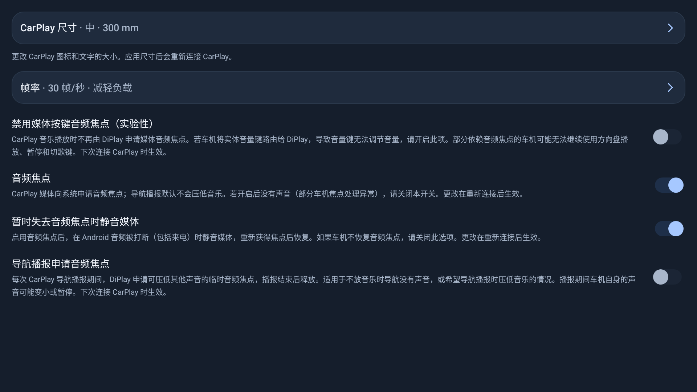

# v0.2.22 合并记录

## 基线与方式

- ECARX 起点：`dev` 的 `f1dc6622`。
- 上游：`v0.2.22`，提交 `28d6002b`；共同祖先为 `v0.2.21`（`49bf3bc2`）。
- 保留两个父提交的 merge，通过 PR 合入 dev；不 rebase、不强推 dev，不 squash 上游合并。
- ECARX 版本序列为 0.2 / versionCode 101，不采用上游的 41。

## 合并取舍

| 范围 | 处理 |
| --- | --- |
| 音乐时钟 | 接入上游平均缓冲测量、启动目标校准及阻塞写入修复，保留完整配套回归测试。测试构造参数按本项目已删除氛围灯 token 的 AudioRenderer 签名调整。 |
| USB 录音 | 接入 PCM 包大小与 RTP 时钟修复；保留实际录音源、RMS、零样本率、ECARX 麦克风仲裁及 820A 参数。 |
| 音频模式 | 结束时用 MODE_NORMAL 撤回本进程的请求；测试用按进程记录的 shadow 验证其他应用的模式继续生效、随后可恢复正常。 |
| 连接 | 接入 USB 重试、断线检测、失败原因与首页状态；保留 USB 信任等待、已选手机失效时自动选择、蓝牙让位与恢复、自启延后及重试追踪。 |
| 车道 | 保留 angles 列表、组件检查和坏包/清空的区分；适配上游 Glance 的车道监听与测试，坏包不清除有效车道。 |
| 仪表、媒体 | 保留 ECARX DIM 仪表路线、封面 HTTP 交付和 UNI/DIM/标准后端；吸收封面到达顺序与损坏封面处理修复。 |
| 不接入部分 | 保持已删除的 BYD/DiLink 功能及测试删除；不引入其他 Geely 机型的仪表、车速路线，也不恢复依赖氛围灯算法的闲置仪表媒体视图改动。 |
| 语言、发布 | 保持英/简中/繁中、ECARX README 与网站、应用标识、签名及本地认证资产配置；上游发布说明保留作参考，不代表本项目已发布。 |
| CI | dev push 与 PR 均运行 Android 检查；构建限制为单 worker，减少测试与 lint 并行时的内存压力。 |

## 验证

最终完整 CI 命令通过：shared/common/home 单元测试、mobile/home/maphost lint 与 Debug 构建。

| 模块 | 用例数 | 失败 | 跳过 |
| --- | ---: | ---: | ---: |
| shared | 1455 | 0 | 1 |
| common | 1206 | 0 | 0 |
| samples/home | 11 | 0 | 0 |

唯一跳过项为 `AirPlayPortSelectorTest.fallsBackWhenAnotherListenerOwnsTheWildcardPort`，受本机端口绑定条件限制。
公开源码凭证检查通过；Debug APK 为 `com.shihab.diplay.hudtest`，0.2-hud-test / 101，未包含 MFi 身份。
本机使用已有的离线 Robolectric SDK 缓存和本地 Mockito agent 初始化脚本，未向源码加入机器路径。
新增 UI 截图只使用当前车机的 1920×1080 横屏、正常字体，已人工查看文字、行高与边界。

## 实车验收（待完成）

1. USB 首连、保留线缆重连、拔插、手机锁定/信任拒绝/确认及恢复。
2. 无线热点连接、蓝牙关闭后重开、iPhone 离开与回车后的恢复。
3. 音乐开始与切歌的速度、长时间缓冲、导航提示与提示结束后的音乐恢复。
4. USB 语音备忘录/微信录音、Siri、通话，以及停止后麦克风仲裁与音频模式释放。
5. 仪表箭头、复合车道、封面、路线结束交还仪表与方向盘按键。
6. UNI/DIM/标准媒体后端、原厂 HiCar 开关与蓝牙媒体让位。

本次仅提供源码合并与 Debug 检查，不发布签名 APK、不宣称上述实车项目通过。
