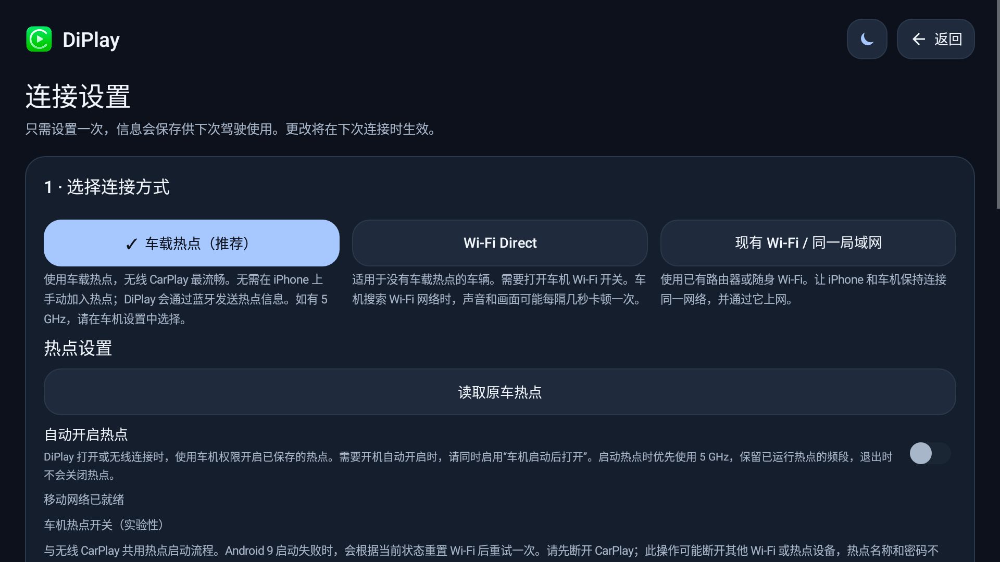
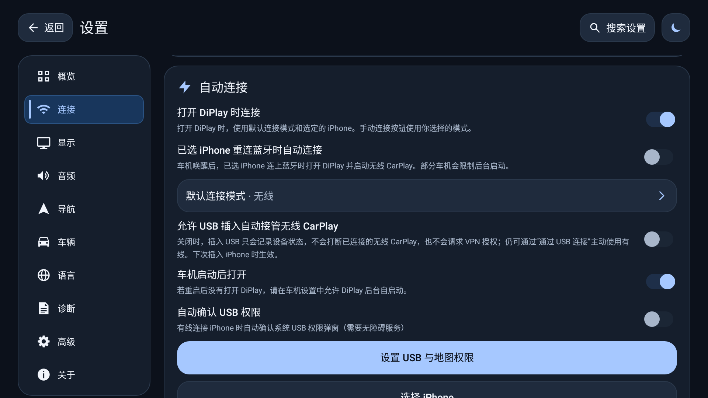
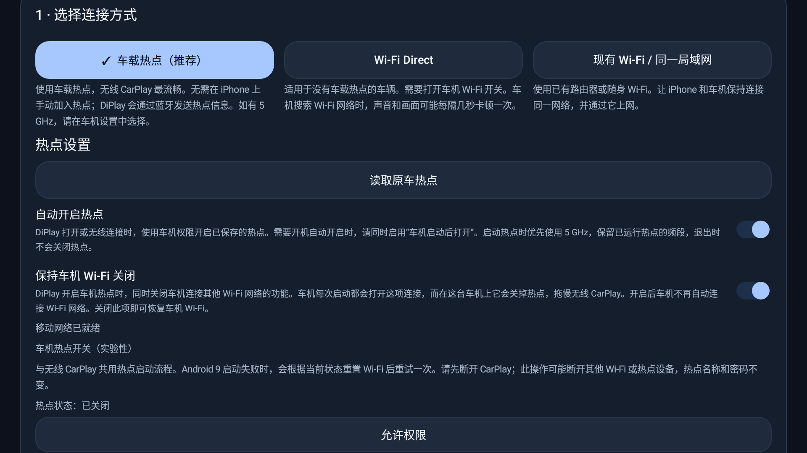
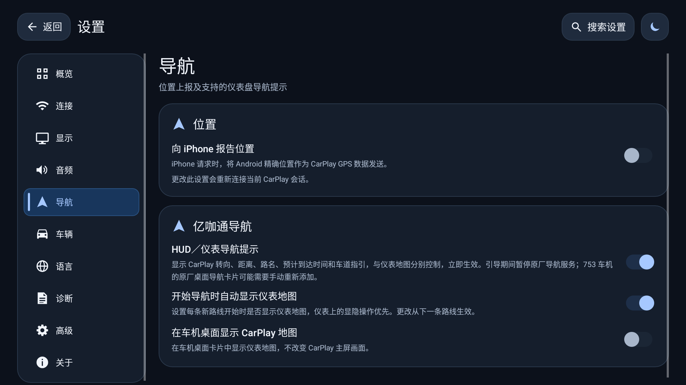
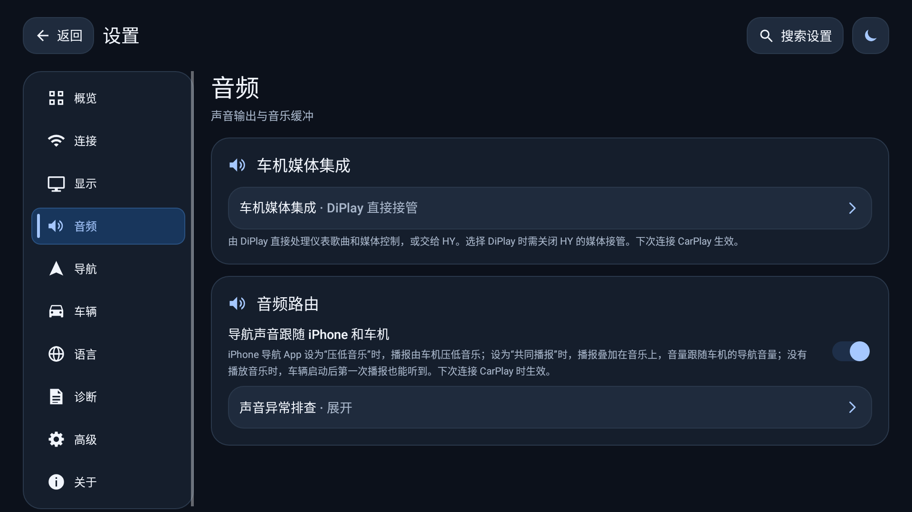
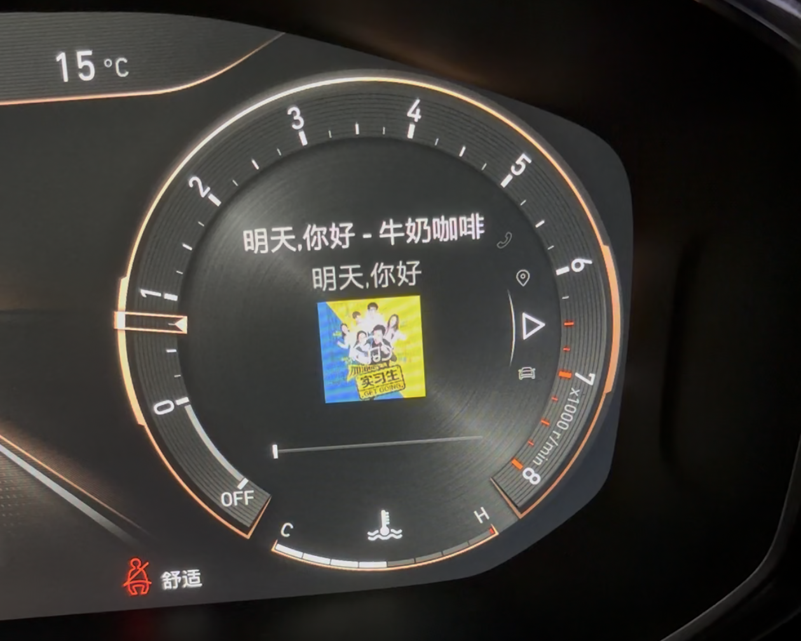
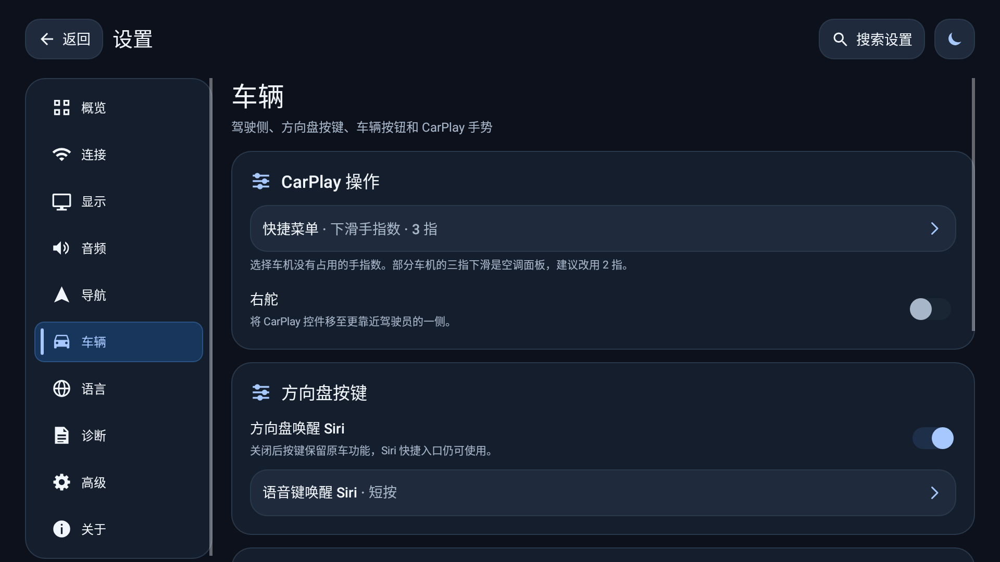

# DiPlay · 领克 01 CarPlay 使用说明

适用版本：v134　更新日期：2026-11-07

DiPlay 让你在车机上使用 iPhone 的导航、音乐、Siri 和电话，也可以把导航提示、地图和歌曲信息显示在仪表上。

目前适配的是 **2021 款领克 01，753 车机系统（Android 9）**，其他车型和系统版本尚未确认。**高德地图显示到仪表，需要 iPhone 使用 iOS 17.4 或更新版本。**

新增设置图来自 v134 模拟器，部分配图来自早期版本；按钮位置和名称以正文及实际界面为准。

## 一、先连上 CarPlay

首次使用建议直接用无线连接：

1. 打开 iPhone 的 Wi-Fi 和蓝牙，按提示与车机配对。
2. 打开 DiPlay，进入 **设置 → 连接 → 连接设置**。
3. 选择「车载热点（推荐）」，按提示保存热点名称和密码。
4. 选好要连接的 iPhone，回到主界面连接，按手机提示完成确认。

看到 CarPlay 画面就连接成功了。如果选择「现有 Wi-Fi / 同一局域网」，让手机与车机连接同一个网络，再按页面提示设置。

### 上车自动连接

在 **设置 → 连接 → 自动连接** 中：

- 打开「车机启动后打开」和「打开 DiPlay 时连接」。
- 「默认连接模式」选择无线，并选好自己的 iPhone。
- 想在手机蓝牙重新连接时也自动进入 CarPlay，可再打开「已选 iPhone 重连蓝牙时自动连接」。

使用车机热点时，还要在 **连接设置** 中保存热点信息，并按需打开「自动开启热点」。

开机时可能先短暂看到原车桌面，稍等后再进入 CarPlay。如果始终停在首页，先检查以上几项是否已设置好。

### 车机热点与 Wi-Fi

进入 **设置 → 连接 → 连接设置**，选择「车载热点（推荐）」，在下方打开「自动开启热点」。DiPlay 就会在连接前准备热点。支持时会优先使用 5 GHz，已开着的热点保持原来的频段，名称和密码不变。

打开自动热点后，会看到默认开启的「保持车机 Wi-Fi 关闭」。它用于避免车机连接其他 Wi-Fi 时把 CarPlay 热点关掉，通常保持开启即可。**iPhone 的 Wi-Fi 仍然需要打开。**

需要车机连接家里或其他 Wi-Fi 时，关闭「保持车机 Wi-Fi 关闭」。如果 CarPlay 正在使用热点，车机 Wi-Fi 会在下次车辆启动时恢复；未使用热点时可立即恢复。若页面提示恢复失败，到车机的 Wi-Fi 设置中手动打开。

如果提示缺少「修改系统设置」权限，按页面指引允许后再试。自动开热点失败时，也可以在连接设置中手动开热点，再连接 CarPlay。

### 插线充电与有线连接

已经配置好无线时，「允许 USB 插入自动接管无线 CarPlay」默认关闭，插线充电不会主动切换到有线。

| 你想要 | 怎么做 |
| --- | --- |
| 插线只充电，继续用无线 | 保持「允许 USB 插入自动接管无线 CarPlay」关闭 |
| 临时用一次有线 | 在连接页点「通过 USB 连接」 |
| 插线就自动切成有线 | 在 **设置 → 连接 → 自动连接** 打开「允许 USB 插入自动接管无线 CarPlay」 |

USB 连接仍可能卡顿，建议以无线为主。取消 USB 授权后，不一定会自动回到无线，需要时手动重新连接。

## 二、按自己的习惯设置

| 我想要 | 去哪里设置 |
| --- | --- |
| 仪表上显示箭头、距离和车道 | **导航 → 亿咖通导航 → HUD／仪表导航提示** |
| 仪表上显示完整地图 | **导航 → 亿咖通导航 → 开始导航时自动显示仪表地图** |
| 调整导航播报和音乐的关系 | **音频 → 音频路由 → 导航声音跟随 iPhone 和车机** |
| 仪表上显示歌名和封面 | **音频 → 车机媒体集成** |
| 用方向盘语音键叫 Siri | **车辆 → 方向盘按键 → 方向盘唤醒 Siri** |
| 画面日夜跟随车辆 | **显示 → 显示与性能 → CarPlay 日夜模式** |

修改后如果出现重新连接提示，按提示重连一次。方向盘 Siri 的开关、短按／长按选择会立即生效。

### 仪表导航与地图

进入 **设置 → 导航 → 亿咖通导航**，根据需要选择：

| 设置 | 有什么用 |
| --- | --- |
| HUD／仪表导航提示 | 显示箭头、距离、路名等信息；手机地图提供车道信息时，也会一同显示 |
| 开始导航时自动显示仪表地图 | 开始一条路线时，自动在仪表上显示完整地图 |
| 在车机桌面显示 CarPlay 地图 | 在原厂桌面卡片里显示地图，通常无需开启 |

**高德地图投到仪表前，先确认 iPhone 已升级到 iOS 17.4 或更新版本。** 然后连接 CarPlay，在高德中开始导航。

只想看箭头和歌曲信息，可以关闭「开始导航时自动显示仪表地图」。需要地图时，再用仪表上的显隐操作或三指飞屏展开；隐藏地图不会结束手机导航，箭头和距离仍可继续显示。第一次展开地图可能需要稍等。

不建议开启 **高级 → 仪表显示 → 整屏镜像到仪表（实验性）**，它可能遮住原车的导航和歌曲卡片。地图挡住时速等读数时，可在同一页面调整「仪表安全区」，保存后重连。

结束导航时，可以在 CarPlay 或 iPhone 中结束路线，也可以在仪表点「退出导航」并确认。如果仪表确认框一直不消失，先点「否」返回，再到 CarPlay 或手机中结束。

车道显示取决于手机地图和车机支持，并非每个路口都有。各款地图的实车表现仍在确认中。若使用后原厂桌面的导航卡片不见了，可进入桌面编辑模式，点空位「+」重新添加。

### 导航播报与音乐

在 **设置 → 音频 → 音频路由** 中，建议保持「导航声音跟随 iPhone 和车机」开启。

| 你想怎么听 | 在手机地图中选择 | 音量在哪里调 |
| --- | --- | --- |
| 播报时音乐轻一些 | 「压低音乐」或类似选项 | 车机声音设置中的导航音量 |
| 导航和音乐一起播 | 「共同播报」「与音乐共存」或类似选项 | 同样调整车机导航音量 |

不同地图的选项名称可能不同。如果选择压低音乐后，音乐几乎听不见，可以改试共同播报。共同播报时，导航声不会额外放大到超过当前媒体音量。

开启跟随功能后，一些手动调声音的设置会隐藏，这是正常的；一般直接调车机的导航音量即可。更改跟随开关后，需要重新连接 CarPlay。

如果音乐意外改从蓝牙播放，到 **音频 → 音频路由 → 声音异常排查**，打开「CarPlay 期间停用蓝牙媒体」，关闭「通过车辆蓝牙播放 CarPlay 音频」，再重连。

### 歌名、封面与 HY

在 **设置 → 音频 → 车机媒体集成** 中，通常选择「DiPlay 直接接管」。播放音乐后，支持的车机仪表会显示歌名、歌手和封面，不需要另外打开歌曲卡片开关。

如果安装了 HYWebview，根据自己的用法选择：

| 你的情况 | 怎么设置 |
| --- | --- |
| 不使用 HY | 选择「DiPlay 直接接管」 |
| 安装了 HY，但希望由 DiPlay 处理音乐和按键 | 选择「DiPlay 直接接管」，并在 HY 关闭媒体接管及同一个语音键的接管 |
| 一直使用 HY 管理音乐和按键 | 选择「HY 代理」，并按下一节设置 Siri 按键 |

这里的 HY 指 HYWebview，适配版本为 3.6.1。改完媒体集成选项后，需要重连 CarPlay。

### 方向盘 Siri

进入 **设置 → 车辆 → 方向盘按键**，打开「方向盘唤醒 Siri」。

- 使用「DiPlay 直接接管」时，选短按或长按唤醒 Siri，另一种按法留给原车助手。
- 使用「HY 代理」时，在 DiPlay 和 HY 的方向盘设置中，选择相同的「155/156」或「312/303」按键组。

CarPlay 未连接或通话中，按键保持车机原来的行为。已有的 Siri 快捷入口不受这个开关影响。

这里不提供按键学习。上一首、下一首和播放／暂停保持原来的用法，音量键通常仍调车机音量。

### 电话

连接 CarPlay 后，直接在 CarPlay 画面接听或挂断。通话使用车机的麦克风和音响，音乐与导航播报会暂时让位，挂断后恢复。

仪表电话卡片和 CarPlay 的显示可能不同步。仪表没显示号码，或仪表的挂断按钮没反应时，回 CarPlay 画面操作即可。

如果对方听到回声，可尝试 **高级 → 视频与音频 → CarPlay 通话使用车机电话音频（实验性）**。这项默认关闭；开启后如果对方觉得声音变大或失真，就关掉它。

### 日夜显示

进入 **设置 → 显示 → 显示与性能 → CarPlay 日夜模式**：

| 选项 | 适合什么情况 |
| --- | --- |
| 跟随 Android 系统 | 想跟车机系统一起切换，默认使用此项 |
| 跟随车辆 | 想跟随车辆的日夜状态 |
| 跟随环境光 | 想根据周围亮度切换 |
| 始终日间／始终夜间 | 希望固定使用一种外观 |
| 定时 | 希望按设定时间切换 |

选好后回到 CarPlay 查看效果。部分地图可能仍保持深色；若切换不合习惯，可以先改用「跟随 Android 系统」。

「App 外观」只改变 DiPlay 自己的界面，不改变 CarPlay 里的地图。

### 画面流畅度

先保证无线连接稳定，再逐项尝试，避免一次改很多设置。

| 设置 | 在哪里 | 怎么选 |
| --- | --- | --- |
| 帧率 | **显示 → 显示与性能** | 60 帧更流畅；画面或声音卡顿时先改回 30 帧 |
| 高效视频（HEVC） | **高级 → 视频与音频** | 默认关闭，可以单独尝试；黑屏、花屏或卡顿时关闭 |
| 高通低延迟解码（实验性） | **高级 → 视频与音频** | 默认关闭；开启后若有花屏或卡顿，就关掉再试 |

这三项都需要保存后重新连接。想查看实际帧率，可打开 **设置 → 诊断 → FPS 计数器**。

## 三、遇到问题

### 无线连不上

先确认 iPhone 的 Wi-Fi 和蓝牙已打开，把手机靠近车机并解锁，再点重新连接。

如果以前先用 USB 连过，之后一直无法无线连接，可以按下面的步骤重配：

1. 在 iPhone 打开 **设置 → 通用 → CarPlay 车载**，移除这台车。
2. 按提示重新配对。
3. 第一次重新连接时不要插线，先完成无线连接。

连接过程中返回首页，有时本次连接仍会继续完成。如果要重新开始，可使用 **设置 → 连接 → 无线连接帮助 → 重置 CarPlay Wi-Fi**，再按提示连接。

### 常见情况

| 遇到什么 | 先这样处理 |
| --- | --- |
| 提示手机没有响应、连接超时 | 解锁手机并靠近车机，确认 Wi-Fi 和蓝牙已开，再重试 |
| 提示不能使用无线 CarPlay | 按上面的步骤移除本车记录，再先用无线重新配对 |
| 提示「iPhone 未通过 MFi 认证」 | 重新配对后再试；仍失败时联系安装包提供者，先不要卸载或清除数据 |
| 高德地图不能显示到仪表 | 确认 iOS 为 **17.4 或更新版本**，已开始导航，并打开了仪表地图设置 |
| 仪表没有箭头或车道 | 打开「HUD／仪表导航提示」；不是每款地图、每个路口都有车道信息 |
| 地图挡住原车读数或歌曲卡片 | 检查「整屏镜像到仪表」是否关闭，必要时调整仪表安全区 |
| 导航没有声音，或音乐被压得太低 | 打开「导航声音跟随 iPhone 和车机」并重连；检查手机地图的播报方式和车机导航音量 |
| 车机不再自动连接其他 Wi-Fi | 关闭「保持车机 Wi-Fi 关闭」；正在用 CarPlay 热点时，等下次车辆启动后恢复 |
| 插 USB 后切走了无线 | 在 **连接 → 自动连接** 关闭 USB 自动接管，并确认「默认连接模式」没有选 USB |
| 语音键没有叫出 Siri | 检查开关和短按／长按选择；使用 HY 时，两边的按键组要一致 |
| 仪表退出导航的确认框不消失 | 点「否」返回，到 CarPlay 或 iPhone 中结束路线 |
| 挂断后音乐没有恢复、画面持续异常 | 重连一次；仍复现时保存报告，并记下出现问题的时间 |

### 保存报告，方便反馈

进入 **设置 → 诊断 → 保存诊断报告**。也可以选择保存位置，或使用「在手机上取得报告」，完成后确认拿到了文件。

反馈时附上：车型和车机系统版本、iPhone 和 iOS 版本、使用的地图、问题出现的大概时间，以及当时做了什么。导航声音问题请同时说明，手机地图选了压低还是共同播报、当时是否在放音乐。

报告不会自动发送。分享前检查一下个人信息，不要附上热点密码或连接认证文件。

## 四、安装与升级

使用与当前版本配套的安装包，直接覆盖安装，通常可以保留设置。**不要先卸载或清除数据。** 如果提示签名不一致或版本过低，先向安装包提供者确认。

有些安装包不包含连接所需的认证文件，首次安装前请向提供者确认是否需要额外配置。私人车测安装包不要转发。

从 v122 升级后，重点检查三处：

- **导航声音**：建议保持「导航声音跟随 iPhone 和车机」开启，播报方式在手机地图里选，导航音量在车机里调。
- **自动热点**：「保持车机 Wi-Fi 关闭」默认开启；需要车机连接其他 Wi-Fi 时，按第一节的说明关闭。
- **开机连接**：确认选好了 iPhone，并开启所需的自动连接选项。开机短暂显示原车桌面时，可以稍等再看。

DiPlay 不会在应用内主动提醒新版本，需要升级时从原来的发布渠道获取。

v134 的导航声音、自动热点、开机后 Siri，以及仪表地图显隐等功能仍在实车确认中；不要把本说明当作所有地图和车机版本均已验证的承诺。遇到异常，按上面的方式保存报告反馈即可。
