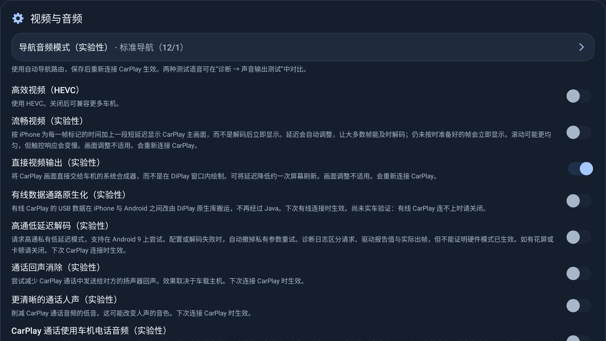

# 原生媒体阶段 1–6：台架实验与验证边界

记录日期：2026-11-12。阶段 1 已在 PR #94 合入；本次 PR 汇集阶段 2–6。
本记录区分已测版本与最终提交：最后的 AAudio 快路径和 USB NCM 代码不在 C/D 测试包中，不能把 C/D 数据当作最终包验收。

## 版本与方法

平台为小米 8、Android 15，真实无线 iPhone 会话、两路视频和音乐。它是调试台架，不是 Android 9／ECARX 753 实车。
请求视频帧率为 60 fps，日志有 `operatingRate=60`。每轮安装、重连、启动音乐并等待后采样 300 秒。
先按 A1 → B1 → A2 → B2 执行，再测 C1/C2、D1/D2；后两组没有与 A 再次交错，存在温度、手机画面及运行顺序的影响。

| 包 | 内容 | 本地 revision 文件记录 |
| --- | --- | --- |
| A | 阶段 0：Kotlin 接收＋原生 ChaCha | `19561e9d` |
| B | 阶段 1：Rust 接收、解密与池化包 | `021c494f` |
| C | 阶段 1–3：再加 PCM 与原生异步视频循环 | `03408b0d`；C1 包还包含后续 feeder 线程修正 |
| D | 阶段 1–5：再加 AAudio、opus-pure 与原生麦克风发送 | `3e01650a` |

revision 文件只记录构建时的 HEAD，不包含工作区差异，不能单独用于重现这些实验 APK。
原始 APK、`start.txt` / `end.txt`、`cpu.txt`、`logcat.txt` 和运行脚本保留在本地工作区
`artifacts/native-media-bench-20261111/`，不提交带认证资产的测试 APK。
可公开核对的逐轮计数整理在[CSV](native-media-2026-11-12.csv)，数字从保存的完整日志提取，不使用被截断的 `summary.txt`。

CPU 来自各线程 `/proc/<pid>/task/*/stat` 的 utime＋stime 差值，脚本按每 tick 10 ms、采样 300 秒计算并汇总。
100% 表示一个核心。该方法没有覆盖独立 codec／AudioFlinger 服务进程，不能称为整机 CPU 或功耗。
接收心跳窗口与 CPU 采样窗口不完全对齐；音频发生序号异常时会提前输出、重置统计窗口。

## CPU 结果

| 包 | 第一轮 | 第二轮 | 均值（占单核） | 相对 A 均值 |
| --- | ---: | ---: | ---: | ---: |
| A | 50.72% | 50.77% | 50.745% | 基线 |
| B | 49.68% | 50.20% | 49.940% | −1.6% |
| C | 40.67% | 40.50% | 40.585% | −20.0% |
| D | 41.27% | 41.63% | 41.450% | −18.3% |

阶段 1 的整进程差距只有约 0.81 个百分点，两轮不足以建立统计显著性。
C 的主要线程变化是 `MediaCodec_loop` 从约 16.2% 降到约 9.3%，原 Kotlin 视频 worker 的约 9%
变成 worker、Rust feeder 和 NDK 回调线程合计约 4.6%。这支持视频循环是主要收益来源，但不是逐项隔离的因果实验。

D 比 C 均值高约 0.87 个百分点（2.1%），没有测出 AAudio 的 CPU 优势。
D 日志确认音乐走 `route=usage(aaudio)`，会话输出快照观察到 AudioStreamTrack；不能据此判断车机的 MMAP 能力或实际延迟。
最终工作区还加入了 AAudio 的单位增益／无重采样直接写入路径，此优化尚无新一轮设备数据。

## 帧率、音频与 GC 的口径

接收日志没有流 ID，CSV 按每个视频窗口的包数排序为低／高两路，不强行对应主屏和仪表。
A/B 每 300 秒约有 6,560–6,590 和 10,480–10,530 个接收消息，约为 22 和 35 个/秒；
合计约 57 不能写成“主屏实际 57 fps”。C1、D1/D2 接收量接近，C2 较低一路为 5,175 个，约 17.25 个/秒，负载并非严格相同。
这些是接收统计；没有用 SurfaceFlinger 有效呈现时间戳或外部高速录像证明物理显示持续 60 fps。

A2 的音乐统计记录到一次向前序号缺口和一次晚到／重复包，已输出窗口累计只有 269,261 ms；
D2 同样各有一次，已输出窗口累计只有 55,740 ms。因此两轮保存下来的音乐心跳包数不能当作完整 300 秒收包总量，
也不能据此认定音乐随后停止。各轮结束时媒体会话均记录为 PLAYING，这仍不能替代音频听感与欠载验收。

日志中的 GC 条数依次为 A1=3、B1=4、A2=3、B2=2、C1=3、C2=3、D1=2、D2=3。
它不是严格对齐采样窗口的分配率；HeapTaskDaemon 的 CPU 接近计数精度下限，未测得明确的 GC 收益。
B 的池化包未释放计数峰值为 8，属于观测值，不构成长时间无泄漏证明。

## 已有验证与待验收项

- C 的第二轮 smoke 日志有 `packet=NativePacket decoder=native` 和首帧输出。
- D 的 smoke、D1、D2 日志确认音乐使用 AAudio。
- Rust 主机测试覆盖 PCM 高通／衰减／淡入、Opus 编码回解、RTP 加密黄金向量、视频节拍和池化包所有权，
  以及 NCM NTB16、重组、邻居通告校验和与流量计数；Kotlin 侧保留对应黄金向量。
- 通话、Siri 和指定旧式 stream type 的输出保留 AudioTrack；AAudio 打开失败时回退到 AudioTrack。
- 纯 Rust Opus 已有主机编码回解测试，但现有 D 采样日志没有麦克风上行验证，不能标记真实 Siri／通话验收通过。
- 有线 Rust 通路由高级设置“有线数据通路原生化（实验性）”控制，默认关闭，下次有线连接生效；
  诊断报告和设置备份包含该开关。Rust 引擎无法启动时保留 Kotlin 通路。
- 未做真实 USB 主机 NCM 会话、断连重连及资源释放验收；台架手机当前作为 Mac 的 USB 从设备，未提供该测试拓扑。
- 尚未构建／采样最终 E 包；未验收车机音频 BUS 路由、焦点切换、真实通话、长时间稳定性和物理呈现延迟。

原生库从本次源码重新构建 ARM64 和 ARMv7，最终字节数与校验值见[原生库来源记录](../../shared/src/main/jniLibs/NOTICE.md)。
整理提交时，Rust 24 项主机测试通过；完整 Android 单测为 3394 通过、2 跳过、0 失败，四应用 lint、Debug 构建和 R8 检查通过。
新增的实验开关 UI／设置备份往返测试另行通过，并生成下图。自动检查通过不能替代上述设备验收。

## Issue #96：AAudio 正确性修复

在 `fd49e6d1` 后修复焦点线程直接访问 Rust 输出状态、衰减／重采样部分写入重复消费输入两项问题。
焦点回调只保存目标增益，由音频 worker 应用；Rust 保留未写完的 PCM，返回已消费的输入字节，
在接受下一块前排空余量。worker 在没有新包时继续排空；原生写入失败结束 renderer 并释放资源。
普通单位增益路径继续直接写入，只记住实际写入的最后一帧；关闭使用的 FLUSH 清除待写 PCM 和插值历史。

本次验证：

- 开发中运行 AAudio 4 项定向 Rust 测试及 Kotlin 47 项音频／焦点／缓冲／时钟回归，全部通过。
- 最终 Rust 主机测试 27 项通过；Android 完整单测 3396 项通过、2 跳过、0 失败，四应用 lint、Debug 构建及 R8 检查通过。
- 使用 NDK `28.2.13676358` 重建 ARM64、ARMv7；本次校验值更新在原生库 NOTICE 中。
- 小米 8（API 35）和 Android 9 ARM64 模拟器（API 28）各通过 2 项设备测试：暂停时超缓冲容量的单／双声道静音写入、启动后无新输入的尾部排空，以及播放期间／释放后的跨线程音量回调。
- 模拟器首轮回调测试因 200 次短休眠和固定等待时间超时；测试改用关闭 latch 后，只重建并重跑设备测试，两端均通过。生产代码未因此改动或重复运行全局检查。

以上是输出 API 和所有权回归，未新增 CPU／延迟对照结果，未进行 ECARX 753 实车、iPhone 音乐／Siri／通话听感、USB NCM 或长时间稳定性验收。

## Issue #96：视频接收直连解码

在 `18206bc8` 后，将 Rust 视频接收器与既有原生解码队列接通。配置、Surface、镜像拓扑和解码器选择仍由 Kotlin 管理；普通视频帧在 Rust 内完成接收、解密、Annex B 转换、镜像引用分发和入队，不再逐帧回调 Kotlin 后经 JNI 提交。

每条接收流持有独立 route，Rust 用 Arc 持有目的解码器；换流／关闭先断开旧 route。原生句柄销毁后，尚未退出的接收线程只能丢弃发往该目标的新包，不能访问已释放内存。任一目标不能提供原生 pipe 时，整条流保留原有 Kotlin 句柄分发路径。输入 FPS、字节、活跃／静止间隔和主屏触摸到下一帧统计随原生输出统计拉取，保留日志口径。

验证范围：

- 开发中运行 32 项 Kotlin 视频／接收／Surface 定向回归，全部通过；新增 Rust 输入统计回归覆盖跨窗口间隔、静止间隔和触摸样本清零。
- 设备回归覆盖镜像分发、目的替换、目的句柄先销毁、route 先销毁、包池归零、首次接收事件、配置顺序、无原生目的时的回退和认证失败。
- 硬件解码烟测使用 ffmpeg/libx264 生成的 64×64 黑色 baseline SPS／PPS／IDR，通过 ScreenStream 与 AndroidMediaSink 将加密帧送到平台 AVC 硬件解码器和 SurfaceTexture；断言有解码输出且 Kotlin 包回调为 0。测试不包含私有会话样本。该项要求设备具备 AVC 硬件解码器，不能在无硬件解码器的模拟器上替代验收。
- API 28 ARM64 模拟器曾在 ImageReader PRIVATE 分配缓冲后崩于系统 CCodec；改用 YUV 和 SurfaceTexture 后，软件 CCodec 收帧但未输出。对照原有 Kotlin 句柄转交路径也复现了无输出（`rx=119, rendered=0`；直连对照 `rx=130, rendered=0`），本次没有为模拟器修改生产解码器选择或车机校准。此环境只用于路由／生命周期验证，API 28 硬件输出仍需 ECARX 753 验收。
- Rust 主机测试 28 项通过；Android 完整单测 3398 项通过、2 跳过、0 失败，四应用 lint、Debug 构建和 R8 检查通过，完整检查执行一轮（6 分 6 秒）。
- ABI 复核发现原有 `AMediaCodec_queueInputBuffer` 的 offset 固定声明为 i64，而 NDK 头文件要求 `_off_t_compat` 与 C long 等宽，ARMv7 必须为 32 位。改为 `libc::c_long` 后双 ABI 重建；小米 8 强制 ARMv7 和 ARM64 各 3 项设备回归通过，均覆盖真实硬件输出。API 28 ARM64 模拟器 2 项通过，硬件烟测 1 项因缺少硬件解码器跳过。
- ABI 声明修正没有改动 Kotlin 逻辑，沿用已通过的完整单测、lint／R8 结果，只重打包最终四应用 Debug 与独立设备测试 APK；来源校验值更新在原生库 NOTICE。公共源码凭据和 diff 检查通过。本地构建／测试及 API 28 对照日志保存在工作区 `artifacts/issue96-video-20261112/`。

没有新增 CPU／物理延迟性能结论，没有验证真实 iPhone H.264／HEVC、主屏与仪表双路切换、停放／恢复或长时间稳定性。音频队列、缓冲音乐锚点、SETRATE／FLUSH、时钟和背压仍待迁移；协议／会话等后续工作保持 issue #96 的既定顺序。

## Issue #96：音频队列、缓冲音乐控制与时钟

在 `4a6b077c` 后，将渲染器压缩音频队列、缓冲音乐 queue／未听到的 fed 预填、RTP／NTP 锚点、SETRATE／FLUSH／GETANCHOR／feedback、发送节奏与 TCP 背压迁入 Rust。保留 192 包渲染队列、8 MiB／两分钟缓冲上限、15 秒后四倍速填充、400 ms 开始锚点和一秒预填；音乐持续拥塞恢复、RTP 回绕、暂停恢复也沿用原有规则。

Rust 同时拥有音乐 PI 时钟的目标测量、到达加权样本、误差平均和 learned drift，保持车机已有的 1.5% 限幅和测量／更新窗口。Kotlin 串行执行平台开始、交付和停止；开始回调后的 core generation 验证会拒绝重入暂停／FLUSH／关闭所失效的旧交付。关闭先释放并唤醒 Rust owner，再停止 receiver；接收线程通过 Arc 保持内存有效。缓冲接收沿用原有进程级共享包池。渲染器入队／关闭唤醒等待 worker，句柄销毁与生产者串行；取出的包持独立引用，时钟随 output worker 释放。

AAC MediaCodec、AudioTrack／AAudio 平台调用、焦点、路由与校准继续保留。UDP 音频接收到平台 sink、缓冲 feed 到 renderer／平台解码仍有逐包句柄交接，剩余输出调度尚未完全闭环；协议 NTP 同步属于后续协议迁移。本批没有新增依赖、开关或 LIVI 源码。Kotlin 算法只在原生库无法加载时启用，不与 Rust 同时维护状态。

验证：

- 开发中仅运行缓冲音乐、会话、时钟、积压恢复和 rebuffer 的 61 项 Kotlin 定向回归，全部通过；Rust 最终 38 项主机测试通过，新增 10 项覆盖边界、所有权及硬件时钟快慢漂移。
- 最终完整 CI 一轮（6 分 6 秒）：Android 3398 项通过、2 跳过、0 失败，四应用 lint、Debug 构建和 R8 通过。最终包池／双 ABI 库和 NOTICE 同步后仅重打包四应用及独立测试 APK，没有重复全局测试；核对 source → merged → stripped → APK 原生库和 NATIVE-NOTICE 资产一致。
- 新增 `NativeAudioStateDeviceTest` 7 项在小米 8／API 35 的 ARM64、ARMv7 和 API 28 ARM64 模拟器分别通过。覆盖生成静音 AAC 经加密 TCP 接收、真实 MediaCodec 解码和平台播放头推进，暂停／恢复／FLUSH／feedback，回调重入、在途交付排序、满缓冲关闭唤醒、外来对端拒绝、非法长度、TCP 分片／认证失败／RTP 回绕，以及队列关闭和等待唤醒。每个 ABI 还用 12,000 步对照原 Kotlin PI 算法，结果完全一致。
- 小米 8 扩展回归每个 ABI 共 16 项：13 通过、3 失败。新增音频 7 项、原有 AAudio 2 项、视频 3 项均通过；原有 Opus 4 项中的编码、能力探测、非法输入后恢复 3 项失败。分别用 `4a6b077c` 的 ARM64／ARMv7 原生库替换同一独立测试 APK 并重签，在同机复现相同 3 项失败；已按旧 NOTICE 哈希核对基线库。未改动 Opus 实现，也未将该失败当作本批新增回归或已验收通过。
- API 28 模拟器扩展回归 9 项：新增音频 7 项与原有增益回调 1 项通过；旧 AAudio 大块排空用例超时。仅重跑失败用例仍失败，使用 `4a6b077c` ARM64 库对照同样超时，根因尚未定位。该限制不影响本批生成 AAC 的实际播放头推进测试通过，但不能声称模拟器完整 AAudio 回归通过。
- 独立测试包最终恢复为本批构建，小米 8 选择 ARM64；双 ABI 校验值更新到原生库 NOTICE。日志、基线对照和构建元数据保存在本地 `artifacts/issue96-audio-20261112/`，原始日志／测试 APK 不上传。

下一步先定位两项遗留设备失败，继续收敛逐包交接与平台输出调度；随后按 issue #96 对照 LIVI 推进协议／会话迁移。尚未做 ECARX 753 BUS／焦点、真实 iPhone 音乐／导航／Siri／通话听感、实车长测或性能对照，NCM 仍默认关闭，完整迁移 PR 保持 Draft。

## Issue #96：协议、会话与领域并行首批

用户授权新开子会话后，从 `e1bfde1c` 建立三个隔离 worktree。主会话集中审查、合并共享入口、构建与验证；子会话只运行定向回归。

| 工作线 | 主分支提交 | 首批交付与边界 |
| --- | --- | --- |
| 领域 | `3f5d85b4` | EV 0xA101 参数体转换；SDK provider、订阅、有线／无线 reporter 和 Iap2Frame 包装保留 |
| 会话 | `e0bf8e8a` | WirelessRunState 生命周期、handoff、tunnelReady、首次失败；controller 代际、资源顺序、超时／恢复动作保留 |
| 协议 | `de448386`、修正 `b8ed2ccd` | RTSP 请求分帧／解析与响应编码；公开 DTO 不变，bplist／配对／控制加密／iAP2 后续迁移 |

Rust 定义无线状态的 opaque value token，Kotlin 只串行保存该值，所有查询与转移交给 Rust；它不是 native 堆句柄，因此关闭后仍可报告首次迟到失败，无终态策略副本或句柄缓存。EV 转换保留字段顺序、未知能量省略、负值钳零、u32 溢出／NaN 拒绝、缩放／舍入和无穷值钳制。

RTSP 保留本项目 16 KiB header／1 MiB body、重复头、trim／大小写、Content-Length、响应顺序及 ProtocolException。JNI 直接构造既有 Request／Parsed，UTF-16 字符串与按消息 local frame 保留 NUL 并限制局部引用；R8 规则保留 DTO 名称与构造器。两次只读审查后，真实设备对照仍抓到了桌面 JDK 与 Android 的补充字符 ASCII 替换差异：Rust 按 scalar 输出一个 `?`，Android 旧实现按两个 UTF-16 单元输出两个 `?`。改为按 UTF-16 单元转换，保持 Android 既有字节；保留桌面 fallback 的不同黄金预期。未因此修改协议规则或车机校准。

LIVI 对照固定：RTSP 为 `6ac88bab7351a39b0cffac20c5dcf92ca848319b`，标准 RTSP／500 响应与 ts_vectors 逐字节相同；其 16 MiB 上限、leading-digit 长度、非 ASCII 等语义不同，首批保留本仓库行为。EV 对照 `870d26441e073cdb802c427c5ae8833dba694951` 的 iap2-csm vehicle_status 字段／类型一致，livi-cp vehicle_state 是另一车辆特征协议。没有导入 LIVI 文件、宏、运行时或新依赖。

验证：

- 三路分别运行 Kotlin 定向 37／21／22 项，全部通过；Rust 新增 RTSP 4、无线状态 5、车辆转换 4 项，集成后主机共 51 项通过。
- 新增设备测试 9 项：RTSP 分片／合包／边界／ASCII／NUL／异常，10,000 消息 DTO 引用压力及真实 AirPlaySession loopback；无线状态 32,000 步 Kotlin 对照与 50 轮关闭／失败／迟到回调并发；EV 1944 组快照黄金字节及非法值拒绝。
- 最终同一独立测试 APK 在小米 8／API 35 的 ARM64、ARMv7 及 API 28 ARM64 模拟器各 16 项通过（新增 9 项 + 上一批音频 7 项）。初轮两个 ARM64 环境均有且仅有上述 ASCII 对照失败，修正后重新构建／运行，未以主机结果代替 Android 输出语义。
- 本批只在集成后运行一轮完整 CI（6 分 14 秒）：Android 单测 3403 通过、2 跳过、0 失败，四应用 lint、Debug 构建、R8 通过。主应用 R8 保留 NativeRtsp 与 Request／Parsed 的 JNI 类名，构造器规则已核对；主应用／独立测试 APK 的双 ABI 来源／strip 产物和 NATIVE-NOTICE 与最终源码一致，公共源码凭据和 diff 检查通过。
- 来源校验、最终 CI 与 R8 结果随本批集成记录保存到 `artifacts/issue96-parallel-20261112/`。手机测试包最终恢复 ARM64，原始日志／测试 APK 不上传。

这三个首批 owner 可独立实施；完整会话接入与 HID 编码仍须统一协议事件／存储／编码契约。三个大阶段均未整体完成，实车／iPhone、配对、有线／无线重连、导航／HID 和性能仍待验收。上一批已复现的双 ABI Opus 编码失败及 API 28 模拟器 AAudio 大块排空超时未在本批修复；NCM 仍默认关闭，PR 保持 Draft。

## Issue #96：bplist、导航状态与音频遗留项

本批继续沿完整迁移分支推进，集成 `577e39f2`（Opus）、`344de861`／`6b660273`（导航）、`57369165`／`40022c23`（bplist），以及 `4736174f` 的构建来源和 AAudio 测试计时修正。

- `BplistCodec.encode/decode` 的线格式、类型与解码预算迁入 Rust；Java 集合／标量映射、畸形 UTF-16 的平台 charset 替换在 JNI 边界执行。保留无符号整数的 Long 位模式、负整数编码为 Double、Date／Float 类型、字典顺序和重复键行为。修复 BigInteger 65536／2^40 在选定 4／8 字节宽度时未补零的既有缺陷；编码两路径统一限制为 128 层，解码保持 32 层、reads／payload 预算。
- `RouteGuidanceState` 保留 Glance／ECARX HUD 既有入口，Rust 唯一拥有 TLV、maneuver 缓存、距离已知标记、空列表宽限、stale／liveSession、NoRoute／Arrived／clear 与 ETA。两个生产 owner 为进程级 singleton，独立保留各自策略；临时测试 owner 显式释放。Kotlin 提供单调／墙钟和当前会话存活状态，保留 SDK 输出；没有第二份同时活动的导航核心。
- Opus 设备失败根因为 JNI 使用 opus-pure 的 120 ms／7662 字节容量检查 Kotlin 的 20 ms／1275 字节输出，导致编码提前返回 -1。统一单帧上限，按既有契约拒绝非 1920 字节 PCM 与非正码率；VoIP、complexity 5、voice signal 和有效码率不变。新增主机回归直接调用真实 JNI 入口及相同 1275 字节缓冲，先失败后通过。
- AAudio 临时计数确认 native pending=0、平台 written=generated=51327，但旧测试在一次 6894 ms 的阻塞排空后已耗尽其提前启动的 5 秒等待；100 ms 后播放头完整到达 51840 输入帧。Android 9 [legacy write](https://android.googlesource.com/platform/frameworks/av/+/refs/tags/android-9.0.0_r1/media/libaaudio/src/legacy/AudioStreamTrack.cpp) 将正超时视为 blocking，而非遵守其时长。修正测试从首次阻塞提交后计时，仍使用 5 秒和严格全部帧断言；不改生产缓冲、增益或重采样。最终源码已移除临时计数／控制实验代码；同一修正测试在当前库及 `4a6b077c` ARM64 旧库均 2/2 通过，旧库 SHA-256 为 `1f88638a7f579e7483cbd53e1637cf5b39692410d7c71cc4a0ef83ff376071bc`。
- `build.sh` 复制路径现遵守 `CARGO_TARGET_DIR`，避免在外部 target 构建后复制本地旧库；默认、相对、绝对目录三种配置均用双 ABI 哨兵产物检查。

LIVI 对照固定 `6ac88bab7351a39b0cffac20c5dcf92ca848319b`，bplist blob 为 `9d258cc0a7798ac68a0a5ea9f518b6bdb6652281`。复用 458 字节黄金向量数据（SHA-256 `b4e3e93557bb97d6207978c92e3a52f533a60cd3f0e9034a4253c080b83e872a`），实现按本项目 Kotlin 契约迁移；LIVI 的 Date／ASCII／字典与预算规则不能直接替换。没有导入其实现、运行时或新依赖；README 与应用可查看的第三方许可资产保留其要求的署名。

设备验证使用同一 Debug 独立测试 APK：小米 8／API 35 的 ARM64、ARMv7，以及 API 28 ARM64 模拟器各 35 项通过。集合为 bplist 7、导航 6、Opus 4、AAudio 2、音频状态 7、RTSP 5、无线状态 2、EV 2，包含真实 AirPlaySession loopback、平台 charset／Date、20,000 键与 10,000 maneuver DTO 引用压力，以及加密 AAC 解码和播放头推进。

首轮两个 ARM64 环境各发现一项导航畸形 UTF-8 差异：桌面 JDK 将 `ED A0 80` 合并为一个替换字符，Android 则替换为三个。删除桌面专用特判，使用 Rust 标准替换行为；保留 NUL 截断和 trim，补明确 Android 黄金向量。重新构建双 ABI 后三个环境的最终 35 项全部通过，未把最初的失败记作通过。

最终 Rust 主机 73 项通过；bplist 另有 26 项真实 macOS JNI 回归，`-Xcheck:jni` 无诊断。JNI Java 回调后先检查异常，再清理局部引用；导航字段查询、DTO 构造与释放边界经独立只读复核。双 ABI 来源、APK 资产、最终完整 CI 与 R8 结果记录在 `artifacts/issue96-bplist-navigation-20261112/verification.json`，原始日志与测试包不上传。

本批在设备收敛后运行一轮完整 CI，用时 5 分 50 秒：Android 单测 3416 通过、2 跳过、0 失败（shared 1830 总数／2 跳过，common 1573，home 15）；四应用 lint、Debug 与 R8 检查通过，未变化的任务复用缓存。主应用 R8 mapping 保留 NativeBplist／NativeRouteGuidance／NativeRtsp／AppleManeuver 类名，seeds 保留 maneuver 的八参数构造器。主应用和独立测试 APK 的 source／cargo／merged／stripped 来源与 NATIVE-NOTICE、LIVI 声明匹配；其余三个应用也检查了产物，按原依赖边界不包含该原生库。公共源码凭据及 diff 检查通过，手机测试包恢复 ARM64。

配对／控制加密／iAP2／NTP、controller 代际与恢复、其余车辆转换与 HID、剩余媒体逐包交接仍待继续迁移。设备验证为 Debug 测试包；未运行缩减后的发布包实车互通、ECARX BUS／焦点、真实 iPhone 听感、USB NCM 主机拓扑、长测或物理延迟对照，PR 继续保持 Draft。

## Issue #96：控制加密、无线恢复与 HID

本批从 `e116d00a` 并行实施，主线集成 `f9ddfb38`（HID）、`745d86b1`（恢复）、`c5c3952e`（加密及关闭锁序），`49f27b1d` 补齐原有测试中的临时 cipher 释放。没有新增依赖或设置；PASCD／VehicleSpeedLocationProvider 只有测试消费，没有生产 SDK 装配点，因此本批未新增车辆速度原生模块。

- Rust `control_cipher` 唯一持有 control／event 的分帧、AEAD key 与双向 wrapping nonce counter。保留空输入的 18 字节帧、16 KiB 加密分块、u16 解密长度、部分帧 rest identity，以及成功 prefix 后遇到认证失败时已推进的计数。Kotlin 同步 encrypt／decrypt／close，Session 关闭、替换和迟到安装均管理真实 owner；JNI 构造既有 Decrypted，保留其 R8 构造器。
- 创建原生 owner 时固定密钥；生产 PairVerify／HKDF 调用方均传入新生成的 32 字节数组，不依赖创建后修改外部数组。非法 key 保留异常类型与使用时才失败的时机，provider 专属错误文本可能不同；认证失败保持 AEADBadTagException 与 tag mismatch。
- Rust `wireless_recovery` 用不透明值 token 持有 run 三项一次性预算、attempt 编号／有效性／stage／超时，以及 Throwable facts 的失败决策。最多四次 attempt，保留 connect retry 400 ms、bootstrap retry 800 ms、一次 fallback、终止错误优先与 8 层 cause 检查。Kotlin 保留异常消息／cause／suppressed 组装、验证及资源执行顺序、100 ms 可取消等待、watchdog 调度；不分配原生堆句柄或保留第二份活动策略。
- Rust `hid` 编码 touch／knob／media／telephony 报告及四类 descriptor，直接消费原 `/info` 和 Session 发送入口。UID／Map 元数据、Android 输入适配及 AirPlayTouchSlots 保留 Kotlin。保留 slot id 首次匹配、Android Math.round、坐标低 16 位、轴 ±127 与按键低 8 位；JNI 传递 primitive arrays，不创建状态句柄。

交叉审查发现原有 event 写锁与 VideoPlaybackAvailability monitor 的锁环：写失败自行 close，或 reader EOF 清理时，可能与持 monitor 等待发送的档位更新互等。新增两条定向回归先在旧实现复现失败，再做最小锁序修正：先关 socket 打断 I/O，full close 不再重置已死亡会话的视频状态，迟到发送／可用性更新受 closed gate 限制；正常 RTSP TEARDOWN 仍重置状态。reader finally 同样先关 socket。两条夹具均先确认档位线程已 BLOCKED，修复后通过，VideoPlaybackAvailability 自身未迁移。

LIVI 对照固定 `6ac88bab7351a39b0cffac20c5dcf92ca848319b` 的 livi-cp control_cipher.rs、hid.rs 与 ts_vectors，仅复用 cipher／cipher2 和 HID 黄金数据，没有复制实现／宏或引入其运行时。LIVI debug counter 溢出、rest copy、触摸列表顺序／饱和轴等规则与本项目不同；本批保留本项目 wrapping counter、rest identity、按 id 选槽及低位截断。README 和应用第三方许可资产保留其 NOTICE 要求的完整署名。

开发中定向验证：HID Kotlin 38／Rust 5，恢复 Kotlin 74／Rust 6，控制加密及关闭 Kotlin 78／Rust 7，集成后临时 owner 清理回归 28，均通过。控制加密另有真实 macOS JNI 10 项，四个 native 方法动态链接可核对；`-Xcheck:jni` 无 JNI 诊断，JDK 25 的 System.loadLibrary 受限方法提示单独保留。集成 Rust 主机共 91 项通过。

统一重建 API 28 双 ABI，最终同一 Debug 独立测试 APK 在小米 8／API 35 ARM64、ARMv7 和 API 28 ARM64 模拟器各 51 项通过：control cipher 7、HID 6、恢复 3，加上前批 bplist 7、导航 6、Opus 4、AAudio 2、音频状态 7、RTSP 5、无线状态 2、EV 2。包含真实 PairVerify→加密 control／event 往返、Session.close 清零、阻塞写／EOF／迟到安装，以及原 HID 入口的 11 个加密 event 报告。

设备收敛后完整 CI 仅一轮，5 分 54 秒：Android 单测 3429 通过、2 跳过、0 失败（shared 1843 总数／2 跳过，common 1573，home 15），四应用 lint、Debug 构建及 R8 均通过。测试子代理独立核对双 ABI ELF、source=cargo=merged、stripped=主应用／独立测试 APK、NATIVE-NOTICE／第三方许可资产和 Decrypted 构造器；其余三个应用沿原依赖边界不包含该核心库。公共源码凭据与 diff 检查通过，手机恢复 ARM64，未重复已通过设备集合。

完整来源记录：`artifacts/issue96-control-recovery-hid-20261112/verification.json`，编译源码提交 `49f27b1d`，测试 APK SHA-256 `67d0fe9909e888a4598fa8f5ce2dae4f8c43858c2e30cc45788f6f67917e41e1`。原始日志、APK 和私有 dump 不上传。配对／iAP2／NTP、watchdog 调度与 controller 代际／平台资源、触摸槽状态及其余车辆转换、剩余媒体交接继续待迁移；Android／SDK 适配保留。设备为 Debug 测试包，缩减发布包运行、ECARX／真实 iPhone、USB NCM、长测和新性能对照仍未验收，NCM 默认关闭，PR 保持 Draft。

## Issue #96：PairVerify 与有线控制 Deadline

本批从 `71d2fea8` 开始。测试代理先提交旧 Kotlin 黑盒合同（主线 `1568c27a`），协议／会话代理分别实现，主线集成 `34afa4e0`（Deadline）与 `4511430f`（PairVerify）。测试代理独立复核 JNI、R8、状态／安全边界，并负责统一设备及最终 CI；原始源码、APK 和私有日志不上传。

- Rust `pair_verify` 完整拥有 M1/M2/M3/M4、临时公钥、shared／加密 key、验证状态、controller raw ID 与 control keys；不连带 PairSetup／SRP／MFi／持久化。同步 Closeable facade 保护使用与释放，Session 在 teardown 后释放 owner，生产 getter 使用单次快照。旧反射 sharedSecret 夹具改成真实 M1，临时 owner 有明确清理。
- 平台只执行实时 PairingStore 查询和 UTF-8 转换；JNI 显式保留 lookup、PairingStore 类名及 ControlKeys 构造器。保留 TLV 截断尾忽略、crypto 取 key 前32字节但完整 raw 参与签名、M2 时 shared／加密 key 已可用、M1 失败前部分字段先更新，以及新／失败握手不清旧 verified／controller／control keys。无额外运行时或依赖，旧核心仅在库加载失败时启用。
- Rust `control_deadline` 拥有 wired Iap2ControlDeadline 的认证窗口、有限／无限模式、向上取整及30秒 poll 上限，原 Iap2WiredControlClient 实际消费。两 Long 不透明 token 原样保留全部 start／timeout 位；仅认证无限态变为空 token，无 native 堆句柄。保留全部 Long wrapping、负值／回拨／回绕及异常算术，有限认证不重置窗口；先快照 token 再采样，保持 clock 重入只影响下一次查询，无限认证后完全不读时钟。wireless deadline、watchdog 调度和 controller 资源不在本批。

在未提交的迁移实现中发现 provider 安全差异：ring 0.17.14 会接受 identity-point 公钥的通用伪签名 R=B／S=1，而旧 BC1.79 先拒绝该公钥。独立构建完整 Rust owner、分别完成真实 M1／shared／AEAD M3 的对照显示，补边界前会返回成功并发布 control keys；补后返回 state4／error2 且不发布 keys，与旧 Kotlin 的 ed25519Verify 捕获异常并返回 false 一致。该弱化实现未推送。

修正只在 stored Ed key 的前32字节边界匹配 BC1.79 checkPointFullVar 的数学编码条件：局部清 sign 检查 y，拒绝 y=0／1、p-1 至最大值及两组 order-8 y；通过后保留原始 sign。测试代理用实际 BC jar 私有方法与生产 Rust 筛选独立对照658组，含边界／邻值／符号／随机值／长后缀，全部一致；不增加完整素数子群限制、不复制其受版权实现或引入新依赖。已有 Bouncy Castle 许可继续随应用打包。

LIVI 对照固定 `6ac88bab7351a39b0cffac20c5dcf92ca848319b`。实际复用 ts_vectors 的 `hkdf`、`edSig`、`chachaLabel`、`tlv8` 长度／SHA256 四字段，没有完整 PairVerify transcript 黄金向量；完整握手由本仓 Kotlin／BC 合同及独立客户端交叉验证。未导入 aws-lc-rs／OpenSSL／Tokio／num-bigint，应用许可资产同步扩展 primitive 数据来源说明。

开发验证：旧 Kotlin 初始合同18项通过；补安全合同后 PairVerify 定向20项、真实 macOS JNI 合同9项，Deadline 定向17项、测试代理真实 JNI 11项均通过；11个 JNI 导出真实链接，`-Xcheck:jni` 无 JNI 诊断。Rust 定向分别10／3项，最终集成主机104项通过。两路 Android 测试源码均编译，统一双 ABI／测试包从 `4511430f` 构建。

首轮完整 CI 在 shared 的1860项中出现一项旧夹具时序失败（1分21秒）：AirPlayEventPeerTest 固定等待500ms后，日志只有“陌生IPv6已拒绝”，合法IPv4 accepted尚未记录。`ec3d503a` 仅将该测试改为等待精确拒绝／接受事件的有界 latch，保留两条安全断言与连接失败断言；该类2项定向3秒通过。首次全部258份 shared XML／SHA清单已保存，只替换这一个修复类的结果，保留其余未改用例证据，不复制回 Gradle 输出伪装全量通过。生产源码、已验证双 ABI 与测试 APK 均未改，因此不重复设备集合或无关 shared 用例。

其余尚未执行的 CI 任务一次完成，用时4分42秒：common／home单测、四应用 lint／Debug／R8均通过。全部任务覆盖后的 Android 聚合结果为3446通过、2跳过、0剩余失败（shared1858通过／2跳过，common1573，home15），不是单次完整命令全绿。测试代理核对12类／27个native方法、lookup回调／ControlKeys构造器，以及原JNI规则、双ABI ELF、source=cargo=merged、stripped=主应用／测试APK和许可资产；公共树扫描及diff通过。

同一最终 Debug 测试 APK 在小米8／API35 ARM64、ARMv7和API28 ARM64模拟器首轮各60项通过（前批51＋PairVerify6＋Deadline3），手机恢复ARM64；各环境分别11.135／12.423／16.304秒。冻结测试APK SHA-256为`e9ba9348538cd5889d99eea529509696e88ecd4118cb025b509512e7d23e49e2`。完整记录位于`artifacts/issue96-pairverify-deadline-20261112/verification.json`，运行时代码`4511430f`、测试夹具`ec3d503a`分开记录；原始证据保留本地。未验证缩减发布包运行、ECARX／真实iPhone、USB NCM、长测或新的性能收益，PR保持Draft。

本批仍保留迁移期生产 fallback。后续按已验收模块退出该路径，把旧实现移至测试参考，原生核心加载失败明确报启动错误；BC仍被 PairSetup／SRP、身份密钥和 MFi ASN.1 实际消费，清完这些调用才删除依赖。硬件能力回退不随之机械删除。

## Issue #96：Rust 职责目录整理

按用户要求从已验收的 `3cfb0313` 整理源码，主线布局提交 `04dba8ee`。原37个源文件变为45个：36个owner文件按职责移动，新增8个正常目录模块声明，`lib.rs`只组装`protocols／session／media／vehicle／platform／transport`。音视频分组，独立JNI成为对应owner的私有子模块；stop JNI随共享stream移动，不保留根兼容导出或`#[path]`别名。

一路单写、另一路逐文件独立审查：只移动文件、调整导入及必要文档／模块声明，算法、字段权限、JNI／C ABI均未改。原public owner仍可达，5个JNI子模块仍私有；Android／Linux接收／stream／NCM engine、Android-only NDK／vpipe和host纯算法／AAudio的cfg范围保持。保留NCM engine沿用media stats clock的依赖，不为分目录增加抽象。Cargo包名、库名、依赖和build入口未变。

开发及测试代理在集成源码上各确认host104项通过、doctest0、无警告。115个原生声明名称和规范化签名逐项一致；统一API28重建双ABI后，测试代理以NDK llvm-nm和llvm-readelf独立比较新旧完整defined dynamic集合，两个ABI均115项（114 Java入口＋JNI_OnLoad）且集合diff为空。

新测试APK SHA-256为`d9d6d1a98823825354105963fd032a32fed9baae83ff0e495d95b6784248ee11`，同包在小米8／API35 ARM64、ARMv7及API28 ARM64模拟器首轮各60项通过，分别11.160／12.551／16.196秒，手机恢复ARM64。仅重打包受新库／NOTICE影响的主应用及测试APK（2秒），没有重复未改Kotlin的3446项JVM／2跳过或R8；这些验证引用上一批完整来源及修复证据，不能记作本批重跑。

编译源码`04dba8ee`与布局前库`3cfb0313`的SHA／导出、映射与新APK来源记录于`artifacts/issue96-rust-layout-20261112/verification.json`。Linux条件分支做静态复核，未执行Linux运行测试；设备包仍为Debug，缩减发布包运行、实车／真实iPhone、USB NCM、长测和新性能均待验收，PR保持Draft。
